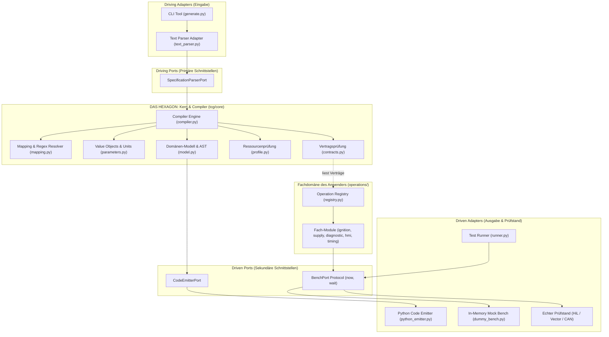
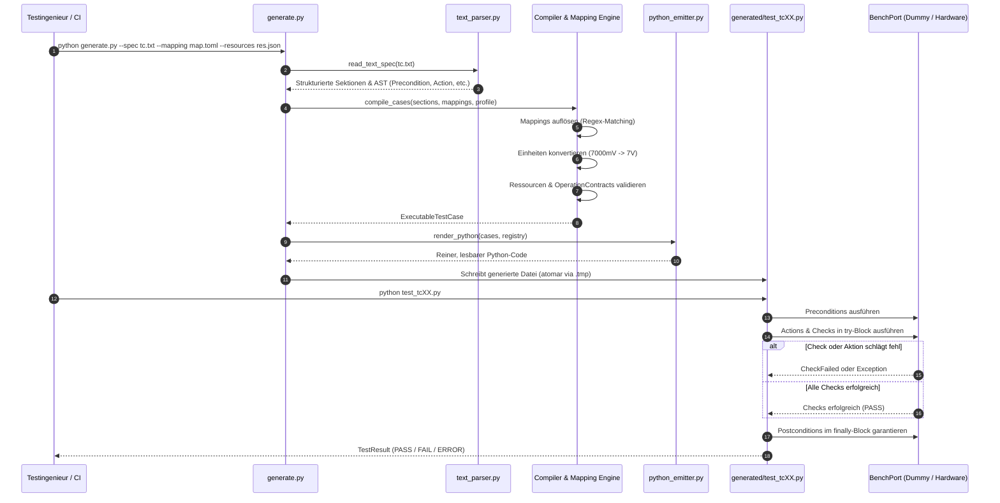
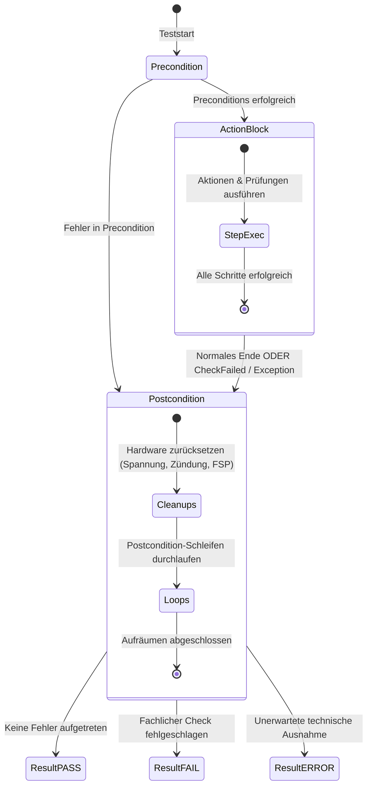
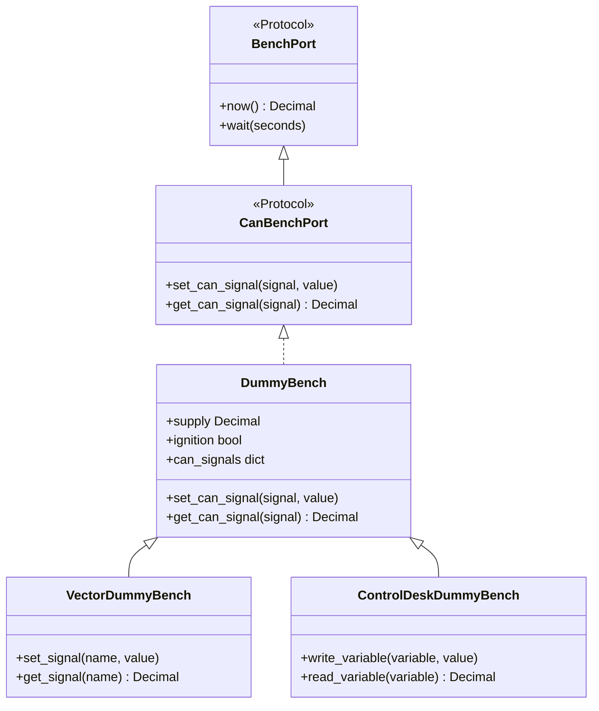
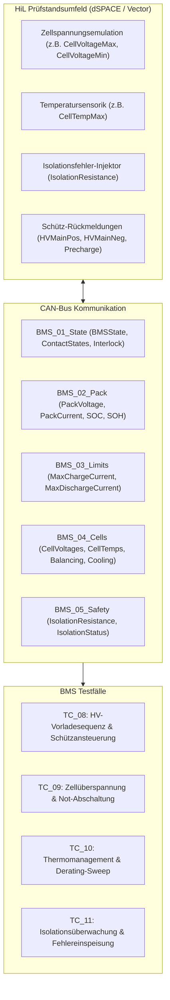

# SpecToTest: Deterministischer Testfall-Compiler

Ein nach den Prinzipien der **Hexagonalen Architektur (Ports & Adapters)** entwickelter Testfall-Compiler. **SpecToTest** übersetzt natürlichsprachliche, lesbare Spezifikationen (`.txt` und `.md`) über konfigurierbare Regex-Mappings (`.toml`) und typsichere Verträge (`OperationContract`) in deterministischen, wartbaren und direkt lesbaren Python-Testcode.

---

## Inhaltsverzeichnis

1. [Motivation & Kernprinzipien](#-motivation--kernprinzipien)
2. [Hexagonale Architektur (Ports & Adapters)](#-hexagonale-architektur-ports--adapters)
3. [End-to-End Datenfluss & Pipeline](#-end-to-end-datenfluss--pipeline)
4. [Projekt- & Ordnerstruktur](#-projekt--ordnerstruktur)
5. [Detaillierte Funktionsweise](#-detaillierte-funktionsweise)
   - [5.1 Testspezifikation (.txt)](#51-testspezifikation-txt)
   - [5.2 Sprach-Mapping (.toml)](#52-sprach-mapping-toml)
   - [5.3 Ressourcen- & Profilvalidierung (.json)](#53-ressourcen--profilvalidierung-json)
   - [5.4 Fachdomänen-Operationen (operations/)](#54-fachdomänen-operationen-operations)
   - [5.5 Schlanker Code-Emitter & Testausführung](#55-schlanker-code-emitter--testausführung)
   - [5.6 Vector Dummy Bench & dSPACE ControlDesk (HiL / CAN)](#56-vector-dummy-bench--dspace-controldesk-hil--can)
   - [5.7 Battery Management System (BMS) HiL-Testing](#57-battery-management-system-bms-hil-testing)
   - [5.8 Signal-Toleranzen, Wertebereiche & Relationale Operatoren](#58-signal-toleranzen-wertebereiche--relationale-operatoren)
   - [5.9 CI/CD JUnit-XML Reporting & Bench-Umschaltung](#59-cicd-junit-xml-reporting--bench-umschaltung)
   - [5.10 Automatisierter Grenzwert-Testfall-Generator (BVA)](#510-automatisierter-grenzwert-testfall-generator-boundary-value-analysis)
6. [Schnellstart & Arbeitsanweisungen](#-schnellstart--arbeitsanweisungen)
   - [Venv aktivieren](#1-virtuelle-umgebung-aktivieren)
   - [Testfälle generieren](#2-testfälle-generieren)
   - [Testfälle ausführen](#3-generierten-testcode-ausführen)
   - [Automatisierte Tests ausführen](#4-pipeline--und-unit-tests-ausführen)
7. [Erweiterungsanleitung](#-erweiterungsanleitung-how-to-extend)

---

## Motivation & Kernprinzipien

In vielen Prüfstands- und Automatisierungsprojekten (z. B. Automotive HiL/SiL) existiert eine Kluft zwischen Spezifikation und Testcode:
- **Testspezifikationen** liegen oft in unstrukturierten Tabellen oder Texten vor.
- **Testskripte** sind häufig schwer lesbare, unübersichtliche Monolithen mit viel Boilerplate, Logging-Code und fest verdrahteten Strings.
- **Hardware-Abhängigkeiten** erschweren das Testen auf Entwicklerrechnern oder in der CI/CD-Pipeline.

**SpecToTest löst diese Probleme:**
- **Reine Fachsprache in der Spezifikation:** Klare Abschnitte (`Precondition`, `Action`, `Expected Result`, `Postcondition`), Kontrollstrukturen (`FOR`, `BREAK`) und physikalische Einheiten (`7000mV`, `13.8V`, `500 ms`).
- **Kein Boilerplate im generierten Code:** Der erzeugte Code ist direkter, sauberer Python-Code mit verständlichen Funktionsaufrufen (z. B. `ignition.set_ignition(bench, state=True)`).
- **Strikte Hexagonale Trennung:** Der Compiler-Kern (`tcg/`) kennt keine automobilspezifischen Strings (`DTC00173`, `BCM1` etc.). Fachoperationen liegen getrennt in `operations/`.
- **Deterministisch & Auditierbar:** Jede generierte Python-Datei enthält die Original-Spezifikation als Docstring und klare Zeilenkommentare über jedem Schritt.
- **Garantiertes Cleanup (`try ... finally`):** Nachbedingungen werden immer zuverlässig ausgeführt, selbst wenn ein Zwischenschritt oder eine Prüfung fehlschlägt.

---

## Hexagonale Architektur (Ports & Adapters)

Das System folgt strikt dem Prinzip der Hexagonalen Architektur: Die Fachlogik (Compiler, AST, Validierung) bildet den Kern und hat keinerlei Abhängigkeiten zu Ein-/Ausgabeformaten oder konkreter Hardware.



---

## End-to-End Datenfluss & Pipeline

Der Lebenszyklus von der Spezifikation bis zum fertigen Testbericht:



---

## Projekt- & Ordnerstruktur

```text
SpecToTest/
├── generate.py                             # Hexagonal CLI Composition Root (Kompilierung)
├── requirements.txt                        # Abhängigkeiten (Reine Standard-Bibliothek ab Python 3.11)
├── README.md                               # Umfassende Dokumentation
│
├── tcg/                                    # Das Testfall-Compiler- & Framework-Paket
│   ├── core/                               # DAS HEXAGON: Reine Fachlogik (compiler-agnostisch)
│   │   ├── model.py                        # Domänenmodell (TestCase, Step, Loop, BreakStatement)
│   │   ├── compiler.py                     # AST-Transformation & semantische Validierung
│   │   ├── mapping.py                      # Regex-Musterauflösung gegen Templates
│   │   ├── parameters.py                   # Value Objects, Maßeinheiten-Konvertierung (mV, V, s, ms)
│   │   ├── contracts.py                    # Operationsverträge (OperationContract, ParameterSpec)
│   │   └── profile.py                      # Ressourcenprofil-Validierung (ECUs, Screens, Parameter)
│   │
│   ├── ports/                              # PORTS: Abstrakte Schnittstellen & Protokolle
│   │   ├── specification.py                # Driving Port: SpecificationParserPort
│   │   ├── emitter.py                      # Driven Port: CodeEmitterPort
│   │   └── bench.py                        # Driven Port: BenchPort (Hardware-Abstraktion: now, wait)
│   │
│   ├── adapters/                           # ADAPTER: Technologie-Anbindungen
│   │   ├── inbound/                        # Driving Adapter
│   │   │   └── text_parser.py              # Parst lesbare .txt-Spezifikationen
│   │   └── outbound/                       # Driven Adapter
│   │       ├── python_emitter.py           # Rendert sauberen, schlanken Python-Testcode
│   │       └── dummy_bench.py              # In-Memory Prüfstand für deterministische Simulationen
│   │
│   └── runtime/                            # RUNTIME: Ausführungsumgebung & Ergebnisse
│       ├── result.py                       # TestResult (PASS, FAIL, ERROR, JSON-Report)
│       ├── runner.py                       # CLI & Ausführungs-Engine für generierte Skripte
│       └── test_log.py                     # CheckFailed & TestFailure Auswertungen
│
├── operations/                             # BENUTZER-OPERATIONEN (Modular & erweiterbar)
│   ├── __init__.py                         # Paket-Export
│   ├── registry.py                         # Zentrale Verträge (REGISTRY) für alle Operationen
│   ├── ignition.py                         # Zündungs-Funktionen (set_ignition)
│   ├── supply.py                           # Spannungsversorgungs-Funktionen (set_battery_voltage)
│   ├── diagnostic.py                       # Fehlerspeicher & Diagnose (clear, read, expect, monitor)
│   ├── timing.py                           # Zeit- & Wartefunktionen (wait)
│   ├── hmi.py                              # Display & Parameter-Interaktion (screen, parameter)
│   └── can.py                              # CAN-Signal Stimulation & Verifikation
│
├── inputs/                                 # Konfigurationen & kategorisierte Spezifikationen
│   ├── can_signals.json                    # CAN-Signal-Datenbank (ID, Zykluszeit, Bit-Position, Einheit)
│   ├── demo_bench.json                     # Prüfstandskonfiguration (Schwellen, Delays, CAN-Defaults)
│   ├── operation_mapping.toml              # Sprach-Mappings für den Compiler
│   ├── resources.json                      # Zulässige Ressourcen (ECUs, Parameter, CAN-Signale)
│   │
│   ├── bms/                                # Kategorie: Battery Management System (BMS)
│   │   ├── tc_08_bms_hv_precharge_sequence.{md,txt}
│   │   ├── tc_09_bms_cell_overvoltage_derating.{md,txt}
│   │   ├── tc_10_bms_thermal_derating_sweep.{md,txt}
│   │   ├── tc_11_bms_isolation_monitoring.{md,txt}
│   │   └── tc_12_bms_signal_tolerances_and_ranges.{md,txt}
│   ├── can/                                # Kategorie: CAN-Bus Kommunikation & Signale
│   │   └── tc_06_can_signal_transmission.{md,txt}
│   ├── diagnostics/                        # Kategorie: Diagnose, UDS & Spannungsversorgung
│   │   ├── tc_01_undervoltage_recovery.{md,txt}
│   │   ├── tc_03_diagnostic_powercycle.{md,txt}
│   │   ├── tc_05_diagnostic_timing_undervoltage.{md,txt}
│   │   └── tc_13_reference_undervoltage.{md,txt}
│   ├── hil/                                # Kategorie: HiL-Simulation & dSPACE ControlDesk
│   │   └── tc_07_controldesk_hil_simulation.{md,txt}
│   ├── hmi/                                # Kategorie: Mensch-Maschine-Schnittstelle
│   │   └── tc_02_hmi_loop_verification.{md,txt}
│   ├── limits/                             # Kategorie: Grenzwerte & Parameter-Sweeps
│   │   └── tc_04_parameter_limits_sweep.{md,txt}
│   ├── md/                                 # Format-Spiegel: Reine Markdown-Spezifikationen
│   └── txt/                                # Format-Spiegel: Reine Text-Spezifikationen
│
├── generated/                              # Generierter, auditierbarer Python-Testcode
│   ├── bms/                                # Generierte BMS-Testfälle (test_tc08 .. test_tc12)
│   ├── can/                                # Generierte CAN-Testfälle (test_tc06)
│   ├── diagnostics/                        # Generierte Diagnose-Testfälle (test_tc01, test_tc03, etc.)
│   ├── hil/                                # Generierte HiL-Testfälle (test_tc07)
│   ├── hmi/                                # Generierte HMI-Testfälle (test_tc02)
│   ├── limits/                             # Generierte Grenzwert-Testfälle (test_tc04)
│   └── test_tc01.py .. test_tc13.py        # Flat-kompatible Testskripte
│
├── run_bench.py                            # Testbench-Runner & HTML-Report Generator (kategorie-fähig)
│
└── tests/                                  # Strukturierte 5-stufige Test-Architektur
    ├── common.py                           # Gemeinsame Fixtures, Pfade und BaseTestCase
    ├── unit/                               # Isolierte Komponententests (Parser, Typen, Scoping, Log)
    ├── module/                             # Modultests (Mapping-Engine, Compiler, Generator, Report)
    ├── interface/                          # Schnittstellentests (Ports, Bench-Protokolle, Exceptions)
    ├── integration/                        # Integrationstests (BMS-Domäne, Diagnostics, CAN, Timing)
    └── e2e/                                # End-to-End Tests (Referenzfall, CLI, Batch-Runner)
```

---

## Detaillierte Funktionsweise

### 5.1 Testspezifikation (`.txt` & `.md`)

Spezifikationen können als **reine Textdateien (`.txt`)** oder als formatierte **Markdown-Dateien (`.md`)** verfasst werden. Sie werden in vier klare Phasen unterteilt:

````carousel
```text
Precondition
10. Zündung an
20. Fehlerspeicher BCM1 löschen
30. Batteriespannung = 13.8V

Action
40. Batteriespannung = 7000mV
50. Warte 1 s
60. Fehlerspeicher BCM1 lesen
70: FOR (v;[10, 20, 30])
71:   Parameter LIMIT auf v schreiben
72:   BREAK (v==20)
73: END FOR

Expected Result
60. Fehlerspeichereintrag DTC00173 eingetragen
70. Parameter LIMIT ist 20

Postcondition
80. Batteriespannung = 13.8V
90. Zündung aus
100. FSP BCM1 löschen
```
<!-- slide -->
```markdown
# TESTFALL: TC_01_UNDERVOLTAGE_RECOVERY
**NAME:** Unterspannung und Wiederanlauf

## Precondition
- 10. Zündung an
- 20. Fehlerspeicher BCM1 löschen
- 30. Batteriespannung = 13.8V

## Action
- 40. Batteriespannung = 7000mV
- 50. Warte 1 s
- 60. Fehlerspeicher BCM1 lesen

## Expected Result
- 60. Fehlerspeichereintrag DTC00173 eingetragen

## Postcondition
- 70. Batteriespannung = 13.8V
- 80. Zündung aus
- 90. Fehlerspeicher BCM1 löschen
```
````

#### Wichtige Features des Parsers:
1. **Volle Markdown-Unterstützung (`.md`):** Überschriften (`#`, `##`), Markdown-Listen (`- `, `* `), Fettschrift (`**NAME:**`), Fenced Code Blocks (```` ``` ````) und HTML-Kommentare (`<!-- ... -->`) werden nativ verarbeitet.
2. **Verknüpfung von Aktion und Erwartung:** Eine Zeile unter `Expected Result` mit der Nummer `60.` wird automatisch der Aktion `60.` aus `Action` zugeordnet und direkt nach ihr geprüft.
3. **Physikalische Einheiten:** Werte wie `7000mV` werden automatisch zu `Decimal('7')` (Volt) normalisiert; `500 ms` zu `Decimal('0.5')` (Sekunden).
4. **Schleifen & Bedingungen:** Schleifen werden mit `FOR (var;[1, 2, 3])` geöffnet und mit `END FOR` geschlossen. Vorzeitiger Abbruch erfolgt über `BREAK (bedingung)` oder unbedingtes `BREAK`.
5. **Kommentare:** Zeilen mit `#`, `//`, `/* ... */` oder `<!-- ... -->` werden ignoriert.

---

### 5.2 Sprach-Mapping (`.toml`)

In [`inputs/operation_mapping.toml`](file:///Users/cc/Desktop/SpecToTest/inputs/operation_mapping.toml) wird festgelegt, welches Satzmuster auf welche Python-Operation abgebildet wird:

```toml
[[mapping]]
id = "MAP_BATTERY_VOLTAGE"
template = "Batteriespannung = {spannung}"
operation = "set_battery_voltage"
parameters = { spannung = "value" }

[[mapping]]
id = "MAP_FAULT_ENTRY_PRESENT"
template = "Fehlerspeichereintrag {code} eingetragen"
operation = "expect_fault_memory_entry"
parameters = { code = "code" }

[[mapping]]
id = "MAP_DIAGNOSTIC_WITHIN"
template = "Auf Fehler {code} in {steuergeraet} {status} warten, maximal {zeitgrenze}, Prüfintervall {intervall}"
operation = "expect_diagnostic_within"
parameters = { code = "code", steuergeraet = "controller", status = "active", zeitgrenze = "timeout", intervall = "interval" }
```

- Platzhalter in geschweiften Klammern `{...}` werden als benannte Argumente an die registrierte Operation übergeben.
- Mehrdeutige Mappings werden vom Compiler bereits vor der Code-Generierung mit einem `SpecError` abgelehnt.

---

### 5.3 Ressourcen- & Profilvalidierung (`.json`)

Die Datei [`inputs/resources.json`](file:///Users/cc/Desktop/SpecToTest/inputs/resources.json) verhindert Tippfehler in Fachbegriffen (z. B. falsche Steuergerätenamen):

```json
{
  "profile_id": "DEMO_RESOURCES_V1",
  "resources": {
    "controller": ["BCM", "BCM1"],
    "diagnostic_code": ["UNDERVOLTAGE", "DTC00173"],
    "screen": ["HOME", "SETTINGS"],
    "parameter": ["GAIN", "LIMIT"]
  }
}
```

Wird in einer Spezifikation z. B. `Fehlerspeicher ABC löschen` geschrieben, bricht der Compiler sofort ab:
`SpecError: controller 'ABC' is absent from resource profile`.

---

### 5.4 Fachdomänen-Operationen (`operations/`)

Alle ausführbaren Python-Funktionen liegen gekapselt in `operations/`. Sie sind reine Funktionen, die als erstes Argument `bench` entgegennehmen:

```python
# operations/diagnostic.py
from tcg.runtime import CheckFailed

def expect_fault_memory_entry(bench, *, code: str, ecu: str = 'BCM1'):
    """Prüft, ob der Fehlercode im Fehlerspeicher hinterlegt ist."""
    entries = bench.read_fault_memory(ecu)
    if code not in entries:
        raise CheckFailed(f"Fehlerspeicher {ecu}: Fehlercode {code!r} nicht gefunden (aktuelle Einträge: {entries})")
```

#### Unterschied FAIL vs. ERROR:
- Wirft eine Operation [`CheckFailed`](file:///Users/cc/Desktop/SpecToTest/tcg/runtime/test_log.py), gilt der Test als **fachlich fehlgeschlagen (FAIL)**.
- Wirft eine Operation eine andere Ausnahme (z. B. `ConnectionError`, `ValueError`), gilt der Test als **technischer Fehler (ERROR)**.

---

### 5.5 Schlanker Code-Emitter & Testausführung

Der generierte Code verzichtet vollständig auf künstliche Framework-Wrappern (`log.step`, `planned=[...]`). 



#### Struktur des erzeugten Testcodes:
```python
def run_tc_01_undervoltage_recovery(bench):
    """Original Test Specification:
    ========================================================================
    Precondition
    10. Zündung an
    ...
    ========================================================================
    """
    # --- Precondition ---
    # 10. Zündung an
    ignition.set_ignition(bench, state=True)

    try:
        # --- Action & Expected Result ---
        # 40. Batteriespannung = 7000mV
        supply.set_battery_voltage(bench, value=Decimal('7'))
        # 60. Fehlerspeichereintrag DTC00173 eingetragen
        diagnostic.expect_fault_memory_entry(bench, code='DTC00173', ecu='BCM1')
    finally:
        # --- Postcondition (Cleanup) ---
        # 90. Batteriespannung = 13.8V
        supply.set_battery_voltage(bench, value=Decimal('13.8'))
        # 100. Zündung aus
        ignition.set_ignition(bench, state=False)

    return TestResult('TC_01_UNDERVOLTAGE_RECOVERY', "PASS")
```

---

### 5.6 Vector Dummy Bench & dSPACE ControlDesk (HiL / CAN)

In der realen Automobil-Entwicklung und Prüfstands-Automatisierung werden Steuergeräte über Tools wie **Vector CANoe/CANalyzer** (CAN-Bus-Restbussimulation) oder **dSPACE ControlDesk** (HiL-Prüfstandssimulation) angesteuert.

SpecToTest stellt hierfür dedizierte Schnittstellen und Adapter bereit, die sich nahtlos in die hexagonale Architektur einfügen:



#### 1. CAN-Signal-Datenbank (`inputs/can_signals.json`)
Statt Signale willkürlich zu hardcoden, definiert eine Signal-Datenbank (äquivalent zu einer Vector `.dbc` Datei) alle Eigenschaften der CAN-Signale:

```json
{
  "signals": {
    "EngineSpeed": {
      "message_id": "0x120",
      "cycle_time_ms": 10,
      "bit_start": 0,
      "bit_length": 16,
      "unit": "rpm",
      "factor": 1,
      "offset": 0,
      "min": 0,
      "max": 8000,
      "default": 0
    },
    "VehicleSpeed": {
      "message_id": "0x120",
      "cycle_time_ms": 10,
      "bit_start": 16,
      "bit_length": 16,
      "unit": "km/h",
      "factor": 0.01,
      "min": 0,
      "max": 300,
      "default": 0
    }
  }
}
```

#### 2. Spezifikations-Syntax für CAN- und HiL-Signale
In der Spezifikation können Signale mit physikalischen Einheiten (`rpm`, `km/h`, `%`, `V`) gesetzt, geprüft und asynchron abgewartet werden:

```text
Precondition
10. Zündung an
20. CAN-Signal Clamp15Status auf 1 setzen
30. CAN-Signal EngineSpeed auf 0 rpm setzen

Action
50. CAN-Signal EngineSpeed auf 2500 rpm setzen
70. CAN-Signal DoorContactStatus auf 1 setzen

Expected Result
50. CAN-Signal EngineSpeed ist 2500 rpm
70. Auf CAN-Signal DoorContactStatus == 1 warten, maximal 1 s, Prüfintervall 50 ms
```

#### 3. Spezifische Bench-Adapter
* **`VectorDummyBench`**: Bietet neben `set_can_signal` auch Vector CANoe-typische Methoden wie `bench.set_signal('EngineSpeed', 2500)` und `bench.get_signal('EngineSpeed')`.
* **`ControlDeskDummyBench`**: Bietet dSPACE XIL API / Automation typische Methoden wie `bench.write_variable('EngineSpeed', 2500)` und `bench.read_variable('EngineSpeed')`.

---

### 5.7 Battery Management System (BMS) HiL-Testing

Für Hochvolt-Batteriemanagementsysteme (BMS) auf Prüfständen (z. B. dSPACE SCALEXIO mit Zellspannungs-Emulatoren oder Vector VT-System) stellt SpecToTest spezialisierte Signale, Mappings und typische Testfall-Muster bereit:



#### Enthaltene BMS-Testfälle:
1. **`tc_08_bms_hv_precharge_sequence.txt`**: Prüft die sequentielle Schließung des Vorladeschützes (`PrechargeContactState`), Spannungsanstieg im Zwischenkreis (`BatteryVoltageCAN`) auf 380 V, Schließen der Hauptschütze (`HVMainPosContactState`, `HVMainNegContactState`) und Öffnen des Vorladeschützes.
2. **`tc_09_bms_cell_overvoltage_derating.txt`**: Simuliert das Erreichen der Ladeschlussgrenze (4.20 V) mit stufenweisem Ladestrom-Derating (`MaxChargeCurrent` auf 40 A) bis zur Notabschaltung (4.28 V) mit Schützöffnung und Fehlerspeichereintrag `DTC_BMS_CELL_OVERVOLTAGE`.
3. **`tc_10_bms_thermal_derating_sweep.txt`**: Fährt einen kontinuierlichen Temperatur-Sweep (`FOR`-Schleife über 35, 45, 55 °C) und verifiziert die Aktivierung der Kühlstufe (`CoolingRequest = 2`) sowie das thermische Entladederating (`MaxDischargeCurrent = 150 A`).
4. **`tc_11_bms_isolation_monitoring.txt`**: Injiziert einen Isolationswiderstands-Abfall auf 60 kOhm (unter den Schwellwert von 100 kOhm) und verifiziert das Setzen des Warnstatus (`IsolationStatus = 2`) und die Eintragung von `DTC_BMS_ISOLATION_FAULT`.
5. **`tc_12_bms_signal_tolerances_and_ranges.txt`**: Demonstriert Toleranzbänder (`± 50 mV`), Wertebereichs-Intervalle (`liegt im Bereich [50 °C, 60 °C]`) und relationale Grenzwerte (`>= 55 °C`, `< -100 A`, `<= 1000 kOhm`).

---

### 5.8 Signal-Toleranzen, Wertebereiche & Relationale Operatoren

Auf realen HiL-Prüfständen sind analoge Sensorsignale und Buswerte durch Rauschen, ADC-Quantisierung und Filterlaufzeiten niemals absolut identisch mit theoretischen Fixwerten. SpecToTest unterstützt daher robuste Prüfstands-Syntax:

| Spezifikations-Syntax | Prüfstand-Semantik | Beispiel |
| :--- | :--- | :--- |
| `CAN-Signal {sig} ist {wert} ± {tol}` | Toleranzband $[v - tol, v + tol]$ | `CAN-Signal CellVoltageMax ist 4.20 V ± 50 mV` |
| `CAN-Signal {sig} liegt im Bereich [{min}, {max}]` | Geschlossenes Intervall $[min, max]$ | `CAN-Signal CellTempMax liegt im Bereich [50 °C, 60 °C]` |
| `CAN-Signal {sig} >= {wert}` | Mindestwert (größer gleich) | `CAN-Signal CellTempMax >= 55 °C` |
| `CAN-Signal {sig} <= {wert}` | Höchstwert (kleiner gleich) | `CAN-Signal IsolationResistance <= 1000 kOhm` |
| `CAN-Signal {sig} > {wert}` | Strikt größer | `CAN-Signal IsolationResistance > 900 kOhm` |
| `CAN-Signal {sig} < {wert}` | Strikt kleiner | `CAN-Signal PackCurrent < -100 A` |

---

### 5.9 CI/CD JUnit-XML Reporting & Bench-Umschaltung

Die generierten Testskripte können direkt in Continuous-Integration-Pipelines (Jenkins, GitLab CI, Azure DevOps) eingebunden werden:

```bash
# Ausführung mit Vector CANoe Dummy und Generierung von JUnit XML
PYTHONPATH=. python generated/test_tc12.py \
  --bench-type vector \
  --junit-xml build/reports/junit-report.xml
```

Auswahl der Prüfstands-Plattform über `--bench-type`:
* `--bench-type dummy`: Standard In-Memory Simulation
* `--bench-type vector`: Vector CANoe / CANalyzer Semantik
* `--bench-type controldesk`: dSPACE ControlDesk / HiL Semantik

---

### 5.10 Automatisierter Grenzwert-Testfall-Generator (Boundary Value Analysis)

SpecToTest beinhaltet ein domänen-agnostisches **Generator-Modul** ([`tcg/generators/boundaries.py`](file:///Users/cc/Desktop/SpecToTest/tcg/generators/boundaries.py)). Es enthält **keinerlei fest verdrahtete Fachbegriffe oder Signalnamen**, sondern wird vollständig über Templates gesteuert:

```python
from tcg.generators.boundaries import generate_boundary_suite

# Erzeugt BVA-Testspezifikationen für beliebige Signale mit benutzerdefinierten Templates:
generated_specs = generate_boundary_suite(
    variable_definitions=can_db,
    target_variables=['PackSOC', 'CellTempMax'],
    set_template="CAN-Signal {name} auf {val}{unit} setzen",
    check_template="CAN-Signal {name} ist {val}{unit}",
    preconditions=["Zündung an", "CAN-Signal Clamp15Status auf 1 setzen"],
    postconditions=["CAN-Signal Clamp15Status auf 0 setzen", "Zündung aus"],
    output_dir='inputs/generated_bva_specs'
)
```

Ebenso können damit HMI-Parameter (`set_template="Parameter {name} auf {val} schreiben"`) oder andere Fachdomänen ohne Code-Änderung im Framework generiert werden.

---

## Schnellstart & Arbeitsanweisungen

### 1. Virtuelle Umgebung aktivieren

SpecToTest benötigt **Python 3.11+** (getestet mit Python 3.13) und nutzt ausschließlich Module der Python-Standardbibliothek.

```zsh
# Virtuelle Umgebung aktivieren (wichtig: mit source!)
source .venv/bin/activate
```

*(Falls noch kein venv existiert: `python3 -m venv .venv && source .venv/bin/activate`)*

---

### 2. Testfälle generieren

#### Option A: Gesamten kategorisierten Ordner auf einmal kompilieren (Empfohlen)
```bash
python generate.py \
  --spec inputs/ \
  --mapping inputs/operation_mapping.toml \
  --resources inputs/resources.json \
  --output generated/
```
*Kompiliert automatisch alle Kategorien (`bms`, `can`, `diagnostics`, `hil`, `hmi`, `limits`) und erzeugt strukturierte Ordner in `generated/`.*

#### Option B: Eine einzelne Spezifikation kompilieren
```bash
python generate.py \
  --spec inputs/diagnostics/tc_01_undervoltage_recovery.md \
  --mapping inputs/operation_mapping.toml \
  --resources inputs/resources.json \
  --output generated/diagnostics/test_tc01.py
```

---

### 3. Generierten Testcode ausführen & HTML-Report erzeugen

#### Option A: Gesamte Test-Suite mit automatischem HTML-Dashboard ausführen (Empfohlen)
```bash
# Führt alle generierten Testfälle aus und erzeugt einen interaktiven HTML-Report:
python run_bench.py --bench-type vector --html-report reports/test_report.html
```
Ausgabe:
```text
==============================================================================
⚡ SpecToTest — Automatisierter Testbench-Lauf
==============================================================================
Prüfstand:   Vector CANoe / CANalyzer (VectorDummyBench)
Test-Suite:  generated (12 Skripte gefunden)
HTML-Report: reports/test_report.html
------------------------------------------------------------------------------
 ✅ PASS  TC_01_UNDERVOLTAGE_RECOVERY                (12 Schritte,    0.2 ms)
 ✅ PASS  TC_02_HMI_LOOP_VERIFICATION                ( 9 Schritte,    0.0 ms)
 ...
 ✅ PASS  TC_12_BMS_SIGNAL_TOLERANCES_AND_RANGES     (20 Schritte,    0.0 ms)
------------------------------------------------------------------------------
Ergebnis: 12 bestanden, 0 fehlgeschlagen, 0 Fehler (Gesamtdauer: 0.01 s)
==============================================================================
📊 Interaktiver HTML-Report gespeichert unter: reports/test_report.html
```

#### Option B: Ein einzelnes Skript direkt ausführen
```bash
PYTHONPATH=. python generated/test_tc01.py --bench-type vector --html-report reports/single_test.html
```

---

### 4. Strukturierte Test-Suite ausführen (Unit, Modul, Interface, Integration, E2E)

Führt die gesamte Regressionstestsuite über alle 5 Teststufen aus:

```bash
# Alle 47 Tests über alle Stufen ausführen:
python -m unittest discover -s tests -v
```

Einzelne Teststufen gezielt ausführen:
```bash
# 1. Reine Unit-Tests (Parser, Typen, Scoping):
python -m unittest discover -s tests/unit -v

# 2. Modultests (Mapping-Engine, Compiler-Core, HTML-Report):
python -m unittest discover -s tests/module -v

# 3. Schnittstellentests (BenchPort, Adapter, Protections):
python -m unittest discover -s tests/interface -v

# 4. Domänen-Integrationstests (BMS, CAN, Timing, Diagnostics):
python -m unittest discover -s tests/integration -v

# 5. End-to-End Tests (Referenzspezifikation, Batch-Kompilierung):
python -m unittest discover -s tests/e2e -v
```

Ergebnis:
```text
Ran 47 tests in 0.238s
OK
```

---

## Erweiterungsanleitung (How to extend)

### Einen neuen Testfall hinzufügen

1. Erstelle eine neue Spezifikationsdatei in `inputs/`, z. B. `inputs/tc_06_can_bus_sleep.md`.
2. Definiere die Sektionen `Precondition`, `Action`, `Expected Result` und `Postcondition`.
3. Kompiliere den Testfall:
   ```bash
   python generate.py --spec inputs/tc_06_can_bus_sleep.md --mapping inputs/operation_mapping.toml --resources inputs/resources.json --output generated/test_tc06.py
   ```

### Eine neue Operation implementieren

1. **Python-Funktion anlegen:**  
   In einem Modul unter `operations/` (z. B. `operations/can.py`):
   ```python
   # operations/can.py
   def send_can_frame(bench, *, can_id: int, payload: str):
       bench.send_can_frame(can_id, payload)
   ```

2. **Vertrag registrieren:**  
   In `operations/registry.py`:
   ```python
   from tcg.core.contracts import OperationContract, ParameterSpec
   from tcg.core.parameters import Integer, String
   from . import can

   CAN_SEND = OperationContract(
       id='send_can_frame',
       function=can.send_can_frame,
       parameters=(
           ParameterSpec('can_id', Integer(minimum=0, maximum=0x7FF)),
           ParameterSpec('payload', String()),
       ),
       phases=frozenset({'ACTION', 'PRECONDITION', 'CLEANUP'}),
   )
   ```

3. **Sprach-Muster mappen:**  
   In `inputs/operation_mapping.toml`:
   ```toml
   [[mapping]]
   id = "MAP_CAN_SEND"
   template = "CAN-Botschaft {can_id} mit Payload {payload} senden"
   operation = "send_can_frame"
   parameters = { can_id = "can_id", payload = "payload" }
   ```

Fertig! Ab sofort kann der Satz `CAN-Botschaft 0x123 mit Payload AA BB CC senden` in jeder `.md`- oder `.txt`-Spezifikation verwendet werden. Der Compiler-Kern muss dafür **nicht** modifiziert werden.

---

## Sprachvertrag, Erwartungsbindung & Robuste Laufzeit

### 1. Verbindlicher Sprachvertrag (`docs/specification_language.md`)
Die vollständige Sprachdefinition ist in [docs/specification_language.md](docs/specification_language.md) festgeschrieben:
- **Eindeutige Referenzen:** Jede Schrittnummer im `Action`-Baum muss eindeutig sein. Doppelte Schrittnummern blockieren die Übersetzung mit `SpecError`.
- **Keine verwaisten Erwartungen:** Nummerierte Erwartungen müssen auf eine existierende Aktion oder Schleife im `Action`-Baum verweisen. Verweise auf unbekannte Schritte oder auf Vor-/Nachbedingungen werden strikt abgelehnt.
- **Unnummerierte Erwartungen:** Werden als Abschlussprüfungen nach dem gesamten `Action`-Block und vor den Nachbedingungen ausgeführt.

### 2. Rekursive Erwartungsbindung
Erwartungen werden im AST direkt an die Zielknoten gebunden:
- **Aktionsschritte:** Die Prüfung läuft unmittelbar nach dem Zielschritt.
- **Schritte innerhalb einer `FOR`-Schleife:** Die Prüfung läuft pro Schleifeniteration unmittelbar nach dem Schritt im Körper (mit Zugriff auf die Schleifenvariable).
- **Prüfung auf die Schleife selbst:** Eine Erwartung, die auf die Schrittnummer der `FOR`-Schleife referenziert, wird genau einmal nach Abschluss oder `BREAK` der Schleife ausgeführt (ohne Zugriff auf die Schleifenvariable).

### 3. Geschützte Vorbedingungen & Isolierte Cleanup-Schritte
- **Vorbedingungen und Aktionen im geschützten Block:** Sowohl `Precondition` als auch `Action` liegen innerhalb des `try:`-Blocks. Schlägt ein Vorbedingungsschritt fehl, wird die Ausführung der Nachbedingungen (`Postcondition`) dennoch garantiert.
- **Isolierte Cleanup-Schritte:** Jeder Nachbedingungsschritt ist einzeln geschützt (`try ... except`). Schlägt Schritt 70 fehl, werden die Schritte 80 und 90 dennoch zwingend ausgeführt.
- **Fehlererhaltung:** Primärfehler (z. B. `CheckFailed` oder Kommunikationsabbruch) und nachfolgende Fehler in der Nachbedingung werden gemeinsam gesammelt und im Bericht vollständig ausgewiesen.

### 4. Atomare Generierung
- Jede Generierung erfolgt atomar über temporäre Dateien (`.tmp`). Schlägt eine Übersetzung fehl, bleibt der vorherige Stand unberührt.

### 5. Multi-TOML Mappings
Mehrere Mapping-Dateien können über wiederholtes `--mapping` übergeben werden:
```bash
python generate.py \
  --spec inputs/tc_01_undervoltage_recovery.md \
  --mapping inputs/operation_mapping.toml \
  --mapping inputs/extra_mapping.toml \
  --resources inputs/resources.json \
  --output generated/test_tc01.py
```
Mapping-IDs werden dateiübergreifend auf globale Eindeutigkeit validiert. Die Reihenfolge konfliktfreier Mappingdateien ändert das Ergebnis nicht.

