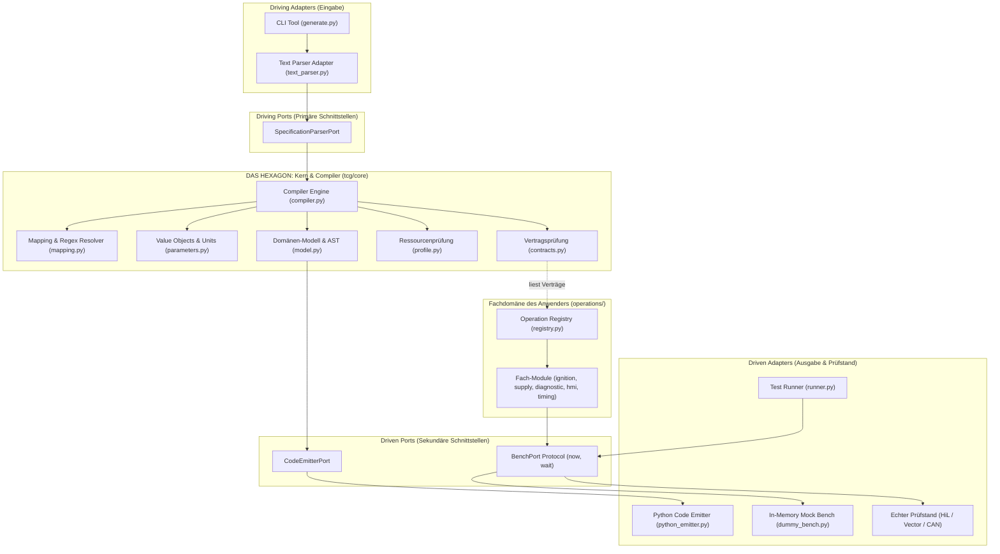
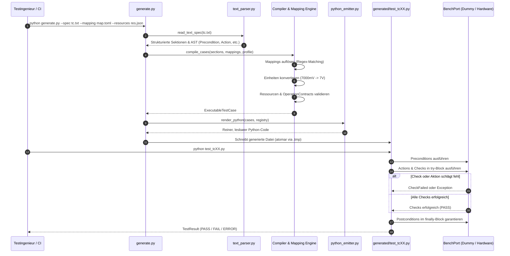
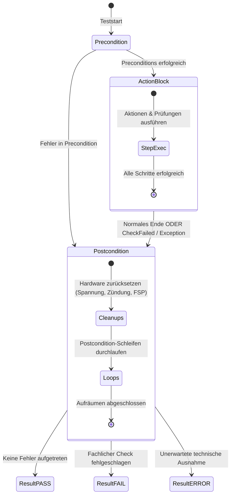
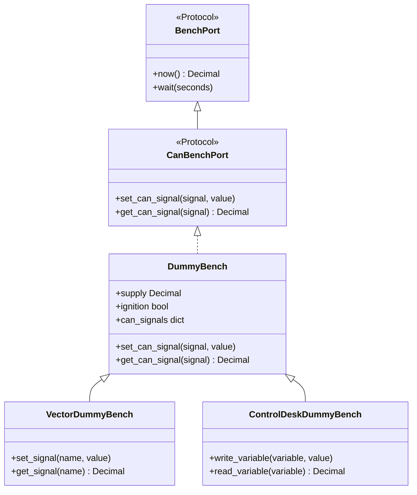
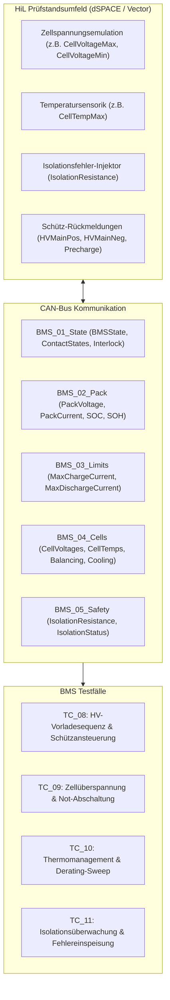

# SpecToTest: Deterministischer Testfall-Compiler

Ein nach den Prinzipien der **Hexagonalen Architektur (Ports & Adapters)** entwickelter Testfall-Compiler. **SpecToTest** übersetzt natürlichsprachliche, lesbare Spezifikationen (`.txt` und `.md`) über konfigurierbare Regex-Mappings (`.toml`) und typsichere Verträge (`OperationContract`) in deterministischen, wartbaren und direkt lesbaren Python-Testcode.

---

## Inhaltsverzeichnis

1. [Motivation & Kernprinzipien](#-motivation--kernprinzipien)
2. [Hexagonale Architektur (Ports & Adapters)](#-hexagonale-architektur-ports--adapters)
3. [End-to-End Datenfluss & Pipeline](#-end-to-end-datenfluss--pipeline)
4. [Projekt- & Ordnerstruktur](#-projekt--ordnerstruktur)
5. [Detaillierte Funktionsweise](#-detaillierte-funktionsweise)
   - [5.1 Testspezifikation (.txt)](#51-testspezifikation-txt)
   - [5.2 Sprach-Mapping (.toml)](#52-sprach-mapping-toml)
   - [5.3 Ressourcen- & Profilvalidierung (.json)](#53-ressourcen--profilvalidierung-json)
   - [5.4 Fachdomänen-Operationen (operations/)](#54-fachdomänen-operationen-operations)
   - [5.5 Schlanker Code-Emitter & Testausführung](#55-schlanker-code-emitter--testausführung)
   - [5.6 Vector Dummy Bench & dSPACE ControlDesk (HiL / CAN)](#56-vector-dummy-bench--dspace-controldesk-hil--can)
   - [5.7 Battery Management System (BMS) HiL-Testing](#57-battery-management-system-bms-hil-testing)
   - [5.8 Signal-Toleranzen, Wertebereiche & Relationale Operatoren](#58-signal-toleranzen-wertebereiche--relationale-operatoren)
   - [5.9 CI/CD JUnit-XML Reporting & Bench-Umschaltung](#59-cicd-junit-xml-reporting--bench-umschaltung)
   - [5.10 Automatisierter Grenzwert-Testfall-Generator (BVA)](#510-automatisierter-grenzwert-testfall-generator-boundary-value-analysis)
6. [Schnellstart & Arbeitsanweisungen](#-schnellstart--arbeitsanweisungen)
   - [Venv aktivieren](#1-virtuelle-umgebung-aktivieren)
   - [Testfälle generieren](#2-testfälle-generieren)
   - [Testfälle ausführen](#3-generierten-testcode-ausführen)
   - [Automatisierte Tests ausführen](#4-pipeline--und-unit-tests-ausführen)
7. [Erweiterungsanleitung](#-erweiterungsanleitung-how-to-extend)

---

## Motivation & Kernprinzipien

In vielen Prüfstands- und Automatisierungsprojekten (z. B. Automotive HiL/SiL) existiert eine Kluft zwischen Spezifikation und Testcode:
- **Testspezifikationen** liegen oft in unstrukturierten Tabellen oder Texten vor.
- **Testskripte** sind häufig schwer lesbare, unübersichtliche Monolithen mit viel Boilerplate, Logging-Code und fest verdrahteten Strings.
- **Hardware-Abhängigkeiten** erschweren das Testen auf Entwicklerrechnern oder in der CI/CD-Pipeline.

**SpecToTest löst diese Probleme:**
- **Reine Fachsprache in der Spezifikation:** Klare Abschnitte (`Precondition`, `Action`, `Expected Result`, `Postcondition`), Kontrollstrukturen (`FOR`, `BREAK`) und physikalische Einheiten (`7000mV`, `13.8V`, `500 ms`).
- **Kein Boilerplate im generierten Code:** Der erzeugte Code ist direkter, sauberer Python-Code mit verständlichen Funktionsaufrufen (z. B. `ignition.set_ignition(bench, state=True)`).
- **Strikte Hexagonale Trennung:** Der Compiler-Kern (`tcg/`) kennt keine automobilspezifischen Strings (`DTC00173`, `BCM1` etc.). Fachoperationen liegen getrennt in `operations/`.
- **Deterministisch & Auditierbar:** Jede generierte Python-Datei enthält die Original-Spezifikation als Docstring und klare Zeilenkommentare über jedem Schritt.
- **Garantiertes Cleanup (`try ... finally`):** Nachbedingungen werden immer zuverlässig ausgeführt, selbst wenn ein Zwischenschritt oder eine Prüfung fehlschlägt.

---

## Hexagonale Architektur (Ports & Adapters)

Das System folgt strikt dem Prinzip der Hexagonalen Architektur: Die Fachlogik (Compiler, AST, Validierung) bildet den Kern und hat keinerlei Abhängigkeiten zu Ein-/Ausgabeformaten oder konkreter Hardware.



---

## End-to-End Datenfluss & Pipeline

Der Lebenszyklus von der Spezifikation bis zum fertigen Testbericht:



---

## Projekt- & Ordnerstruktur

```text
SpecToTest/
├── generate.py                             # Hexagonal CLI Composition Root (Kompilierung)
├── requirements.txt                        # Abhängigkeiten (Reine Standard-Bibliothek ab Python 3.11)
├── README.md                               # Umfassende Dokumentation
│
├── tcg/                                    # Das Testfall-Compiler- & Framework-Paket
│   ├── core/                               # DAS HEXAGON: Reine Fachlogik (compiler-agnostisch)
│   │   ├── model.py                        # Domänenmodell (TestCase, Step, Loop, BreakStatement)
│   │   ├── compiler.py                     # AST-Transformation & semantische Validierung
│   │   ├── mapping.py                      # Regex-Musterauflösung gegen Templates
│   │   ├── parameters.py                   # Value Objects, Maßeinheiten-Konvertierung (mV, V, s, ms)
│   │   ├── contracts.py                    # Operationsverträge (OperationContract, ParameterSpec)
│   │   └── profile.py                      # Ressourcenprofil-Validierung (ECUs, Screens, Parameter)
│   │
│   ├── comm/                               # KOMMUNIKATION: technologieneutrales Ressourcenmodell
│   │   ├── model.py                        # Technology, ObjectKind, Capability, Ressource, Katalog
│   │   ├── catalog.py                      # Laden mehrerer Beschreibungen je Projekt (+ Migration)
│   │   ├── capabilities.py                 # Benötigte vs. angebotene Testbench-Fähigkeiten
│   │   └── importers/                      # Formatadapter -> gemeinsames Modell
│   │       ├── can_json.py                 # Eigenes CAN-JSON-Format
│   │       ├── dbc.py                      # Vector CANdb (.dbc)
│   │       ├── ldf.py                      # LIN Description File (.ldf), dokumentierter Teilumfang
│   │       └── arxml.py                    # AUTOSAR SERVICE-INTERFACE, dokumentierter Teilumfang
│   │
│   ├── ports/                              # PORTS: Abstrakte Schnittstellen & Protokolle
│   │   ├── specification.py                # Driving Port: SpecificationParserPort
│   │   ├── emitter.py                      # Driven Port: CodeEmitterPort
│   │   └── bench.py                        # Driven Port: BenchPort (Hardware-Abstraktion: now, wait)
│   │
│   ├── adapters/                           # ADAPTER: Technologie-Anbindungen
│   │   ├── inbound/                        # Driving Adapter
│   │   │   └── text_parser.py              # Parst lesbare .txt-Spezifikationen
│   │   └── outbound/                       # Driven Adapter
│   │       ├── python_emitter.py           # Rendert sauberen, schlanken Python-Testcode
│   │       └── dummy_bench.py              # In-Memory Prüfstände (CAN/LIN/Ethernet-Simulation)
│   │
│   └── runtime/                            # RUNTIME: Ausführungsumgebung & Ergebnisse
│       ├── result.py                       # TestResult (PASS, FAIL, ERROR, JSON-Report)
│       ├── runner.py                       # CLI & Ausführungs-Engine für generierte Skripte
│       └── test_log.py                     # CheckFailed & TestFailure Auswertungen
│
├── operations/                             # BENUTZER-OPERATIONEN (Modular & erweiterbar)
│   ├── __init__.py                         # Paket-Export
│   ├── registry.py                         # Zentrale Verträge (REGISTRY) für alle Operationen
│   ├── can_catalog.py                      # CAN-Kompatibilitätsschicht über tcg/comm
│   ├── comm_types.py                       # Ressourcenreferenz & Signalwert (physikalisch/roh)
│   ├── lin.py                              # LIN-spezifische Operationen (Schedule, Frame)
│   ├── ethernet.py                         # Serviceorientierte Ethernet-Operationen
│   ├── ignition.py                         # Zündungs-Funktionen (set_ignition)
│   ├── supply.py                           # Spannungsversorgungs-Funktionen (set_battery_voltage)
│   ├── diagnostic.py                       # Fehlerspeicher & Diagnose (clear, read, expect, monitor)
│   ├── timing.py                           # Zeit- & Wartefunktionen (wait)
│   ├── hmi.py                              # Display & Parameter-Interaktion (screen, parameter)
│   └── can.py                              # CAN-Signal Stimulation & Verifikation
│
├── requirements-dev.txt                    # Nur für Konformitätstests (ldfparser, cantools)
│
├── tools/                                  # Konverter & Beispiel-Busbeschreibungen
│   ├── dbc_to_json.py                      # CAN:      .dbc  <-> JSON (+ Validierung)
│   ├── ldf_to_json.py                      # LIN:      .ldf  <-> JSON (+ Validierung)
│   ├── arxml_to_json.py                    # Ethernet: .arxml <-> JSON (+ Validierung)
│   ├── powertrain_bms.dbc                  # Beispiel: Antrieb & BMS (CAN)
│   ├── body_comfort.ldf                    # Beispiel: Komfort-Subbus (LIN)
│   └── vehicle_services.arxml              # Beispiel: Service-Interfaces (Ethernet)
│
├── inputs/                                 # Konfigurationen & kategorisierte Spezifikationen
│   ├── can_signals.json                    # CAN-Beschreibung  (protocol: CAN,      aus powertrain_bms.dbc)
│   ├── lin_signals.json                    # LIN-Beschreibung  (protocol: LIN,      aus body_comfort.ldf)
│   ├── eth_services.json                   # Service-Beschreibung (protocol: Ethernet, aus vehicle_services.arxml)
│   ├── multibus_mapping.toml               # Optionale Satzmuster für LIN & Ethernet
│   ├── demo_bench.json                     # Prüfstandskonfiguration (Schwellen, Delays, CAN-Defaults)
│   ├── operation_mapping.toml              # Sprach-Mappings für den Compiler
│   ├── resources.json                      # Zulässige Ressourcen (ECUs, Parameter, CAN-Signale)
│   │
│   ├── bms/                                # Kategorie: Battery Management System (BMS)
│   │   ├── tc_08_bms_hv_precharge_sequence.{md,txt}
│   │   ├── tc_09_bms_cell_overvoltage_derating.{md,txt}
│   │   ├── tc_10_bms_thermal_derating_sweep.{md,txt}
│   │   ├── tc_11_bms_isolation_monitoring.{md,txt}
│   │   └── tc_12_bms_signal_tolerances_and_ranges.{md,txt}
│   ├── can/                                # Kategorie: CAN-Bus Kommunikation & Signale
│   │   └── tc_06_can_signal_transmission.{md,txt}
│   ├── diagnostics/                        # Kategorie: Diagnose, UDS & Spannungsversorgung
│   │   ├── tc_01_undervoltage_recovery.{md,txt}
│   │   ├── tc_03_diagnostic_powercycle.{md,txt}
│   │   ├── tc_05_diagnostic_timing_undervoltage.{md,txt}
│   │   └── tc_13_reference_undervoltage.{md,txt}
│   ├── hil/                                # Kategorie: HiL-Simulation & dSPACE ControlDesk
│   │   └── tc_07_controldesk_hil_simulation.{md,txt}
│   ├── hmi/                                # Kategorie: Mensch-Maschine-Schnittstelle
│   │   └── tc_02_hmi_loop_verification.{md,txt}
│   ├── limits/                             # Kategorie: Grenzwerte & Parameter-Sweeps
│   │   └── tc_04_parameter_limits_sweep.{md,txt}
│   ├── md/                                 # Format-Spiegel: Reine Markdown-Spezifikationen
│   └── txt/                                # Format-Spiegel: Reine Text-Spezifikationen
│
├── generated/                              # Generierter, auditierbarer Python-Testcode
│   ├── bms/                                # Generierte BMS-Testfälle (test_tc08 .. test_tc12)
│   ├── can/                                # Generierte CAN-Testfälle (test_tc06)
│   ├── diagnostics/                        # Generierte Diagnose-Testfälle (test_tc01, test_tc03, etc.)
│   ├── hil/                                # Generierte HiL-Testfälle (test_tc07)
│   ├── hmi/                                # Generierte HMI-Testfälle (test_tc02)
│   ├── limits/                             # Generierte Grenzwert-Testfälle (test_tc04)
│   └── test_tc01.py .. test_tc13.py        # Flat-kompatible Testskripte
│
├── run_bench.py                            # Testbench-Runner & HTML-Report Generator (kategorie-fähig)
│
└── tests/                                  # Strukturierte 5-stufige Test-Architektur
    ├── common.py                           # Gemeinsame Fixtures, Pfade und BaseTestCase
    ├── unit/                               # Isolierte Komponententests (Parser, Typen, Scoping, Log)
    ├── module/                             # Modultests (Mapping-Engine, Compiler, Generator, Report)
    ├── interface/                          # Schnittstellentests (Ports, Bench-Protokolle, Exceptions)
    ├── integration/                        # Integrationstests (BMS-Domäne, Diagnostics, CAN, Timing)
    └── e2e/                                # End-to-End Tests (Referenzfall, CLI, Batch-Runner)
```

---

## Detaillierte Funktionsweise

### 5.1 Testspezifikation (`.txt` & `.md`)

Spezifikationen können als **reine Textdateien (`.txt`)** oder als formatierte **Markdown-Dateien (`.md`)** verfasst werden. Sie werden in vier klare Phasen unterteilt:

````carousel
```text
Precondition
10. Zündung an
20. Fehlerspeicher BCM1 löschen
30. Batteriespannung = 13.8V

Action
40. Batteriespannung = 7000mV
50. Warte 1 s
60. Fehlerspeicher BCM1 lesen
70: FOR (v;[10, 20, 30])
71:   Parameter LIMIT auf v schreiben
72:   BREAK (v==20)
73: END FOR

Expected Result
60. Fehlerspeichereintrag DTC00173 eingetragen
70. Parameter LIMIT ist 20

Postcondition
80. Batteriespannung = 13.8V
90. Zündung aus
100. FSP BCM1 löschen
```
<!-- slide -->
```markdown
# TESTFALL: TC_01_UNDERVOLTAGE_RECOVERY
**NAME:** Unterspannung und Wiederanlauf

## Precondition
- 10. Zündung an
- 20. Fehlerspeicher BCM1 löschen
- 30. Batteriespannung = 13.8V

## Action
- 40. Batteriespannung = 7000mV
- 50. Warte 1 s
- 60. Fehlerspeicher BCM1 lesen

## Expected Result
- 60. Fehlerspeichereintrag DTC00173 eingetragen

## Postcondition
- 70. Batteriespannung = 13.8V
- 80. Zündung aus
- 90. Fehlerspeicher BCM1 löschen
```
````

#### Wichtige Features des Parsers:
1. **Volle Markdown-Unterstützung (`.md`):** Überschriften (`#`, `##`), Markdown-Listen (`- `, `* `), Fettschrift (`**NAME:**`), Fenced Code Blocks (```` ``` ````) und HTML-Kommentare (`<!-- ... -->`) werden nativ verarbeitet.
2. **Verknüpfung von Aktion und Erwartung:** Eine Zeile unter `Expected Result` mit der Nummer `60.` wird automatisch der Aktion `60.` aus `Action` zugeordnet und direkt nach ihr geprüft.
3. **Physikalische Einheiten:** Werte wie `7000mV` werden automatisch zu `Decimal('7')` (Volt) normalisiert; `500 ms` zu `Decimal('0.5')` (Sekunden).
4. **Schleifen & Bedingungen:** Schleifen werden mit `FOR (var;[1, 2, 3])` geöffnet und mit `END FOR` geschlossen. Vorzeitiger Abbruch erfolgt über `BREAK (bedingung)` oder unbedingtes `BREAK`.
5. **Kommentare:** Zeilen mit `#`, `//`, `/* ... */` oder `<!-- ... -->` werden ignoriert.

---

### 5.2 Sprach-Mapping (`.toml`)

In [`inputs/operation_mapping.toml`](file:///Users/cc/Desktop/SpecToTest/inputs/operation_mapping.toml) wird festgelegt, welches Satzmuster auf welche Python-Operation abgebildet wird:

```toml
[[mapping]]
id = "MAP_BATTERY_VOLTAGE"
template = "Batteriespannung = {spannung}"
operation = "set_battery_voltage"
parameters = { spannung = "value" }

[[mapping]]
id = "MAP_FAULT_ENTRY_PRESENT"
template = "Fehlerspeichereintrag {code} eingetragen"
operation = "expect_fault_memory_entry"
parameters = { code = "code" }

[[mapping]]
id = "MAP_DIAGNOSTIC_WITHIN"
template = "Auf Fehler {code} in {steuergeraet} {status} warten, maximal {zeitgrenze}, Prüfintervall {intervall}"
operation = "expect_diagnostic_within"
parameters = { code = "code", steuergeraet = "controller", status = "active", zeitgrenze = "timeout", intervall = "interval" }
```

- Platzhalter in geschweiften Klammern `{...}` werden als benannte Argumente an die registrierte Operation übergeben.
- Mehrdeutige Mappings werden vom Compiler bereits vor der Code-Generierung mit einem `SpecError` abgelehnt.

---

### 5.3 Ressourcen- & Profilvalidierung (`.json`)

Die Datei [`inputs/resources.json`](file:///Users/cc/Desktop/SpecToTest/inputs/resources.json) verhindert Tippfehler in Fachbegriffen (z. B. falsche Steuergerätenamen):

```json
{
  "profile_id": "DEMO_RESOURCES_V1",
  "resources": {
    "controller": ["BCM", "BCM1"],
    "diagnostic_code": ["UNDERVOLTAGE", "DTC00173"],
    "screen": ["HOME", "SETTINGS"],
    "parameter": ["GAIN", "LIMIT"]
  }
}
```

Wird in einer Spezifikation z. B. `Fehlerspeicher ABC löschen` geschrieben, bricht der Compiler sofort ab:
`SpecError: controller 'ABC' is absent from resource profile`.

---

### 5.4 Fachdomänen-Operationen (`operations/`)

Alle ausführbaren Python-Funktionen liegen gekapselt in `operations/`. Sie sind reine Funktionen, die als erstes Argument `bench` entgegennehmen:

```python
# operations/diagnostic.py
from tcg.runtime import CheckFailed

def expect_fault_memory_entry(bench, *, code: str, ecu: str = 'BCM1'):
    """Prüft, ob der Fehlercode im Fehlerspeicher hinterlegt ist."""
    entries = bench.read_fault_memory(ecu)
    if code not in entries:
        raise CheckFailed(f"Fehlerspeicher {ecu}: Fehlercode {code!r} nicht gefunden (aktuelle Einträge: {entries})")
```

#### Unterschied FAIL vs. ERROR:
- Wirft eine Operation [`CheckFailed`](file:///Users/cc/Desktop/SpecToTest/tcg/runtime/test_log.py), gilt der Test als **fachlich fehlgeschlagen (FAIL)**.
- Wirft eine Operation eine andere Ausnahme (z. B. `ConnectionError`, `ValueError`), gilt der Test als **technischer Fehler (ERROR)**.

---

### 5.5 Schlanker Code-Emitter & Testausführung

Der generierte Code verzichtet vollständig auf künstliche Framework-Wrappern (`log.step`, `planned=[...]`). 



#### Struktur des erzeugten Testcodes:
```python
def run_tc_01_undervoltage_recovery(bench):
    """Original Test Specification:
    ========================================================================
    Precondition
    10. Zündung an
    ...
    ========================================================================
    """
    # --- Precondition ---
    # 10. Zündung an
    ignition.set_ignition(bench, state=True)

    try:
        # --- Action & Expected Result ---
        # 40. Batteriespannung = 7000mV
        supply.set_battery_voltage(bench, value=Decimal('7'))
        # 60. Fehlerspeichereintrag DTC00173 eingetragen
        diagnostic.expect_fault_memory_entry(bench, code='DTC00173', ecu='BCM1')
    finally:
        # --- Postcondition (Cleanup) ---
        # 90. Batteriespannung = 13.8V
        supply.set_battery_voltage(bench, value=Decimal('13.8'))
        # 100. Zündung aus
        ignition.set_ignition(bench, state=False)

    return TestResult('TC_01_UNDERVOLTAGE_RECOVERY', "PASS")
```

---

### 5.6 Vector Dummy Bench & dSPACE ControlDesk (HiL / CAN)

In der realen Automobil-Entwicklung und Prüfstands-Automatisierung werden Steuergeräte über Tools wie **Vector CANoe/CANalyzer** (CAN-Bus-Restbussimulation) oder **dSPACE ControlDesk** (HiL-Prüfstandssimulation) angesteuert.

SpecToTest stellt hierfür dedizierte Schnittstellen und Adapter bereit, die sich nahtlos in die hexagonale Architektur einfügen:



#### 1. CAN-Signal-Datenbank (`inputs/can_signals.json`)
Statt Signale willkürlich zu hardcoden, definiert eine Signal-Datenbank (äquivalent zu einer Vector `.dbc` Datei) alle Eigenschaften der CAN-Signale.

**Die Datenbank wird pro Projekt ausdrücklich konfiguriert.** Es gibt keine eingebauten
Demo-Zustände und keinen impliziten Standardpfad: Der Signalkatalog des aktiven Projekts
ist die einzige Quelle symbolischer Zustände.

| Verbraucher | Konfiguration |
| --- | --- |
| CLI (`generate.py`) | `--can-database inputs/can_signals.json` |
| GUI / Projektprofil | Feld `can_database` in der `ProjectProfile`-Konfiguration |
| Python-API | `build_operations_registry(can_catalog=load_can_signal_catalog(pfad))` |

Relative Pfade werden relativ zur Projektkonfiguration (`base_dir`) aufgelöst, nicht
relativ zum Arbeitsverzeichnis. Ein Projekt ohne symbolische CAN-Zustände lässt
`can_database` leer und benötigt keine Datenbank.

Verwendet eine Spezifikation einen symbolischen Zustand, ohne dass ein Katalog
konfiguriert ist, schlägt die Übersetzung mit einer erklärenden Meldung fehl (CLI:
Exit-Status 2). Fehlende, beschädigte oder widersprüchliche Dateien führen ebenfalls zu
einem sichtbaren Fehler — es gibt keine stillen Rückfälle auf alte oder eingebaute Werte.

Beim Laden werden geprüft: JSON-Struktur und Feldtypen, doppelte JSON-Schlüssel (bevor
ein Wert überschrieben wird), endliche numerische Enum-Werte sowie Zustandsnamen, die
nach der Normalisierung (Leerzeichen ≙ Unterstrich, Groß-/Kleinschreibung ignoriert)
mehrdeutig wären. Eine solche Kollision schlägt fehl, statt eine Zuordnung still zu
überschreiben.

Symbolische Zustände gelten **ausschließlich pro Signal**. Dieselbe Bezeichnung darf in
zwei Signalen unterschiedliche Rohwerte haben:

```json
{
  "signals": {
    "DoorContactStatus": { "values": { "0": "Geschlossen", "1": "Offen" } },
    "InterlockStatus":   { "values": { "0": "Offen", "1": "Geschlossen" } }
  }
}
```

`CAN-Signal DoorContactStatus auf Geschlossen setzen` ergibt damit `0`,
`CAN-Signal InterlockStatus auf Geschlossen setzen` ergibt `1`. Ein Zustand, den das
adressierte Signal nicht deklariert, wird abgelehnt — auch dann, wenn ein anderes Signal
ihn kennt.

Die vollständige Signaldefinition:

```json
{
  "signals": {
    "EngineSpeed": {
      "message_id": "0x120",
      "cycle_time_ms": 10,
      "bit_start": 0,
      "bit_length": 16,
      "unit": "rpm",
      "factor": 1,
      "offset": 0,
      "min": 0,
      "max": 8000,
      "default": 0
    },
    "VehicleSpeed": {
      "message_id": "0x120",
      "cycle_time_ms": 10,
      "bit_start": 16,
      "bit_length": 16,
      "unit": "km/h",
      "factor": 0.01,
      "min": 0,
      "max": 300,
      "default": 0
    }
  }
}
```

#### 2. Spezifikations-Syntax für CAN- und HiL-Signale
In der Spezifikation können Signale mit physikalischen Einheiten (`rpm`, `km/h`, `%`, `V`) gesetzt, geprüft und asynchron abgewartet werden:

```text
Precondition
10. Zündung an
20. CAN-Signal Clamp15Status auf 1 setzen
30. CAN-Signal EngineSpeed auf 0 rpm setzen

Action
50. CAN-Signal EngineSpeed auf 2500 rpm setzen
70. CAN-Signal DoorContactStatus auf 1 setzen

Expected Result
50. CAN-Signal EngineSpeed ist 2500 rpm
70. Auf CAN-Signal DoorContactStatus == 1 warten, maximal 1 s, Prüfintervall 50 ms
```

#### 3. Spezifische Bench-Adapter
* **`VectorDummyBench`**: Bietet neben `set_can_signal` auch Vector CANoe-typische Methoden wie `bench.set_signal('EngineSpeed', 2500)` und `bench.get_signal('EngineSpeed')`.
* **`ControlDeskDummyBench`**: Bietet dSPACE XIL API / Automation typische Methoden wie `bench.write_variable('EngineSpeed', 2500)` und `bench.read_variable('EngineSpeed')`.

---

### 5.7 Battery Management System (BMS) HiL-Testing

Für Hochvolt-Batteriemanagementsysteme (BMS) auf Prüfständen (z. B. dSPACE SCALEXIO mit Zellspannungs-Emulatoren oder Vector VT-System) stellt SpecToTest spezialisierte Signale, Mappings und typische Testfall-Muster bereit:



#### Enthaltene BMS-Testfälle:
1. **`tc_08_bms_hv_precharge_sequence.txt`**: Prüft die sequentielle Schließung des Vorladeschützes (`PrechargeContactState`), Spannungsanstieg im Zwischenkreis (`BatteryVoltageCAN`) auf 380 V, Schließen der Hauptschütze (`HVMainPosContactState`, `HVMainNegContactState`) und Öffnen des Vorladeschützes.
2. **`tc_09_bms_cell_overvoltage_derating.txt`**: Simuliert das Erreichen der Ladeschlussgrenze (4.20 V) mit stufenweisem Ladestrom-Derating (`MaxChargeCurrent` auf 40 A) bis zur Notabschaltung (4.28 V) mit Schützöffnung und Fehlerspeichereintrag `DTC_BMS_CELL_OVERVOLTAGE`.
3. **`tc_10_bms_thermal_derating_sweep.txt`**: Fährt einen kontinuierlichen Temperatur-Sweep (`FOR`-Schleife über 35, 45, 55 °C) und verifiziert die Aktivierung der Kühlstufe (`CoolingRequest = 2`) sowie das thermische Entladederating (`MaxDischargeCurrent = 150 A`).
4. **`tc_11_bms_isolation_monitoring.txt`**: Injiziert einen Isolationswiderstands-Abfall auf 60 kOhm (unter den Schwellwert von 100 kOhm) und verifiziert das Setzen des Warnstatus (`IsolationStatus = 2`) und die Eintragung von `DTC_BMS_ISOLATION_FAULT`.
5. **`tc_12_bms_signal_tolerances_and_ranges.txt`**: Demonstriert Toleranzbänder (`± 50 mV`), Wertebereichs-Intervalle (`liegt im Bereich [50 °C, 60 °C]`) und relationale Grenzwerte (`>= 55 °C`, `< -100 A`, `<= 1000 kOhm`).

---

### 5.8 Signal-Toleranzen, Wertebereiche & Relationale Operatoren

Auf realen HiL-Prüfständen sind analoge Sensorsignale und Buswerte durch Rauschen, ADC-Quantisierung und Filterlaufzeiten niemals absolut identisch mit theoretischen Fixwerten. SpecToTest unterstützt daher robuste Prüfstands-Syntax:

| Spezifikations-Syntax | Prüfstand-Semantik | Beispiel |
| :--- | :--- | :--- |
| `CAN-Signal {sig} ist {wert} ± {tol}` | Toleranzband $[v - tol, v + tol]$ | `CAN-Signal CellVoltageMax ist 4.20 V ± 50 mV` |
| `CAN-Signal {sig} liegt im Bereich [{min}, {max}]` | Geschlossenes Intervall $[min, max]$ | `CAN-Signal CellTempMax liegt im Bereich [50 °C, 60 °C]` |
| `CAN-Signal {sig} >= {wert}` | Mindestwert (größer gleich) | `CAN-Signal CellTempMax >= 55 °C` |
| `CAN-Signal {sig} <= {wert}` | Höchstwert (kleiner gleich) | `CAN-Signal IsolationResistance <= 1000 kOhm` |
| `CAN-Signal {sig} > {wert}` | Strikt größer | `CAN-Signal IsolationResistance > 900 kOhm` |
| `CAN-Signal {sig} < {wert}` | Strikt kleiner | `CAN-Signal PackCurrent < -100 A` |

---

### 5.9 CI/CD JUnit-XML Reporting & Bench-Umschaltung

Die generierten Testskripte können direkt in Continuous-Integration-Pipelines (Jenkins, GitLab CI, Azure DevOps) eingebunden werden:

```bash
# Ausführung mit Vector CANoe Dummy und Generierung von JUnit XML
PYTHONPATH=. python generated/test_tc12.py \
  --bench-type vector \
  --junit-xml build/reports/junit-report.xml
```

Auswahl der Prüfstands-Plattform über `--bench-type`:
* `--bench-type dummy`: Standard In-Memory Simulation
* `--bench-type vector`: Vector CANoe / CANalyzer Semantik
* `--bench-type controldesk`: dSPACE ControlDesk / HiL Semantik

---

### 5.10 Automatisierter Grenzwert-Testfall-Generator (Boundary Value Analysis)

SpecToTest beinhaltet ein domänen-agnostisches **Generator-Modul** ([`tcg/generators/boundaries.py`](file:///Users/cc/Desktop/SpecToTest/tcg/generators/boundaries.py)). Es enthält **keinerlei fest verdrahtete Fachbegriffe oder Signalnamen**, sondern wird vollständig über Templates gesteuert:

```python
from tcg.generators.boundaries import generate_boundary_suite

# Erzeugt BVA-Testspezifikationen für beliebige Signale mit benutzerdefinierten Templates:
generated_specs = generate_boundary_suite(
    variable_definitions=can_db,
    target_variables=['PackSOC', 'CellTempMax'],
    set_template="CAN-Signal {name} auf {val}{unit} setzen",
    check_template="CAN-Signal {name} ist {val}{unit}",
    preconditions=["Zündung an", "CAN-Signal Clamp15Status auf 1 setzen"],
    postconditions=["CAN-Signal Clamp15Status auf 0 setzen", "Zündung aus"],
    output_dir='inputs/generated_bva_specs'
)
```

Ebenso können damit HMI-Parameter (`set_template="Parameter {name} auf {val} schreiben"`) oder andere Fachdomänen ohne Code-Änderung im Framework generiert werden.

---

## Kommunikationsarchitektur (CAN, LIN, Automotive Ethernet)

Die CAN-Signaldatenbank ist der erste Anwendungsfall einer erweiterbaren
Kommunikationsarchitektur. Vier Ebenen werden bewusst getrennt gehalten, weil ihre
Vermischung Bus-Spezifika in den generischen Compiler sickern lässt:

| Ebene | Beispiele | Ort im Code |
| --- | --- | --- |
| 1. Kommunikationstechnologie | CAN, LIN, Ethernet | `Technology` in `tcg/comm/model.py` |
| 2. Beschreibungsformat | DBC, LDF, ARXML, JSON | Importer in `tcg/comm/importers/` |
| 3. Kommunikationsobjekt | Signal, Frame, PDU, Service, Methode, Event, Feld, Schedule | `ObjectKind` |
| 4. Testbench-Fähigkeit | lesen, schreiben, Frame senden, Schedule schalten, Methode rufen, Event abonnieren | `Capability` in `tcg/comm/capabilities.py` |

Der Compiler sieht niemals DBC-, LDF- oder ARXML-Strukturen: Importadapter übersetzen
in das gemeinsame Modell, der Compiler arbeitet ausschließlich darauf.

### Identität und qualifizierte Referenzen

Ein Signalname allein ist keine Identität. Dieselbe Bezeichnung darf in mehreren
Netzwerken oder Frames vorkommen. Eine Ressource wird daher über ihre Herkunft
adressiert:

```text
VehicleSpeed                                 # nur erlaubt, solange eindeutig
PowertrainCAN::VehicleSpeed                  # Netzwerk qualifiziert
PowertrainCAN::Drive_01::VehicleSpeed        # Netzwerk + Frame qualifiziert
```

Ist eine Kurzreferenz mehrdeutig, schlägt die Übersetzung mit einer Meldung fehl, die
alle Treffer nennt. Projektweite Aliasse (`aliases` in der Projektkonfiguration)
können eine Kurzform ausdrücklich auf eine qualifizierte Referenz festlegen.

### Drei getrennte Ebenen der Benennung

| Ebene | Wofür | Beispiel | Wird bestimmt durch |
| --- | --- | --- | --- |
| **Ressource** | Identität im Katalog | `BodyLIN::LIN_Door_01::DoorContactFL` | die Beschreibungsdatei |
| **Projektalias** | Kurzform in Spezifikationen | `Fahrertuerkontakt` | `aliases` in der Projektkonfiguration |
| **Adapteradresse** | Adresse am Prüfstand | `DoorContactFL` | `adapter_naming` / `adapter_names` der jeweiligen Beschreibung |

**Eine Adapteradresse ändert sich nicht dadurch, dass ein weiteres Netzwerk geladen
wird.** Sie folgt ausschließlich aus der eigenen Beschreibung und deren Richtlinie:

| `adapter_naming` | Adresse |
| --- | --- |
| `local` (Standard) | `DoorContactFL` |
| `prefixed` | `BodyLIN_DoorContactFL` |
| `qualified` | `BodyLIN::LIN_Door_01::DoorContactFL` |

`adapter_names` setzt einzelne Ressourcen ausdrücklich auf eine beliebige Adresse,
etwa `{"VehicleSpeed": "XCP::Speed_kmh"}`.

Beanspruchen zwei Beschreibungen dieselbe Adapteradresse, **schlägt das Laden mit
einer Kollisionsmeldung fehl**, die beide Ressourcen nennt. Ein zweites Netzwerk kann
bestehende Adressen also entweder unverändert lassen oder sichtbar scheitern — es
kann sie nie unbemerkt verschieben. Mehrdeutige Kurzreferenzen *in Spezifikationen*
scheitern davon unabhängig weiterhin (siehe oben).

### Unterstützte Beschreibungsformate

| Format | Importer | Technologie | Umfang |
| --- | --- | --- | --- |
| `can_json` | `importers/can_json.py` | CAN | Eigenes JSON-Format (`inputs/can_signals.json`): Botschaften, Signale, Skalierung, `values`-Enums |
| `lin_json` | `importers/lin_json.py` | LIN | Eigenes JSON-Format (`inputs/lin_signals.json`): Frames, Signale, Schedules, Encodings |
| `service_json` | `importers/service_json.py` | Ethernet | Eigenes JSON-Format (`inputs/eth_services.json`): Services, Methoden, Events, Felder |
| `dbc` | `importers/dbc.py` | CAN | Vector CANdb: `BO_`, `SG_`, `VAL_`, `CM_`, Zykluszeit. Nicht unterstützt: erweitertes Multiplexing, beliebige Attributdefinitionen, Umgebungsvariablen |
| `ldf` | `importers/ldf.py` | LIN | LIN 2.x: `Signals`, `Frames`, `Schedule_tables`, `Signal_encoding_types` (`logical_value`, `physical_value`), `Signal_representation`. Nicht unterstützt: Diagnose-Frames, `Node_attributes`, event-getriggerte und sporadische Frames, `bcd_value`/`ascii_value` |
| `arxml` | `importers/arxml.py` | Ethernet | **ausschließlich** `SERVICE-INTERFACE` (METHODS, EVENTS, FIELDS) sowie `SOMEIP-SERVICE-INTERFACE-DEPLOYMENT` für IDs. Namensraumerkennung gegen reale 3.1.2/3.2.3/4.2-Dateien geprüft; der Service-Import selbst **nur gegen selbst erstellte Dateien** |

**ARXML ist kein Bustyp.** Der Import deckt einen ausdrücklich begrenzten Ausschnitt
ab. Die frühere Formulierung „AUTOSAR 4.x/3.x unterstützt“ war zu weit: unabhängig
geprüft ist bislang nur die Ablehnung realer, nicht unterstützter Dateien dieser
Versionen. Für den Service-Import lag **keine** fremde Datei mit `SERVICE-INTERFACE`
vor; er ist daher nur gegen eigene Dateien validiert. **Nicht unterstützt:** ECU-Extracts, System-/Topologiebeschreibungen, CAN- oder
LIN-Cluster in ARXML, Frame-/PDU-Mapping, Signal-zu-PDU-Packing, E2E- und
SecOC-Eigenschaften, Datentransformation, CompuMethods und Unit-Auflösung sowie
`PORT-PROTOTYPE`-Verdrahtung. Ein `SERVICE-INTERFACE`, das ein nicht unterstütztes
Kindelement enthält, schlägt mit dessen Namen fehl — benötigte Konstrukte werden nie
still verworfen. SOME/IP wird **nicht** vorausgesetzt: ein Deployment liefert lediglich
Service- und Methoden-IDs als Attribute.

### Beschreibungsdateien und Konverter (`tools/`)

Zu jedem unterstützten Format liegen eine vollständige Beispielbeschreibung und ein
bidirektionaler Konverter mit Validierung bei. Alle drei Konverter arbeiten nach
demselben Muster (`<format>_to_json.py`), teilen sich die Parser mit den Importern und
kommen ohne Fremdbibliotheken aus.

| Technologie | Beispieldatei | Konverter | Inhalt des Beispiels |
| --- | --- | --- | --- |
| CAN | `tools/powertrain_bms.dbc` | `tools/dbc_to_json.py` | Antriebs- und BMS-Botschaften, 27 Signale, `VAL_`-Enums |
| LIN | `tools/body_comfort.ldf` | `tools/ldf_to_json.py` | Komfort-Subbus: 6 Frames, 11 Signale, 3 Schedule-Tabellen, logische und physikalische Encodings |
| Ethernet | `tools/vehicle_services.arxml` | `tools/arxml_to_json.py` | 3 Service-Interfaces mit Methoden, Events und Feldern; zwei davon mit SOME/IP-Deployment, eines bewusst ohne |

Die erzeugten JSON-Dateien sind **vollwertige Beschreibungen**, keine reinen
Berichte: ein Projekt kann statt der `.dbc`/`.ldf`/`.arxml` ebenso gut die JSON
referenzieren. Weil sich alle drei die Endung `.json` teilen, trägt jede ein Feld
`"protocol"` (`CAN`, `LIN`, `Ethernet`); der Loader wählt den Importer danach aus.
Eine JSON ohne erkennbare Zuordnung wird abgelehnt, statt als CAN geraten zu werden.

```bash
# Beschreibung nach JSON wandeln und prüfen
python tools/dbc_to_json.py   tools/powertrain_bms.dbc    -o inputs/can_signals.json  --check
python tools/ldf_to_json.py   tools/body_comfort.ldf      -o inputs/lin_signals.json  --check
python tools/arxml_to_json.py tools/vehicle_services.arxml -o inputs/eth_services.json --check

# Nur prüfen, ohne etwas zu schreiben
python tools/ldf_to_json.py tools/body_comfort.ldf --check

# Rückrichtung: aus JSON wieder eine Beschreibungsdatei erzeugen
python tools/ldf_to_json.py   inputs/lin_signals.json  -o out/body_comfort.ldf
python tools/arxml_to_json.py inputs/eth_services.json -o out/vehicle_services.arxml
```

Exit-Status: `0` in Ordnung, `1` Validierungsbefunde gefunden, `2` Datei fehlt oder
ist nicht lesbar/parsebar.

**Geprüft wird jeweils fachlich, nicht nur syntaktisch:**

* `ldf_to_json.py --check` — LIN-Identifier im Bereich `0x00..0x3F`, doppelte
  Frame-IDs, Signale, die nicht in ihren Frame passen, überlappende Bitlagen,
  Schedule-Einträge auf unbekannte Frames, nicht-positive Delays, Skalierungsfaktor
  null, vertauschte min/max sowie Initial- und Zustandswerte, die nicht in die
  Signalbreite passen.
* `arxml_to_json.py --check` — gültige AUTOSAR-SHORT-NAMEs, leere Service-Interfaces,
  SOME/IP-Wertebereiche (Service ≤ `0xFFFE`, Methode ≤ `0x7FFF`, Event
  `0x8000..0xFFFF`), doppelte Service-, Methoden- und Event-IDs, als SOME/IP markierte
  Services ohne Service-ID sowie Member-IDs ohne zugehöriges Deployment.

Die Beispieldateien sind so angelegt, dass sie unmittelbar als Projektbeschreibung
taugen:

```bash
python generate.py --spec specs --mapping inputs/operation_mapping.toml \
  --mapping inputs/multibus_mapping.toml --resources inputs/resources.json \
  --output generated \
  --communication "PowertrainCAN=tools/powertrain_bms.dbc" \
  --communication "BodyComfortLIN=tools/body_comfort.ldf" \
  --communication "BackboneEth=tools/vehicle_services.arxml"
```

### Bibliotheksbewertung und Prüfstrategie

Geprüft wurden `cantools`, `canmatrix` und `ldfparser` als fertige Parser:

| Bibliothek | Lizenz | Laufzeit-Abhängigkeiten | DBC | LDF | ARXML |
| --- | --- | --- | --- | --- | --- |
| `cantools` 45.1 | MIT | `python-can`, `bitstruct`, `textparser`, `crccheck`, `argparse_addons` | ja | **nein** | ja (CAN-System/ECU-Extract) |
| `canmatrix` 1.3 | BSD-2 | `click`, `attrs`, optional `lxml`, `ldfparser` | ja | nur über `ldfparser` | nur mit `lxml` |
| `ldfparser` 0.26 | MIT | `jinja2`, `lark` | – | ja | – |

**Richtigstellung zum früheren Bericht:** Die ursprüngliche Begründung („`cantools`
zieht `python-can` nach, also verletzt es die Architekturgrenze“) war so nicht
haltbar. Eine transitive Abhängigkeit verletzt für sich genommen keine Grenze — ein
abgeschirmter Importadapter könnte eine Bibliothek nutzen, ohne dass der Core davon
erfährt. Die Entscheidung stützt sich daher jetzt auf die Tabelle oben:

* **Keine Bibliothek deckt alle drei Formate ab.** `cantools` kann kein LDF,
  `ldfparser` kein DBC/ARXML. Man bräuchte zwei bis drei Abhängigkeiten plus eine
  eigene Abbildung auf das gemeinsame Modell — der Parser ist dabei ohnehin nur ein
  Teil der Arbeit.
* **Das Produktversprechen ist eine Standardbibliotheks-Laufzeit.** Compiler und
  Runner sollen in abgeschotteten Prüfstandsumgebungen ohne Paketinstallation
  laufen.
* **Eigene Parser bedeuten dauerhafte Verantwortung.** Genau deshalb sind die
  Bibliotheken jetzt als *Prüfabhängigkeit* im Einsatz (siehe unten): sie bleiben
  die Referenz, gegen die die eigenen Importer laufend gemessen werden.

Ein bibliotheksgestützter Importer bleibt jederzeit nachrüstbar: `register_importer`
nimmt ein beliebiges Modul auf, ohne dass der Core sich ändert. Wer die
Wartungslast lieber abgibt, registriert einen cantools-Adapter und hat denselben
Core.

### Konformitätstests ausführen

Die Referenzbibliotheken sind **reine Prüfabhängigkeiten** — Compiler, Importer und
Runner brauchen sie nicht:

```bash
pip install -r requirements-dev.txt   # ldfparser, cantools
python -m pytest tests/conformance -v
```

Fehlen sie, überspringen sich die Konformitätstests selbst, statt stillschweigend
durchzulaufen. Der Korpus fremder Beschreibungsdateien liegt mit Herkunfts- und
Lizenzangabe unter `tests/fixtures/comm/external/`.

### Was tatsächlich geprüft wurde

Round-trip durch den *eigenen* Importer und Exporter beweist nur interne
Konsistenz. Teilen Importer und Exporter dieselbe falsche Annahme, gelingt der
Round-trip trotzdem. `tests/conformance/` prüft deshalb zwei andere Richtungen:
**fremde Dateien einlesen** und **eigene Exporte von fremden Werkzeugen lesen
lassen**.

| Importer | Fremde Eingabedateien | Unabhängige Referenz | Ergebnis |
| --- | --- | --- | --- |
| `ldf` | 12 Dateien aus `ldfparser` (LIN 1.3 / 2.0 / 2.1 / 2.2, ISO 17987, SAE J2602) | `ldfparser` 0.26 | Signale, Frames, Breiten, Einheiten, Faktor/Offset und symbolische Zustände stimmen feldweise überein; 11 von 12 Dateien importierbar |
| `dbc` | `tools/powertrain_bms.dbc` | `cantools` 45.1 | Botschaften, Signale, Faktor/Offset, Einheit und `VAL_`-Zustände stimmen feldweise überein |
| `arxml` | 5 reale AUTOSAR-Dateien (3.1.2, 3.2.3, 4.2) aus `cantools` | – | **Keine davon enthält ein `SERVICE-INTERFACE`.** Geprüft ist nur, dass sie sauber und mit verständlicher Meldung abgelehnt werden |
| `lin_json`, `service_json`, `can_json` | die mitgelieferten `inputs/*.json` | der jeweilige Quell-Importer | Der Katalog aus der JSON ist objektweise identisch mit dem aus `.ldf` bzw. `.arxml` |

**Exporte, von fremden Werkzeugen gegengelesen:**

* Die erzeugte LDF wird von `ldfparser` akzeptiert (Frames, Slaves, Skalierung und
  Zustände bleiben erhalten).
* Die erzeugte DBC wird von `cantools` akzeptiert (Botschaften, IDs und Signale
  bleiben erhalten).
* Für ARXML gibt es **keinen** solchen Gegennachweis.

Gefunden und behoben wurden dabei unter anderem: eine mitgelieferte LDF ohne das für
LIN 2.0+ vorgeschriebene `Node_attributes` (von `ldfparser` abgelehnt), Frames ohne
Längenangabe, Array-Initialwerte (`{5, 4, 3}`), Delays ohne Leerzeichen (`10ms`),
Schedule-Kommandos, die als Frames gezählt wurden, hängende Schedule-Verweise auf
Diagnose-, Event- und Sporadic-Frames sowie eine nicht-ASCII-kodierte DBC, die
andere Werkzeuge als Mojibake lesen.

### Unterstützungsgrad: importierbar, kompilierbar, ausführbar

Diese drei Stufen sind ausdrücklich **nicht** dasselbe:

| Stufe | Bedeutung |
| --- | --- |
| **importierbar** | Der Importer liest die Beschreibung in das gemeinsame Modell. |
| **kompilierbar** | Es gibt Operationen, Verträge und Satzmuster, sodass Spezifikationen in Python-Testcode übersetzt werden. |
| **ausführbar** | Ein konkreter Prüfstandsadapter führt die Interaktion tatsächlich aus. Der mitgelieferte Adapter ist eine **Simulation**. |

| Technologie / Objekt | importierbar | kompilierbar | ausführbar (Simulation) | ausführbar (reale Hardware) |
| --- | --- | --- | --- | --- |
| CAN-Signal (DBC, JSON) | ja | ja | ja | **nicht enthalten** |
| CAN-Frame | ja | nein (keine Operation) | – | **nicht enthalten** |
| LIN-Signal (LDF) | ja | ja | ja | **nicht enthalten** |
| LIN-Schedule | ja | ja | ja | **nicht enthalten** |
| LIN-Frame senden | ja | ja | ja | **nicht enthalten** |
| LIN Event-/Sporadic-Frame | ja (als Frame) | nein | – | **nicht enthalten** |
| Ethernet-Service / -Methode | ja | ja | ja | **nicht enthalten** |
| Ethernet-Event | ja | ja | ja | **nicht enthalten** |
| Ethernet-Feld | ja | nein (keine Operation) | – | **nicht enthalten** |

Für serviceorientierte Kommunikation sind zusätzlich drei Dinge auseinanderzuhalten:

1. **Servicebeschreibung** — welche Methoden, Events und Felder ein Interface
   deklariert. Das liefert der ARXML-Import.
2. **Kommunikationsbindung** — wie der Service auf dem Netz erreichbar ist
   (Service-/Methoden-IDs, Endpunkte, Serialisierung). Ein SOME/IP-Deployment
   liefert davon nur die IDs; fehlt es, ist der Service beschrieben, aber nicht
   gebunden.
3. **Ausführbare Adapterunterstützung** — ob ein Prüfstandsadapter den Aufruf
   wirklich ausführt. Das prüft die Fähigkeitsprüfung (`call_method`,
   `subscribe_event`), und erfüllt wird es hier nur von der Simulation.

Ein Service **ohne** SOME/IP-Deployment belegt deshalb nur Punkt 1: dass das Modell
Servicebeschreibungen ohne Bindungsmetadaten aufnimmt. Er belegt **keine**
alternative Ethernet-Anbindung.

### Projektkonfiguration

```json
{
  "communication": [
    { "network": "PowertrainCAN", "technology": "can", "format": "dbc",
      "path": "desc/powertrain.dbc" },
    { "network": "BodyLIN",       "technology": "lin", "path": "desc/body.ldf" },
    { "network": "BackboneEth",   "technology": "ethernet", "path": "desc/services.arxml" }
  ],
  "aliases": { "Tempo": "PowertrainCAN::VehicleSpeed" }
}
```

`format` und `technology` sind optional; das Format wird sonst aus der Dateiendung
abgeleitet. Relative Pfade werden gegen das Verzeichnis der Projektkonfiguration
aufgelöst.

**Migration.** Die bisherige Einzelangabe `can_database` funktioniert unverändert
weiter: sie wird automatisch als eine Beschreibung des Formats `can_json` mit der
Technologie CAN gelesen (`tcg.comm.catalog.migrate_can_database`). Ein Projekt muss
erst auf `communication` umgestellt werden, wenn es mehrere Netzwerke oder weitere
Formate nutzt.

Auf der Kommandozeile:

```bash
python generate.py \
  --spec inputs --mapping inputs/operation_mapping.toml \
  --mapping inputs/multibus_mapping.toml \
  --resources inputs/resources.json --output generated \
  --communication "PowertrainCAN=desc/powertrain.dbc" \
  --communication "BodyLIN=desc/body.ldf" \
  --communication "BackboneEth=desc/services.arxml"
```

`--can-database` bleibt als Kurzform für eine einzelne CAN-JSON-Beschreibung erhalten.

### Operationen je Technologie

Gemeinsame Semantik bleibt gemeinsam, Unterschiede bleiben sichtbar. Es gibt
ausdrücklich **kein** generisches `send_bus_data`, das fachliche Unterschiede in
unstrukturierte Dictionaries verschieben würde.

| Technologie | Operationen |
| --- | --- |
| CAN | `set_can_signal`, `expect_can_signal`, Toleranz/Bereich/Vergleiche, `wait_can_signal`, `*_raw` |
| LIN | `set_lin_signal`, `expect_lin_signal`, `set_lin_signal_raw`, `set_lin_schedule`, `expect_lin_schedule`, `send_lin_frame` |
| Ethernet | `call_service_method`, `expect_method_result`, `subscribe_event`, `expect_event_received` |

Satzmuster für LIN und Ethernet liegen in `inputs/multibus_mapping.toml` und werden
zusätzlich zu `inputs/operation_mapping.toml` geladen.

### Physikalische Werte und Rohwerte

Jede Operation legt ausdrücklich fest, womit sie arbeitet. Die Umrechnung erfolgt
genau einmal:

```text
physikalisch = roh * factor + offset
```

* `set_can_signal` / `set_lin_signal` erwarten **physikalische** Werte in der Einheit
  der Ressource (`CAN-Signal PackVoltage auf 400 V setzen`).
* `set_can_signal_raw` / `set_lin_signal_raw` erwarten den **Rohwert** auf dem Bus.
* Symbolische Zustände sind in allen Formaten als Rohwerte deklariert und werden für
  physikalische Operationen genau einmal skaliert.

### Testbench-Fähigkeiten

Ein geladener Katalog beweist nicht, dass der aktive Prüfstand die beschriebenen
Ressourcen bedienen kann. Jede Operation deklariert daher die benötigten Fähigkeiten,
der Prüfstandsadapter deklariert die angebotenen:

```python
OperationContract('set_lin_schedule', lin.set_lin_schedule,
                  (ParameterSpec('schedule', LIN_SCHEDULE),), SETUP, SET_SCHEDULE)
```

Generierte Testmodule tragen die Anforderung als `REQUIRED_CAPABILITIES`; der Runner
prüft sie **vor** dem ersten Test an der Adaptergrenze und bricht mit Status 3 ab,
wenn eine Fähigkeit fehlt. Es gibt bewusst keine Ersatzimplementierung, die Erfolg
meldet, ohne die angeforderte Interaktion auszuführen. Ein Adapter ohne explizite
`BENCH_CAPABILITIES` wird anhand der tatsächlich implementierten Methoden bewertet,
kann also keine Fähigkeit behaupten, für die ihm die Implementierung fehlt.

### GUI

Der Reiter **Operationskatalog → Kommunikation** zeigt geladene Beschreibungen mit
Status, Netzwerke und Kommunikationsobjekte, die qualifizierte Referenz und Herkunft
einer Ressource, Mehrdeutigkeiten sowie die Fähigkeiten des konfigurierten
Prüfstands. Es gibt keine getrennte Hauptanwendung je Bustyp.

> **Hinweis zur Aussagekraft:** Alle mitgelieferten Prüfstände (`DummyBench`,
> `VectorDummyBench`, `ControlDeskDummyBench`, `CanOnlyDummyBench`) sind
> **Simulationen**. Bestandene Tests belegen die Übersetzung und die Testlogik, aber
> **keine** reale CAN-, LIN- oder Ethernet-Integration und keinen SOME/IP-Stack.

---

## Schnellstart & Arbeitsanweisungen

### 1. Virtuelle Umgebung aktivieren

SpecToTest benötigt **Python 3.11+** (getestet mit Python 3.13) und nutzt ausschließlich Module der Python-Standardbibliothek.

```zsh
# Virtuelle Umgebung aktivieren (wichtig: mit source!)
source .venv/bin/activate
```

*(Falls noch kein venv existiert: `python3 -m venv .venv && source .venv/bin/activate`)*

---

### 2. Testfälle generieren

#### Option A: Gesamten kategorisierten Ordner auf einmal kompilieren (Empfohlen)
```bash
python generate.py \
  --spec inputs/ \
  --mapping inputs/operation_mapping.toml \
  --resources inputs/resources.json \
  --output generated/
```
*Kompiliert automatisch alle Kategorien (`bms`, `can`, `diagnostics`, `hil`, `hmi`, `limits`) und erzeugt strukturierte Ordner in `generated/`.*

#### Option B: Eine einzelne Spezifikation kompilieren
```bash
python generate.py \
  --spec inputs/diagnostics/tc_01_undervoltage_recovery.md \
  --mapping inputs/operation_mapping.toml \
  --resources inputs/resources.json \
  --output generated/diagnostics/test_tc01.py
```

---

### 3. Generierten Testcode ausführen & HTML-Report erzeugen

#### Option A: Gesamte Test-Suite mit automatischem HTML-Dashboard ausführen (Empfohlen)
```bash
# Führt alle generierten Testfälle aus und erzeugt einen interaktiven HTML-Report:
python run_bench.py --bench-type vector --html-report reports/test_report.html
```
Ausgabe:
```text
==============================================================================
⚡ SpecToTest — Automatisierter Testbench-Lauf
==============================================================================
Prüfstand:   Vector CANoe / CANalyzer (VectorDummyBench)
Test-Suite:  generated (12 Skripte gefunden)
HTML-Report: reports/test_report.html
------------------------------------------------------------------------------
 ✅ PASS  TC_01_UNDERVOLTAGE_RECOVERY                (12 Schritte,    0.2 ms)
 ✅ PASS  TC_02_HMI_LOOP_VERIFICATION                ( 9 Schritte,    0.0 ms)
 ...
 ✅ PASS  TC_12_BMS_SIGNAL_TOLERANCES_AND_RANGES     (20 Schritte,    0.0 ms)
------------------------------------------------------------------------------
Ergebnis: 12 bestanden, 0 fehlgeschlagen, 0 Fehler (Gesamtdauer: 0.01 s)
==============================================================================
📊 Interaktiver HTML-Report gespeichert unter: reports/test_report.html
```

#### Option B: Ein einzelnes Skript direkt ausführen
```bash
PYTHONPATH=. python generated/test_tc01.py --bench-type vector --html-report reports/single_test.html
```

---

### 4. Strukturierte Test-Suite ausführen (Unit, Modul, Interface, Integration, E2E)

Führt die gesamte Regressionstestsuite über alle 5 Teststufen aus:

```bash
# Alle 47 Tests über alle Stufen ausführen:
python -m unittest discover -s tests -v
```

Einzelne Teststufen gezielt ausführen:
```bash
# 1. Reine Unit-Tests (Parser, Typen, Scoping):
python -m unittest discover -s tests/unit -v

# 2. Modultests (Mapping-Engine, Compiler-Core, HTML-Report):
python -m unittest discover -s tests/module -v

# 3. Schnittstellentests (BenchPort, Adapter, Protections):
python -m unittest discover -s tests/interface -v

# 4. Domänen-Integrationstests (BMS, CAN, Timing, Diagnostics):
python -m unittest discover -s tests/integration -v

# 5. End-to-End Tests (Referenzspezifikation, Batch-Kompilierung):
python -m unittest discover -s tests/e2e -v
```

Ergebnis:
```text
Ran 47 tests in 0.238s
OK
```

---

## Erweiterungsanleitung (How to extend)

### Einen neuen Testfall hinzufügen

1. Erstelle eine neue Spezifikationsdatei in `inputs/`, z. B. `inputs/tc_06_can_bus_sleep.md`.
2. Definiere die Sektionen `Precondition`, `Action`, `Expected Result` und `Postcondition`.
3. Kompiliere den Testfall:
   ```bash
   python generate.py --spec inputs/tc_06_can_bus_sleep.md --mapping inputs/operation_mapping.toml --resources inputs/resources.json --output generated/test_tc06.py
   ```

### Eine neue Operation implementieren

1. **Python-Funktion anlegen:**  
   In einem Modul unter `operations/` (z. B. `operations/can.py`):
   ```python
   # operations/can.py
   def send_can_frame(bench, *, can_id: int, payload: str):
       bench.send_can_frame(can_id, payload)
   ```

2. **Vertrag registrieren:**  
   In `operations/registry.py`:
   ```python
   from tcg.core.contracts import OperationContract, ParameterSpec
   from tcg.core.parameters import Integer, String
   from . import can

   CAN_SEND = OperationContract(
       id='send_can_frame',
       function=can.send_can_frame,
       parameters=(
           ParameterSpec('can_id', Integer(minimum=0, maximum=0x7FF)),
           ParameterSpec('payload', String()),
       ),
       phases=frozenset({'ACTION', 'PRECONDITION', 'CLEANUP'}),
   )
   ```

3. **Sprach-Muster mappen:**  
   In `inputs/operation_mapping.toml`:
   ```toml
   [[mapping]]
   id = "MAP_CAN_SEND"
   template = "CAN-Botschaft {can_id} mit Payload {payload} senden"
   operation = "send_can_frame"
   parameters = { can_id = "can_id", payload = "payload" }
   ```

Fertig! Ab sofort kann der Satz `CAN-Botschaft 0x123 mit Payload AA BB CC senden` in jeder `.md`- oder `.txt`-Spezifikation verwendet werden. Der Compiler-Kern muss dafür **nicht** modifiziert werden.

### Parameterbindung: Reihenfolge und Verantwortlichkeiten

Die Bindung der Satzplatzhalter an die Operationsargumente läuft in `tcg/core/mapping.py`
(`bind_arguments`) in drei ausdrücklichen Schritten ab:

| Schritt | Verantwortlich | Aufgabe |
| --- | --- | --- |
| 1. Erfassen | `mapping.py` | Jeder gematchte Text wird unter dem **benannten Operationparameter** abgelegt, an den er gebunden ist. Nicht erwähnte optionale Parameter erhalten ihren Vertrags-Standardwert. |
| 2. Ordnen | `parameters.resolution_order` | Die Parameter werden anhand des **Operationsvertrags** topologisch sortiert (Abhängigkeit vor Abhängigem, Zyklen werden abgelehnt). Die Platzhalterreihenfolge im Satz hat dabei keinen Einfluss. |
| 3. Konvertieren | `parameters.convert_argument` | Jeder Parameter wird konvertiert. Ein abhängiger Typ erhält die von ihm **deklarierten Geschwisterargumente desselben Operationsaufrufs** explizit übergeben. |

Es gibt keinen impliziten Kontext: kein „zuletzt verwendetes Signal“, keine globalen
Variablen, keine ContextVars und keine Thread-Locals. Gleiche Eingaben und gleiche
Projektkonfiguration ergeben dasselbe Ergebnis, unabhängig von vorherigen Übersetzungen.

**Abhängige Parametertypen.** Ein Parametertyp, dessen Bedeutung von einem
Geschwisterargument abhängt, deklariert dies generisch:

```python
@dataclass(frozen=True)
class CanSignalValue:
    depends_on = ('signal',)                     # benannte Geschwisterparameter

    def convert(self, text, profile, dependencies):
        signal = dependencies['signal']          # ausdrücklich, nie implizit
        ...
```

Einfache, unabhängige Typen behalten ihre Signatur `convert(text, profile)`. Der
generische Compiler kennt dabei keine CAN-Fachlogik und keine konkreten Operation-IDs —
die CAN-Regeln liegen ausschließlich in `operations/can_catalog.py`.

`tcg.core.contracts.build_registry` prüft beim Aufbau der Registry, dass jede deklarierte
Abhängigkeit einen existierenden Geschwisterparameter benennt und zyklenfrei ist. Beim
Laden der Satzmuster lehnt `load_mappings` ein Muster ab, das einen abhängigen Parameter
bindet, ohne dessen Abhängigkeit im selben Satz bereitzustellen — ein Muster wie
`"Setze Wert {wert}"` ohne `{signal}` schlägt also sichtbar fehl, statt zur Laufzeit zu raten.

**Projektbindung.** `tcg.core.contracts.bind_registry(registry, project_data)` erzeugt eine
neue Registry, in der jeder Parametertyp mit `bind(project_data)` an die Konfiguration des
aktiven Projekts gebunden wird. Die Eingabe-Registry bleibt unverändert, daher können
zwei Projekte in einem Prozess einander nicht beeinflussen.

---

## Sprachvertrag, Erwartungsbindung & Robuste Laufzeit

### 1. Verbindlicher Sprachvertrag (`docs/specification_language.md`)
Die vollständige Sprachdefinition ist in [docs/specification_language.md](docs/specification_language.md) festgeschrieben:
- **Eindeutige Referenzen:** Jede Schrittnummer im `Action`-Baum muss eindeutig sein. Doppelte Schrittnummern blockieren die Übersetzung mit `SpecError`.
- **Keine verwaisten Erwartungen:** Nummerierte Erwartungen müssen auf eine existierende Aktion oder Schleife im `Action`-Baum verweisen. Verweise auf unbekannte Schritte oder auf Vor-/Nachbedingungen werden strikt abgelehnt.
- **Unnummerierte Erwartungen:** Werden als Abschlussprüfungen nach dem gesamten `Action`-Block und vor den Nachbedingungen ausgeführt.

### 2. Rekursive Erwartungsbindung
Erwartungen werden im AST direkt an die Zielknoten gebunden:
- **Aktionsschritte:** Die Prüfung läuft unmittelbar nach dem Zielschritt.
- **Schritte innerhalb einer `FOR`-Schleife:** Die Prüfung läuft pro Schleifeniteration unmittelbar nach dem Schritt im Körper (mit Zugriff auf die Schleifenvariable).
- **Prüfung auf die Schleife selbst:** Eine Erwartung, die auf die Schrittnummer der `FOR`-Schleife referenziert, wird genau einmal nach Abschluss oder `BREAK` der Schleife ausgeführt (ohne Zugriff auf die Schleifenvariable).

### 3. Geschützte Vorbedingungen & Isolierte Cleanup-Schritte
- **Vorbedingungen und Aktionen im geschützten Block:** Sowohl `Precondition` als auch `Action` liegen innerhalb des `try:`-Blocks. Schlägt ein Vorbedingungsschritt fehl, wird die Ausführung der Nachbedingungen (`Postcondition`) dennoch garantiert.
- **Isolierte Cleanup-Schritte:** Jeder Nachbedingungsschritt ist einzeln geschützt (`try ... except`). Schlägt Schritt 70 fehl, werden die Schritte 80 und 90 dennoch zwingend ausgeführt.
- **Fehlererhaltung:** Primärfehler (z. B. `CheckFailed` oder Kommunikationsabbruch) und nachfolgende Fehler in der Nachbedingung werden gemeinsam gesammelt und im Bericht vollständig ausgewiesen.

### 4. Atomare Generierung
- Jede Generierung erfolgt atomar über temporäre Dateien (`.tmp`). Schlägt eine Übersetzung fehl, bleibt der vorherige Stand unberührt.

### 5. Multi-TOML Mappings
Mehrere Mapping-Dateien können über wiederholtes `--mapping` übergeben werden:
```bash
python generate.py \
  --spec inputs/tc_01_undervoltage_recovery.md \
  --mapping inputs/operation_mapping.toml \
  --mapping inputs/extra_mapping.toml \
  --resources inputs/resources.json \
  --output generated/test_tc01.py
```
Mapping-IDs werden dateiübergreifend auf globale Eindeutigkeit validiert. Die Reihenfolge konfliktfreier Mappingdateien ändert das Ergebnis nicht.

