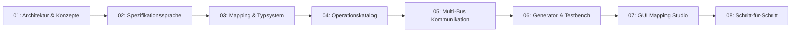

# SpecToTest — Dokumentation & Leitfaden

Willkommen in der Dokumentation von **SpecToTest**, dem deterministischen Testfall-Compiler und Multi-Bus-Testframework nach den Prinzipien der **Hexagonalen Architektur (Ports & Adapters)**.

Diese Dokumentation ist in eine **sequentielle Reihe von Themenheften** unterteilt. Jedes Dokument baut logisch auf dem vorherigen auf, kann aber auch als eigenständiges Nachschlagewerk verwendet werden.

---

## 📚 Sequentielles Inhaltsverzeichnis

| Dokument | Titel | Kerninhalte |
|---|---|---|
| [**01_architektur_und_konzepte.md**](file:///Users/cc/Desktop/SpecToTest/docs/01_architektur_und_konzepte.md) | **Architektur & Kernkonzepte** | Hexagonale Architektur, Ports & Adapters, Trennung von Fachdomäne und Compiler, End-to-End Datenfluss. |
| [**02_spezifikationssprache.md**](file:///Users/cc/Desktop/SpecToTest/docs/02_spezifikationssprache.md) | **Die Spezifikationssprache** | Syntax für `.txt` und `.md`, Testfall-Header, Abschnitte (`Precondition`, `Action`, `Expected Result`, `Postcondition`), Kontrollstrukturen (`FOR`, `BREAK`), Schrittbindung & Scoping. |
| [**03_mapping_und_typsystem.md**](file:///Users/cc/Desktop/SpecToTest/docs/03_mapping_und_typsystem.md) | **Mapping- & Typsystem** | Konfiguration via TOML, Regex-Template-Kompilierung, deterministische Typkonvertierung (`Quantity`, `Resource`, `Boolean`), Einheitenumrechnung, Kontextisolation. |
| [**04_operationskatalog_und_vertraege.md**](file:///Users/cc/Desktop/SpecToTest/docs/04_operationskatalog_und_vertraege.md) | **Operationskatalog & Verträge** | `OperationContract`, `ParameterSpec`, Phasenschutz (`SETUP`, `STIMULUS`, `CHECK`, `TEARDOWN`), Standard-Bibliotheken (Zündung, Versorgung, Diagnose, HMI, Timing). |
| [**05_multibus_kommunikation.md**](file:///Users/cc/Desktop/SpecToTest/docs/05_multibus_kommunikation.md) | **Multi-Bus-Architektur** | CAN, LIN, Ethernet (SOME/IP), Importer für DBC, LDF und ARXML, CLI-Tools, symbolische Enums, strikte Datenbankisolation. |
| [**06_code_generator_und_testbench.md**](file:///Users/cc/Desktop/SpecToTest/docs/06_code_generator_und_testbench.md) | **Code-Generator & Testbench-Ausführung** | Python Code Emitter, deterministisches Cleanup (`try ... finally`), BenchPort-Protokoll, Dummy-Benches, HTML-Dashboard, JUnit-XML Report. |
| [**07_gui_mapping_studio.md**](file:///Users/cc/Desktop/SpecToTest/docs/07_gui_mapping_studio.md) | **SpecToTest Studio (GUI)** | Desktop-Anwendung (PySide6 / Qt), Spezifikationseditor mit Live-Kompilierung, Zeilen-Inspektor, Kommunikations-Browser, Satzprüfung, Projektprofile. |
| [**08_schritt_fuer_schritt_anleitung.md**](file:///Users/cc/Desktop/SpecToTest/docs/08_schritt_fuer_schritt_anleitung.md) | **Schritt-für-Schritt-Anleitung** | Vollständiges Praxisbeispiel: Spezifikation schreiben, Mappings anlegen, Operation programmieren, Bus-Signal importieren, Test kompilieren und ausführen. |

---

## 🎯 Schnelleinstieg nach Rollen

### 1. Testingenieure & Autoren von Spezifikationen
- Startpunkt: [02_spezifikationssprache.md](file:///Users/cc/Desktop/SpecToTest/docs/02_spezifikationssprache.md) & [08_schritt_fuer_schritt_anleitung.md](file:///Users/cc/Desktop/SpecToTest/docs/08_schritt_fuer_schritt_anleitung.md).
- Werkzeug: Starte die GUI mit `python3 gui.py`, um Spezifikationen mit Syntaxprüfung und Zeileninspektor direkt zu bearbeiten.

### 2. Testautomatisierer & Integratoren
- Startpunkt: [03_mapping_und_typsystem.md](file:///Users/cc/Desktop/SpecToTest/docs/03_mapping_und_typsystem.md), [04_operationskatalog_und_vertraege.md](file:///Users/cc/Desktop/SpecToTest/docs/04_operationskatalog_und_vertraege.md) und [05_multibus_kommunikation.md](file:///Users/cc/Desktop/SpecToTest/docs/05_multibus_kommunikation.md).
- Aufgaben: Definieren von Satzmustern in `operation_mapping.toml`, Einbinden von DBC-, LDF- und ARXML-Dateien, Implementieren neuer Prüfstandsoperationen.

### 3. CI/CD- & DevOps-Ingenieure
- Startpunkt: [06_code_generator_und_testbench.md](file:///Users/cc/Desktop/SpecToTest/docs/06_code_generator_und_testbench.md).
- Aufgaben: Einbindung von `generate.py` und `run_bench.py` in Pipelines (GitHub Actions, GitLab CI, Jenkins), Parsing von `junit.xml` und Archivierung von `report.html`.

---

## 🔑 Glossar der Kernbegriffe

- **Hexagonale Architektur (Ports & Adapters):** Architekturmuster, das Fachlogik vollständig von Ein- und Ausgabetechnologien (Dateien, GUIs, Prüfstandshardware) isoliert.
- **Spezifikation (`.txt` / `.md`):** Natürlichsprachliche Testanweisung, strukturiert in Precondition, Action, Expected Result und Postcondition.
- **Mapping (`.toml`):** Regulärer Ausdruck / Satzmuster, der eine natürlichsprachliche Phrase mit einer Python-Operation und Parametern verknüpft.
- **OperationContract:** Formaler Vertrag einer Fachfunktion (Parameter, Typen, Einheiten, zulässige Ausführungsphasen).
- **ResourceProfile:** Liste aller in einer Projektumgebung zulässigen Ressourcen-Identifikatoren (Steuergeräte, CAN-Signale, Diagnoseschlüssel).
- **CommunicationCatalog:** Technologie-unabhängiger Katalog aller geladenen Kommunikationsressourcen (CAN, LIN, Ethernet SOME/IP).
- **BenchPort:** Schnittstellenprotokoll (`Protocol`), das die physische oder simulierte Prüfumgebung für generierte Tests abstrahiert.
