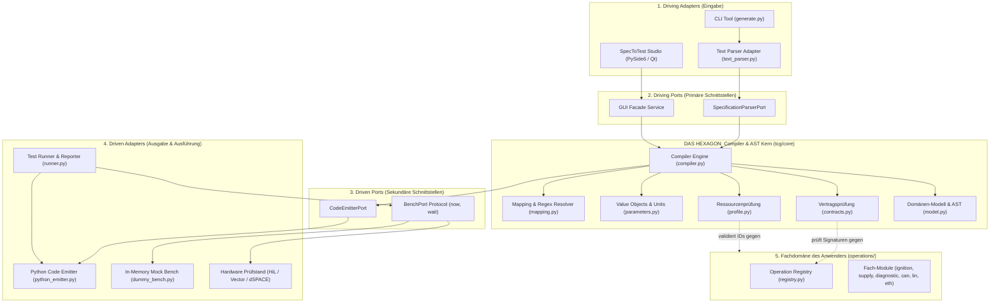
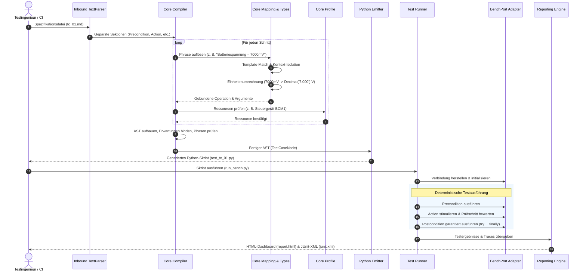

# 01 — Architektur & Kernkonzepte

Dieses Dokument beschreibt die architektonischen Grundlagen und Entwurfsprinzipien von **SpecToTest**. Es erläutert, wie das System die klassische Kluft zwischen fachlicher Testspezifikation und ausführbarem Testcode überwindet.

---

## 1. Motivation & Problemstellung

In Entwicklungs- und Testumgebungen (beispielsweise im Automotive HiL/SiL-Umfeld oder bei verteilten Software-Diensten) treffen zwei gegensätzliche Welten aufeinander:

1. **Die Spezifikationswelt:** Testingenieure und Systemarchitekten formulieren Anforderungen in natürlicher Fachsprache (`Zündung an`, `Batteriespannung = 7000mV`, `Fehlerspeichereintrag DTC00173 eingetragen`).
2. **Die Implementierungswelt:** Testskripte in Python oder C# enthalten oft hunderte Zeilen Boilerplate-Code, Prüfstands-Initialisierung, Hardware-Treiberaufrufe, proprietäre Logging-Mechanismen und fest verdrahtete Zeichenketten.

### Die Folgen klassischer Ansätze
- **Hohe Wartungskosten:** Ändert sich ein Funktionsaufruf oder eine Hardware-Bibliothek, müssen dutzende Skripte manuell refaktoriert werden.
- **Mangelnde Auditierbarkeit:** In einem Audit lässt sich nur schwer beweisen, dass Skriptzeile 342 exakt die Anforderung aus Schritt 20 der Spezifikation erfüllt.
- **Hardware-Abhängigkeit:** Tests können oft nicht ohne den physischen Prüfstand ausgeführt oder auf Entwicklerrechnern vorvalidiert werden.

---

## 2. Die Hexagonale Architektur (Ports & Adapters)

Um diese Probleme nachhaltig zu lösen, basiert **SpecToTest** konsequent auf den Prinzipien der **Hexagonalen Architektur** (Alistair Cockburn):

### Die Schichten im Detail

#### A. Das Hexagon (Compiler-Kern `tcg/core`)
Das Zentrum des Systems ist vollständig frei von I/O-, Prüfstands- oder automobilspezifischen Abhängigkeiten:
- **`tcg/core/model.py`:** Definiert die abstrakte Syntax (AST) eines Testfalls (`TestCaseNode`, `ActionStepNode`, `ExpectationNode`, `LoopNode`).
- **`tcg/core/compiler.py`:** Überführt geparste Abschnitte in den AST, bindet Erwartungen an Aktionsschritte und validiert Scoping-Regeln.
- **`tcg/core/mapping.py`:** Kompiliert TOML-Satzmuster in exakte Regex-Muster und ordnet Satzphrasen deterministisch zu.
- **`tcg/core/parameters.py`:** Typsystem mit physikalischer Einheitenumrechnung (`Quantity`), Ressourcen-Bindung und isolationstechnischem Kontext (`set_step_context`).
- **`tcg/core/contracts.py`:** Prüft Typsignaturen und Phasenberechtigungen von Operationen.
- **`tcg/core/profile.py`:** Stellt sicher, dass nur zulässige Bezeichner (z. B. deklarierte Steuergeräte oder Signale) verwendet werden.

#### B. Driving Ports & Adapters (Eingabe)
- **Adapter `text_parser.py`:** Liest Spezifikationen im `.txt`- oder `.md`-Format ein, filtert Kommentare (Hash, C-Style, HTML-Blöcke) und strukturiert Abschnitte.
- **Adapter `generate.py`:** Kommandozeilenwerkzeug zur Batch-Generierung von Testskripten für CI/CD-Pipelines.
- **Adapter `tcg/gui/`:** Interaktive Arbeitsumgebung (SpecToTest Studio) mit Syntaxprüfung und Zeileninspektor.

#### C. Driven Ports & Adapters (Ausgabe & Prüfstand)
- **Adapter `python_emitter.py`:** Übersetzt den AST in lesbaren Python-Code.
- **Port `BenchPort`:** Schnittstellenprotokoll (`Protocol`), das Zeitstempel (`now()`) und Zeitschritte (`wait(seconds)`) bereitstellt.
- **Adapter `dummy_bench.py`:** Schnelle In-Memory-Simulation für lokale Entwicklung und CI/CD.
- **Adapter Hardware:** Echte Prüfstände (CANoe über COM-Interface, dSPACE ControlDesk, LIN-/Ethernet-Treiber).
- **Adapter `runner.py`:** Führt die generierten Tests aus, sammelt Messwerte und erzeugt Reports.

#### D. Die Fachdomäne (`operations/`)
Hier implementieren Testingenieure ihre fachlichen Bibliotheken (z. B. Spannungsversorgung einstellen, CAN-Signal senden, Fehlerspeicher löschen). Der Compiler-Kern kennt diese Funktionen nicht persönlich — er kennt nur deren formale Verträge (`OperationContract`).

---

## 3. End-to-End Datenfluss & Pipeline

Der Lebenszyklus eines Testfalls von der Spezifikation bis zur Testergebnis-Analyse vollzieht sich in einer deterministischen, sequentiellen Pipeline:

---

## 4. Die Kernprinzipien von SpecToTest

### 1. Strikt deterministisches Kompilieren
Für dieselbe Eingabe (Spezifikation, Mapping, Ressourcenprofil) generiert der Compiler Bit für Bit exakt denselben Python-Code. Es gibt keine Zufallselemente, keine Heuristiken und keine impliziten Standardwerte, die nicht formal deklariert sind.

### 2. Garantierte Aufräumsicherheit (`try ... finally`)
Im generierten Testcode werden alle Nachbedingungen (`Postcondition`) in einem `try ... finally`-Block gekapselt. Selbst wenn ein Testschritt mitten im Ablauf fehlschlägt oder eine Assertion nicht erfüllt ist, wird das System immer in einen sicheren Ausgangszustand versetzt (z. B. Zündung aus, Spannungsversorgung abschalten).

### 3. Vollständige Auditierbarkeit & Traceability
Jedes generierte Python-Testskript enthält im Modul-Docstring den exakten Wortlaut der ursprünglichen Spezifikation. Jeder einzelne generierte Aufruf ist mit der Zeilennummer und dem Originalsatz aus der Spezifikation kommentiert.

### 4. Technologieneutrale Multi-Bus-Unterstützung
CAN, LIN und Automotive Ethernet (SOME/IP) werden über ein einheitliches Abstraktionsmodell in `tcg/comm/` verwaltet. Weder der Compiler noch die Spezifikationssprache sind an eine bestimmte Bus-Hardware gebunden.
