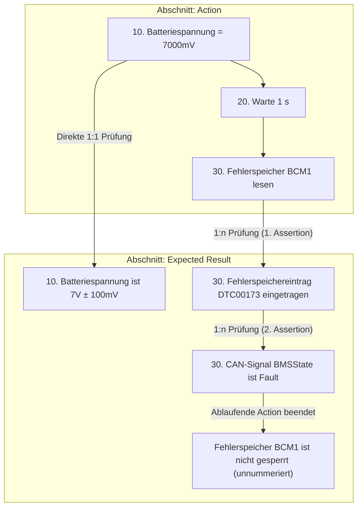
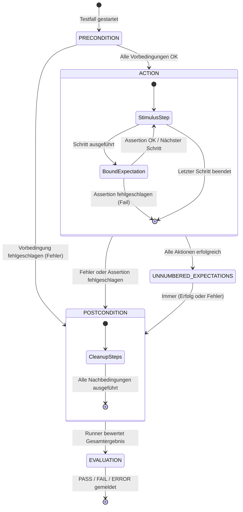

# 02 — Die Spezifikationssprache

Dieses Dokument definiert die formale Syntax, die Strukturregeln, die Kontrollstrukturen sowie die Lebenszyklussemantik der Testspezifikationssprache von **SpecToTest**.

---

## 1. Dateiformat & Zeichenkodierung

- **Dateiendungen:** `.txt` (Klartext) und `.md` (Markdown).
- **Zeichenkodierung:** UTF-8 (mit oder ohne Byte Order Mark / BOM).
- **Zeilenumbrüche:** Sowohl LF (`\n`, Linux/macOS) als auch CRLF (`\r\n`, Windows) werden nahtlos unterstützt.
- **Dichte:** Genau eine Testanweisung oder Kontrollanweisung pro Zeile.

### Unterstützte Kommentarsyntax
Kommentare können flexibel formatiert werden und werden vom Parser vor der semantischen Analyse entfernt:
- **Hash-Kommentare:** `# Dies ist ein Kommentar` (am Zeilenanfang oder inline nach Anweisungen, sofern nicht innerhalb von Anführungszeichen).
- **C-Style Einzelzeilenkommentare:** `// Dies ist ein Kommentar`
- **C-Style Blockkommentare:** `/* Mehrzeiliger Kommentarblock */`
- **HTML-Kommentare:** `<!-- Besonders nützlich in Markdown-Dokumenten -->`

### Markdown-Besonderheiten (`.md`)
SpecToTest parst Markdown direkt ohne externe Präprozessoren:
- **Überschriften:** Beliebige Markdown-Präfixe wie `#`, `##`, `###` sind vor Abschnittsüberschriften (`## Precondition`) und Metadaten (`# TESTFALL: TC_01`) erlaubt.
- **Fett-Formatierung:** Schlüssel wie `**TESTFALL:**`, `**NAME:**` oder `**TESTZIEL:**` werden automatisch normalisiert.
- **Listenpunkte:** Testschritte dürfen als Aufzählungspunkte formatiert sein (`- 10. Zündung an` oder `* 10. Zündung an`).
- **Code-Blöcke & Trennlinien:** Fenced Code Blocks (```` ``` ````) und Trennlinien (`---`, `***`) werden ignoriert.

---

## 2. Dokumentstruktur & Testfall-Header

Eine Spezifikationsdatei kann einen oder mehrere Testfälle enthalten.

### A. Impliziter Header (Einzeltestfall)
Wird kein expliziter Header angegeben, leitet SpecToTest die Testfall-ID automatisch aus dem Dateinamen ab (z. B. `tc_01_undervoltage.txt` $\rightarrow$ `TC_01_UNDERVOLTAGE`).

### B. Expliziter Header
```text
# TESTFALL: TC_01_UNDERVOLTAGE_RECOVERY
NAME: Unterspannung und autonomer Wiederanlauf
ANFORDERUNG: REQ_DIAG_UNDERVOLTAGE_001
TESTZIEL: Nachweis, dass das Steuergerät nach einem Spannungseinbruch fehlerfrei wieder anläuft.
```

- **`TESTFALL:`** Eindeutige Kennung (muss dem Muster `TC_[A-Z0-9_]{1,60}` entsprechen).
- **`NAME:`** Menschenlesbare Bezeichnung des Tests.
- **`ANFORDERUNG:`** (oder `REQUIREMENT:` / `**ANFORDERUNG:**`): Anforderungskennung für lückenlose Traceability (z. B. zu Polarion, DOORS oder Jira).
- **`TESTZIEL:`** Fachliche Kurzbeschreibung des Ziels (optional).

### C. Mehrere Testfälle in einer Datei
Folgen in einer Datei mehrere `TESTFALL:`-Header aufeinander, generiert SpecToTest ein gemeinsames Testskript mit getrennten Ausführungsfunktionen je Testfall.

---

## 3. Die vier Testfall-Abschnitte

Ein Testfall ist in vier disjunkte Abschnitte gegliedert. Abschnittsüberschriften werden unabhängig von Groß-/Kleinschreibung sowohl auf Deutsch als auch auf Englisch erkannt:

| Abschnitt | Deutsche Bezeichnungen | Englische Bezeichnungen | Zweck & Zulässige Operationen |
|---|---|---|---|
| **Precondition** | `Vorbedingungen`, `Vorbedingung` | `Precondition`, `Preconditions` | Systeminitialisierung (z. B. Zündung einschalten, Fehlerspeicher leeren, Prüfstands-Parameter setzen). |
| **Action** | `Ablauf`, `Testschritte` | `Action`, `Actions` | Fachliche Teststimulation und Ablaufsteuerung (z. B. Spannungsrampen, CAN-Nachrichten senden, Schleifen). |
| **Expected Result** | `Erwartungen`, `Erwartete Ergebnisse` | `Expected`, `Expected Result`, `Expected Results` | Verifikations- und Prüfschritte (z. B. Signalwerte auslesen, Fehlerspeichereinträge prüfen). |
| **Postcondition** | `Nachbedingungen`, `Nachbedingung` | `Postcondition`, `Postconditions` | Sicheres Aufräumen und Rücksetzen der Prüflinge (wird immer in einem `finally`-Block ausgeführt). |

---

## 4. Schrittnummerierung & Erwartungsbindung

Im Abschnitt `Action` können Anweisungen mit einer Schrittnummerierung versehen werden (z. B. `10.`, `20:`). Diese Nummern steuern die zeitliche Zuordnung der Prüfungen im Abschnitt `Expected Result`:



### Bindungsregeln im Detail

1. **Nummerierte Erwartungen (1:1 und 1:n):**
   - Eine Erwartung mit Schrittnummer (z. B. `30. Fehlerspeichereintrag DTC00173 eingetragen`) wird **sofort** nach der Ausführung des entsprechenden Aktionsschritts `30.` ausgeführt.
   - Tragen mehrere Erwartungen dieselbe Nummer, werden sie in ihrer Deklarationsreihenfolge nacheinander geprüft.
2. **Bindung an `FOR`-Schleifen:**
   - Referenziert eine Erwartung die Schrittnummer einer Schleife selbst (z. B. `10. FOR (...)`), wird sie **genau einmal nach vollständigem Durchlauf** der Schleife ausgeführt.
   - Referenziert eine Erwartung einen Einzelschritt innerhalb der Schleife, wird sie **in jeder Iteration** unmittelbar nach diesem Schritt ausgeführt.
3. **Unnummerierte Erwartungen:**
   - Erwartungen ohne vorangestellte Nummer werden als abschließende Prüfungen nach dem gesamten `Action`-Abschnitt (aber vor `Postcondition`) ausgeführt.
4. **Strenge Konsistenzprüfung (Orphan Detection):**
   - Referenziert eine Erwartung eine Schrittnummer, die im `Action`-Abschnitt nicht existiert, bricht die Kompilierung mit einem **`SpecError`** ab. Erwartungen werden niemals stillschweigend ignoriert oder an das Dateiende verschoben!
   - Das Referenzieren von Nummern aus `Precondition` oder `Postcondition` ist verboten und führt ebenfalls zu einem `SpecError`.
   - Doppelte Schrittnummern innerhalb des `Action`-Abschnitts sind unzulässig.

---

## 5. Kontrollstrukturen & Scoping

SpecToTest stellt strukturierte Schleifen, Bedingungen und Fallunterscheidungen bereit, ohne dass der Tester Programmiersprachen-Boilerplate benötigt:

### A. Schleifen (`FOR` / `END FOR`) und `BREAK`
```text
FOR (<variable>; [<wert1>, <wert2>, <wert3>, ...])
    <anweisung1>
    <anweisung2>
END FOR
```

Mit optionaler Schrittnummerierung und `BREAK`:
```text
10. FOR (i; [1, 2, 3, 4, 5])
    20. Warte i s
    30. BREAK (i == 3)
END FOR
```

`BREAK` kann ohne Bedingung (`BREAK`) oder mit Bedingung (`BREAK (<bedingung>)`) aufgerufen werden. `BREAK` darf überall innerhalb einer `FOR`- oder `WHILE`-Schleife platziert werden, auch tief verschachtelt innerhalb von `IF`- oder `SWITCH`-Blöcken.

### B. Bedingte Schleifen (`WHILE` / `END WHILE`)
`WHILE`-Schleifen führen Anweisungen solange aus, wie die angegebene Bedingung wahr ist:
```text
WHILE (<bedingung>)
    <anweisungen>
END WHILE
```

Mit Schrittnummerierung und `BREAK`:
```text
10: FOR (retry; [1])
    20: WHILE (retry <= 3)
        21. Fehlerspeicher BMS lesen
        22: BREAK (retry == 2)
    23: END WHILE
24: END FOR
```
`WHILE`-Schleifen werden deterministisch in native Python-`while <cond>:`-Blöcke überführt und unterliegen der gleichen strikten Scoping- und Block-Validierung.

### C. Bedingte Verzweigungen (`IF` / `ELSE IF` / `ELSE` / `END IF`)
Verzweigungen ermöglichen die bedingte Ausführung von Testschritten basierend auf Variablen:
```text
IF (<bedingung>)
    <anweisungen>
ELSE IF (<bedingung>)
    <anweisungen>
ELSE
    <anweisungen>
END IF
```

Beispiel mit zusammengesetzten Bedingungen:
```text
10: FOR (temp; [25, 45, 65])
    20: IF (temp >= 20 AND temp < 30)
        21. CAN-Signal CoolingRequest auf 0 setzen
    22: ELSE IF (temp == 45 OR temp == 50)
        23. CAN-Signal CoolingRequest auf 1 setzen
    24: ELSE
        25. CAN-Signal CoolingRequest auf 2 setzen
    26: END IF
27: END FOR
```

**Bedingungsoperatoren & Logische Verknüpfungen:**
- **Vergleiche:** `==` (Gleichheit), `!=` (Ungleichheit), `<`, `<=` (Kleiner / Kleiner-Gleich), `>`, `>=` (Größer / Größer-Gleich).
- **Logische Operatoren:** `AND` bzw. `&&` (logisches UND), `OR` bzw. `||` (logisches ODER).
- **Klammerung:** Beliebig tiefe Klammerung zur Steuerung der Auswertungsreihenfolge, z. B. `((mode == 1 AND temp < 30) OR override == 1)`. Die Standard-Präzedenz (`AND` bindet stärker als `OR`) wird eingehalten.
- **Werte:** Ganze Zahlen (`45`), Dezimalzahlen/Spannungen (`13.5`), Strings (`"DriveReady"`), Booleans (`True`/`False`) oder Variablen.

### D. Mehrfachauswahl (`SWITCH` / `CASE` / `DEFAULT` / `END SWITCH`)
Für mehrstufige Fallunterscheidungen steht das `SWITCH`-Konstrukt zur Verfügung, das deterministisch in moderne Python-`match ... case:`-Strukturen übersetzt wird:
```text
SWITCH (<variable>)
    CASE (<wert1>)
        <anweisungen>
    CASE (<wert2>)
        <anweisungen>
    DEFAULT
        <anweisungen>
END SWITCH
```

Beispiel:
```text
10: FOR (mode; [1, 2, 3])
    20: SWITCH (mode)
        21: CASE (1)
            22. CAN-Signal BMSState auf 1 setzen
            23. CAN-Signal CoolingRequest auf 0 setzen
        24: CASE (2)
            25. CAN-Signal BMSState auf 2 setzen
            26. CAN-Signal CoolingRequest auf 1 setzen
        27: DEFAULT
            28. CAN-Signal BMSState auf 3 setzen
            29. CAN-Signal CoolingRequest auf 2 setzen
    30: END SWITCH
31: END FOR
```

### E. Scoping- und Lebenszyklusregeln
1. **Gültigkeitsbereich:** Schleifenvariablen (z. B. `temp` oder `mode`) existieren ausschließlich innerhalb des jeweiligen Blocks zwischen `FOR` und `END FOR`. In `WHILE`-Schleifen und `IF`-Verzweigungen können alle im übergeordneten Gültigkeitsbereich definierten Variablen geprüft werden.
2. **Schutz vor Überstrahlung:** Nach `END FOR` oder in unnummerierten Erwartungen führt der Zugriff auf eine Schleifenvariable zu einem `SpecError: variable '<var>' in IF condition is undefined; in scope: [...]`.
3. **Strenge Block-Integrität:**
   - Ein `CASE` oder `DEFAULT` ist nur innerhalb von `SWITCH` erlaubt.
   - `CASE` nach `DEFAULT` wird vom Compiler strikt abgelehnt.
   - Befehle direkt in `SWITCH` außerhalb von `CASE` oder `DEFAULT` führen zu einem Syntaxfehler.
   - Ein `ELSE` oder `ELSE IF` ist nur innerhalb von `IF` erlaubt; `ELSE IF` nach `ELSE` ist unzulässig.
   - Unvollständig geschlossene Blöcke (z. B. fehlendes `END IF` oder `END WHILE` vor `END FOR` oder vor dem nächsten Abschnitt) werden mit präziser Zeilenangabe beanstandet.
4. **Verschachtelung:** `FOR`, `WHILE`, `IF` und `SWITCH` können beliebig tief ineinander geschachtelt werden. Innerhalb geschachtelter Blöcke bleiben die Variablen aller übergeordneten Schleifen sichtbar.

---

## 6. Lebenszyklus eines Testfalls

Der generierte Python-Code bildet den Testablauf als deterministischen Zustandsautomaten ab:



### Deterministisches Cleanup (`try ... finally`)
Unabhängig davon, an welcher Stelle im Ablauf ein Fehler auftritt (Syntaxfehler in Stimuli, Verbindungsabbruch zum Prüfstand oder fehlgeschlagene Erwartung), wird der Abschnitt `Postcondition` immer garantiert durchlaufen. Dadurch bleiben keine Relais angezogen, Zündungen aktiv oder gefährliche Spannungen am Prüfling anliegen.

