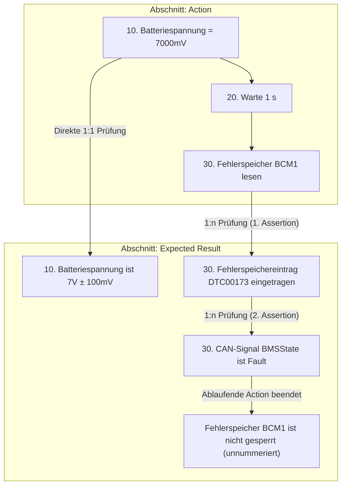
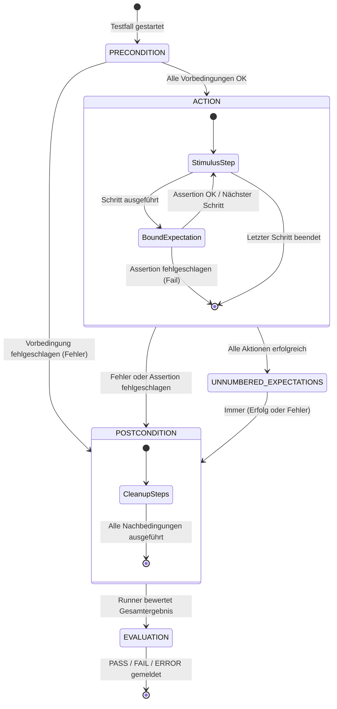

# 02 — Die Spezifikationssprache

Dieses Dokument definiert die formale Syntax, die Strukturregeln, die Kontrollstrukturen sowie die Lebenszyklussemantik der Testspezifikationssprache von **SpecToTest**.

---

## 1. Dateiformat & Zeichenkodierung

- **Dateiendungen:** `.txt` (Klartext) und `.md` (Markdown).
- **Zeichenkodierung:** UTF-8 (mit oder ohne Byte Order Mark / BOM).
- **Zeilenumbrüche:** Sowohl LF (`\n`, Linux/macOS) als auch CRLF (`\r\n`, Windows) werden nahtlos unterstützt.
- **Dichte:** Genau eine Testanweisung oder Kontrollanweisung pro Zeile.

### Unterstützte Kommentarsyntax
Kommentare können flexibel formatiert werden und werden vom Parser vor der semantischen Analyse entfernt:
- **Hash-Kommentare:** `# Dies ist ein Kommentar` (am Zeilenanfang oder inline nach Anweisungen, sofern nicht innerhalb von Anführungszeichen).
- **C-Style Einzelzeilenkommentare:** `// Dies ist ein Kommentar`
- **C-Style Blockkommentare:** `/* Mehrzeiliger Kommentarblock */`
- **HTML-Kommentare:** `<!-- Besonders nützlich in Markdown-Dokumenten -->`

### Markdown-Besonderheiten (`.md`)
SpecToTest parst Markdown direkt ohne externe Präprozessoren:
- **Überschriften:** Beliebige Markdown-Präfixe wie `#`, `##`, `###` sind vor Abschnittsüberschriften (`## Precondition`) und Metadaten (`# TESTFALL: TC_01`) erlaubt.
- **Fett-Formatierung:** Schlüssel wie `**TESTFALL:**`, `**NAME:**` oder `**TESTZIEL:**` werden automatisch normalisiert.
- **Listenpunkte:** Testschritte dürfen als Aufzählungspunkte formatiert sein (`- 10. Zündung an` oder `* 10. Zündung an`).
- **Code-Blöcke & Trennlinien:** Fenced Code Blocks (```` ``` ````) und Trennlinien (`---`, `***`) werden ignoriert.

---

## 2. Dokumentstruktur & Testfall-Header

Eine Spezifikationsdatei kann einen oder mehrere Testfälle enthalten.

### A. Impliziter Header (Einzeltestfall)
Wird kein expliziter Header angegeben, leitet SpecToTest die Testfall-ID automatisch aus dem Dateinamen ab (z. B. `tc_01_undervoltage.txt` $\rightarrow$ `TC_01_UNDERVOLTAGE`).

### B. Expliziter Header
```text
# TESTFALL: TC_01_UNDERVOLTAGE_RECOVERY
NAME: Unterspannung und autonomer Wiederanlauf
TESTZIEL: Nachweis, dass das Steuergerät nach einem Spannungseinbruch fehlerfrei wieder anläuft.
```

- **`TESTFALL:`** Eindeutige Kennung (muss dem Muster `TC_[A-Z0-9_]{1,60}` entsprechen).
- **`NAME:`** Menschenlesbare Bezeichnung des Tests.
- **`TESTZIEL:`** Fachliche Kurzbeschreibung des Ziels (optional).

### C. Mehrere Testfälle in einer Datei
Folgen in einer Datei mehrere `TESTFALL:`-Header aufeinander, generiert SpecToTest ein gemeinsames Testskript mit getrennten Ausführungsfunktionen je Testfall.

---

## 3. Die vier Testfall-Abschnitte

Ein Testfall ist in vier disjunkte Abschnitte gegliedert. Abschnittsüberschriften werden unabhängig von Groß-/Kleinschreibung sowohl auf Deutsch als auch auf Englisch erkannt:

| Abschnitt | Deutsche Bezeichnungen | Englische Bezeichnungen | Zweck & Zulässige Operationen |
|---|---|---|---|
| **Precondition** | `Vorbedingungen`, `Vorbedingung` | `Precondition`, `Preconditions` | Systeminitialisierung (z. B. Zündung einschalten, Fehlerspeicher leeren, Prüfstands-Parameter setzen). |
| **Action** | `Ablauf`, `Testschritte` | `Action`, `Actions` | Fachliche Teststimulation und Ablaufsteuerung (z. B. Spannungsrampen, CAN-Nachrichten senden, Schleifen). |
| **Expected Result** | `Erwartungen`, `Erwartete Ergebnisse` | `Expected`, `Expected Result`, `Expected Results` | Verifikations- und Prüfschritte (z. B. Signalwerte auslesen, Fehlerspeichereinträge prüfen). |
| **Postcondition** | `Nachbedingungen`, `Nachbedingung` | `Postcondition`, `Postconditions` | Sicheres Aufräumen und Rücksetzen der Prüflinge (wird immer in einem `finally`-Block ausgeführt). |

---

## 4. Schrittnummerierung & Erwartungsbindung

Im Abschnitt `Action` können Anweisungen mit einer Schrittnummerierung versehen werden (z. B. `10.`, `20:`). Diese Nummern steuern die zeitliche Zuordnung der Prüfungen im Abschnitt `Expected Result`:



### Bindungsregeln im Detail

1. **Nummerierte Erwartungen (1:1 und 1:n):**
   - Eine Erwartung mit Schrittnummer (z. B. `30. Fehlerspeichereintrag DTC00173 eingetragen`) wird **sofort** nach der Ausführung des entsprechenden Aktionsschritts `30.` ausgeführt.
   - Tragen mehrere Erwartungen dieselbe Nummer, werden sie in ihrer Deklarationsreihenfolge nacheinander geprüft.
2. **Bindung an `FOR`-Schleifen:**
   - Referenziert eine Erwartung die Schrittnummer einer Schleife selbst (z. B. `10. FOR (...)`), wird sie **genau einmal nach vollständigem Durchlauf** der Schleife ausgeführt.
   - Referenziert eine Erwartung einen Einzelschritt innerhalb der Schleife, wird sie **in jeder Iteration** unmittelbar nach diesem Schritt ausgeführt.
3. **Unnummerierte Erwartungen:**
   - Erwartungen ohne vorangestellte Nummer werden als abschließende Prüfungen nach dem gesamten `Action`-Abschnitt (aber vor `Postcondition`) ausgeführt.
4. **Strenge Konsistenzprüfung (Orphan Detection):**
   - Referenziert eine Erwartung eine Schrittnummer, die im `Action`-Abschnitt nicht existiert, bricht die Kompilierung mit einem **`SpecError`** ab. Erwartungen werden niemals stillschweigend ignoriert oder an das Dateiende verschoben!
   - Das Referenzieren von Nummern aus `Precondition` oder `Postcondition` ist verboten und führt ebenfalls zu einem `SpecError`.
   - Doppelte Schrittnummern innerhalb des `Action`-Abschnitts sind unzulässig.

---

## 5. Kontrollstrukturen & Scoping

SpecToTest stellt strukturierte Schleifen und bedingte Schleifenabbrüche bereit, ohne dass der Parser Programmiersprachen-Boilerplate benötigt:

### Syntax von `FOR`-Schleifen
```text
FOR (<variable>; [<wert1>, <wert2>, <wert3>, ...])
    <anweisung1>
    <anweisung2>
END FOR
```

Mit optionaler Schrittnummerierung:
```text
10. FOR (U; [9.0V, 10.5V, 12.0V, 13.8V])
    20. Batteriespannung = U
    30. Warte 200 ms
END FOR
```

### Syntax von `BREAK`
Ein bedingter Abbruch beendet die Schleife vorzeitig, wenn eine Bedingung wahr ist:
```text
BREAK (<bedingung>)
```

Beispiel:
```text
10. FOR (i; [1, 2, 3, 4, 5])
    20. Warte i s
    30. BREAK (i == 3)
END FOR
```

### Scoping- und Lebenszyklusregeln
1. **Gültigkeitsbereich:** Die Schleifenvariable (z. B. `U` oder `i`) existiert ausschließlich innerhalb des Schleifenblocks zwischen `FOR` und `END FOR`.
2. **Schutz vor Überstrahlung:** Nach `END FOR` oder in unnummerierten Erwartungen führt der Zugriff auf eine Schleifenvariable zu einem `SpecError: variable '<var>' is undefined; in scope: [...]`.
3. **Unveränderlichkeit:** Innerhalb der Schleifeniteration ist die Schleifenvariable schreibgeschützt.
4. **Verschachtelung:** Schleifen können beliebig tief ineinander verschachtelt werden; innere Schleifen haben Zugriff auf die Variablen äußerer Schleifen.

---

## 6. Lebenszyklus eines Testfalls

Der generierte Python-Code bildet den Testablauf als deterministischen Zustandsautomaten ab:



### Deterministisches Cleanup (`try ... finally`)
Unabhängig davon, an welcher Stelle im Ablauf ein Fehler auftritt (Syntaxfehler in Stimuli, Verbindungsabbruch zum Prüfstand oder fehlgeschlagene Erwartung), wird der Abschnitt `Postcondition` immer garantiert durchlaufen. Dadurch bleiben keine Relais angezogen, Zündungen aktiv oder gefährliche Spannungen am Prüfling anliegen.
