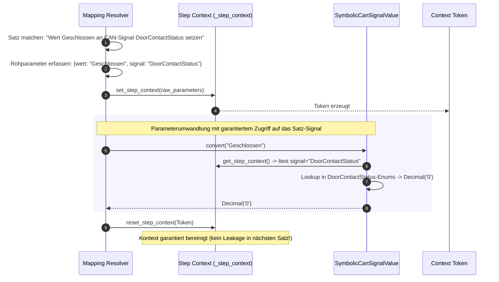

# 03 — Mapping- & Typsystem

Dieses Dokument erläutert, wie **SpecToTest** natürlichsprachliche Formulierungen über deklarative TOML-Mappings auf Python-Operationen abbildet und wie das deterministische Typsystem physikalische Einheiten, boolesche Zustände und Kontextabhängigkeiten typsicher validiert.

---

## 1. Das Konzept: Deklarative Satzmuster (TOML)

Anstatt reguläre Ausdrücke fest im Python-Code zu verdrahten, werden alle Sprachmuster in deklarativen TOML-Dateien gepflegt (z. B. `inputs/operation_mapping.toml`). Dadurch können Testteams die Formulierung von Testanweisungen anpassen oder übersetzen, ohne den Compiler oder die Testlogik anzurühren.

### Struktur eines Mappings
```toml
[[mapping]]
id = "MAP_IGNITION"
template = "Zündung {zustand}"
operation = "set_ignition"
parameters = { zustand = "state" }

[[mapping]]
id = "MAP_SUPPLY_SET"
template = "Batteriespannung = {wert}"
operation = "set_supply"
parameters = { wert = "value" }

[[mapping]]
id = "MAP_CAN_SET_SIGNAL"
template = "CAN-Signal {signal} auf {wert} setzen"
operation = "set_can_signal"
parameters = { signal = "signal", wert = "value" }
```

### Pflichtfelder
| Feld | Typ | Beschreibung |
|---|---|---|
| `id` | String | Eindeutige Kennung des Mappings im Großbuchstaben-Muster (`MAP_[A-Z0-9_]+`). |
| `template` | String | Das Satzmuster mit Platzhaltern in geschweiften Klammern (z. B. `{signal}`). |
| `operation` | String | Der Name der Ziel-Operation aus der Operations-Registry (z. B. `set_can_signal`). |
| `parameters` | Table | Zuordnung von Template-Platzhaltern zu Parameternamen der Operation (`{ <platzhalter> = "<param_name>" }`). |

---

## 2. Template-Syntax & Regex-Generierung

Der Compiler kompiliert jedes Template deterministisch in einen regulären Ausdruck:
1. **Platzhalter:** Dürfen nur Kleinbuchstaben und Unterstriche enthalten (z. B. `{wert}`, `{dauer}`).
2. **Literaler Text:** Zwischen zwei Platzhaltern muss zwingend trennender literaler Text stehen (z. B. `{signal} auf {wert}`). Zwei aufeinanderfolgende Platzhalter ohne Trenner wie `{a}{b}` sind verboten.
3. **Exakte Übereinstimmung:** Jedes Satzmuster matcht die gesamte Zeile. Führende oder nachgestellte Leerzeichen werden ignoriert.

---

## 3. Das deterministische Typsystem

In `tcg/core/parameters.py` definiert SpecToTest ein strenges, typsicheres Wertesystem. Es wandelt Textfragmente in typisierte Python-Objekte um und prüft Wertebereiche und Dimensionen vor der Code-Generierung:

### A. Physikalische Größen (`Quantity`)
Verarbeitet Zahlen mit physikalischen Einheiten, konvertiert sie über exakte `Decimal`-Faktoren in die Basis-Einheit und prüft Grenzwerte:

```python
SUPPLY_VOLTAGE = Quantity(
    dimension='voltage',
    unit='V',
    factors=(('V', Decimal('1')), ('mV', Decimal('0.001'))),
    minimum=Decimal('0'),
    maximum=Decimal('16'),
)
```

- **Eingabe `7000mV`:** Wird erkannt als Millivolt und exakt zu `Decimal('7.000') V` umgerechnet.
- **Eingabe `13.8V`:** Wird erkannt als Volt und zu `Decimal('13.8') V` umgerechnet.
- **Eingabe `24V`:** Löst einen **`SpecError`** aus, da der Maximalwert von 16 V überschritten wird.
- **Schleifenvariablen:** Erkennt Literale, die einer Variablen entsprechen (z. B. `U`), und erzeugt eine `VariableRef('U')`.

### B. Boolesche Parameter (`Boolean`)
Erlaubt fachliche Begriffspaare für Wahrheitswerte:
```python
IGNITION_STATE = Boolean(true_value='an', false_value='aus')
BOOLEAN_STATUS = Boolean(true_value='aktiv', false_value='inaktiv')
```
- `Zündung an` $\rightarrow$ `state = True`
- `Zündung aus` $\rightarrow$ `state = False`
- `Zündung gestartet` $\rightarrow$ `SpecError: expected 'an' or 'aus'`

### C. Ressourcen-Prüfung (`Resource`)
Stellt sicher, dass Bezeichner gegen ein projektspezifisches Ressourcenprofil (`resources.json`) geprüft werden:
```python
ECU = Resource('controller')
CAN_SIGNAL = Resource('can_signal')
```
Wird in der Spezifikation `Fehlerspeicher BCM99 löschen` angegeben, aber `BCM99` ist nicht in `resources.controller` deklariert, schlägt die Kompilierung mit einem aussagekräftigen Fehler fehl.

### D. JSON-Strings & Dezimalzahlen
- **`String`:** Parst Text in Anführungszeichen (z. B. `"Stufe 2"`) nach den JSON-Escaping-Regeln.
- **`Decimal`:** Verarbeitet dimensionslose Zahlen mit optionalen Minimal- und Maximalgrenzen.

---

## 4. Anweisungsbasierte Kontextisolation (`set_step_context`)

Ein zentrales Sicherheitsmerkmal von SpecToTest ist die **Kontextisolation bei der Parameterauflösung**. 

### Die Herausforderung: Invertierte Satzmuster
Ein Satzmuster kann Platzhalter in beliebiger Reihenfolge anordnen:
- Standard: `CAN-Signal {signal} auf {wert} setzen` (Signal vor Wert)
- Invertiert: `Wert {wert} an CAN-Signal {signal} setzen` (Wert vor Signal)

Hängt die Interpretation des Wertes vom Signal ab (z. B. weil `Geschlossen` beim Türkontakt den Rohwert `0` bedeutet, beim Interlock aber `1`), darf die Auflösung von `{wert}` **niemals** von der Reihenfolge im Template oder vom vorherigen Satz abhängen!



### Wie SpecToTest dies garantiert:
1. **Sofortiges Erfassen aller Rohparameter:** Bevor der erste Parameter konvertiert wird, werden alle Rohstrings (`raw_params`) im Thread-/Task-Kontext gespeichert.
2. **Priorisierte Konvertierung:** Referenzparameter (wie `signal`) werden priorisiert verarbeitet.
3. **Garantierte Bereinigung (`try ... finally`):** Nach der Parameterauflösung des Satzes wird der Kontext über das Token sofort zurückgesetzt. Es ist technisch unmöglich, dass ein Zustand aus Zeile 10 die Interpretation von Zeile 20 verfälscht.

---

## 5. Mehrdeutigkeitsprüfung (Ambiguitätsschutz)

Der Compiler stellt sicher, dass jede Testanweisung eindeutig ist:
- **Genau 1 Match:** Ein Satz muss exakt einem Satzmuster zugeordnet werden können.
- **Kein Match:** Schlägt mit `SpecError: no mapping template exactly matches '...'` fehl.
- **Mehrdeutigkeit:** Passen mehrere Satzmuster auf dieselbe Zeile (z. B. durch zu allgemeine Formulierungen), bricht die Kompilierung ab und listet alle kollidierenden Mappings auf:
  ```text
  SpecError: ambiguous: 2 template matches for 'Zündung an': MAP_IGNITION; MAP_IGNITION_ALT
  ```

