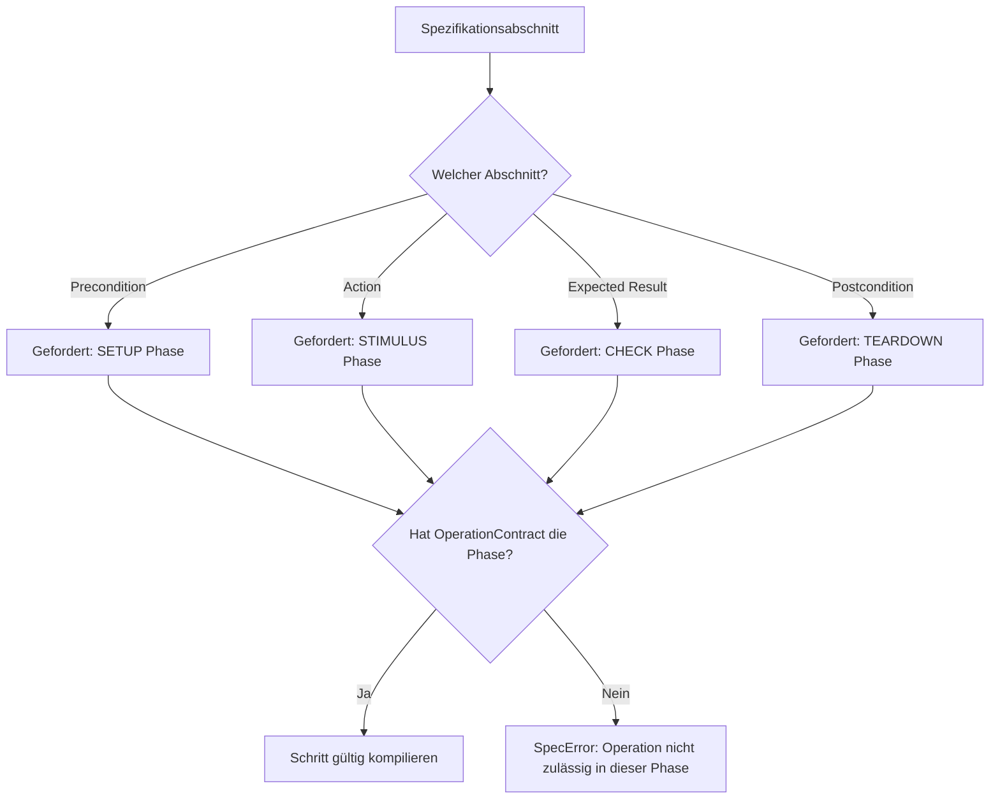

# 04 — Operationskatalog & Verträge

Dieses Dokument beschreibt den formalen Aufbau des **Operationskatalogs** (`operations/`), das Vertragssystem (`OperationContract`) sowie den automatisierten Phasenschutz, der fehlerhafte oder gefährliche Aufrufe zur Kompilierzeit verhindert.

---

## 1. Philosophie: Trennung von Vertrag und Implementierung

In **SpecToTest** sind Testoperationen gewöhnliche Python-Funktionen, die über einen Prüfstands-Port (`bench`) Aktionen ausführen oder Zustände abfragen. Sie enthalten **keinerlei** reguläre Ausdrücke, Mappings oder Kenntnisse über die Spezifikationsdatei.

Die Brücke zwischen dem generischen Compiler und der Python-Funktion bildet der **`OperationContract`**:
- Er deklariert die geforderten Parameter, deren Typen und Standardwerte.
- Er legt verbindlich fest, in welchen Phasen des Testfalls die Operation aufgerufen werden darf.

---

## 2. Aufbau eines `OperationContract`

Ein Vertrag wird in `operations/registry.py` oder einem fachspezifischen Modul definiert:

```python
from tcg.core.contracts import OperationContract, ParameterSpec, SETUP, STIMULUS, CHECK, TEARDOWN
from operations.supply import set_supply
from operations.registry import SUPPLY_VOLTAGE

CONTRACT_SET_SUPPLY = OperationContract(
    name='set_supply',
    function=set_supply,
    docstring='Stellt die geregelte Batteriespannung am Prüfstands-Netzteil ein.',
    parameters=(
        ParameterSpec(name='value', type=SUPPLY_VOLTAGE, required=True),
    ),
    phases=SETUP | STIMULUS | TEARDOWN,
)
```

### Bestandteile des Vertrags
1. **`name`:** Eindeutiger Identifikator der Operation (Referenzziel im TOML-Mapping `operation = "set_supply"`).
2. **`function`:** Die tatsächliche Python-Implementierungsfunktion.
3. **`docstring`:** Verständliche Dokumentation (wird in der GUI im Inspektor und in generierten Skripten angezeigt).
4. **`parameters`:** Tupel von `ParameterSpec`-Objekten mit Name, Typ (`Quantity`, `Boolean`, `Resource`, etc.), Optionalität und Defaultwert.
5. **`phases`:** Bitmaske der zulässigen Ausführungsphasen.

---

## 3. Phasenschutz & Phasenmatrix

Operationen haben unterschiedliche Seiteneffekte. Eine Assertion (Zustandsprüfung) darf das System nicht manipulieren, während eine destruktive Stimulationsoperation nicht im Erwartungsabschnitt stehen darf:



### Die vier Phasen im Vergleich

| Phase | Spezifikationsabschnitt | Typische Operationen | Verbotene Operationen |
|---|---|---|---|
| **`SETUP`** | `Precondition` | Initialisierung, Zündung einschalten, Fehlerspeicher löschen, Grenzwerte konfigurieren. | Prüfungen, Assertion-Vergleiche. |
| **`STIMULUS`** | `Action` | Spannungsrampen fahren, CAN-Nachrichten senden, LIN-Frames triggern, Wartezeiten. | Reine Leseoperationen ohne Stimulus. |
| **`CHECK`** | `Expected Result` | Signalwert prüfen, Toleranzband verifizieren, Fehlerspeichereintrag abfragen. | Zündung schalten, Spannungen verändern, Signale manipulieren. |
| **`TEARDOWN`** | `Postcondition` | Sicheres Abschalten (Zündung aus, Versorgungsspannung auf 0 V, Bus-Ruhezustand). | Neue Stimulationssequenzen oder Prüfungen. |

Wird beispielsweise versucht, `Batteriespannung = 7000mV` im Abschnitt `Expected Result` einzusetzen, bricht der Compiler sofort ab:
```text
SpecError: operation 'set_supply' is not permitted in section 'Expected Result' (requires CHECK phase)
```

---

## 4. Die mitgelieferten Standard-Fachbibliotheken

In `operations/` stellt SpecToTest sofort einsatzbereite Fachmodule für Standard-Aufgaben bereit:

### A. Zündungssteuerung (`operations/ignition.py`)
- **`set_ignition(bench, state: bool)`:** Schaltet Klemme 15 / Zündung ein (`True`) oder aus (`False`). Phasen: `SETUP | STIMULUS | TEARDOWN`.

### B. Spannungsversorgung (`operations/supply.py`)
- **`set_supply(bench, value: Decimal)`:** Setzt die Versorgungsspannung am Netzteil.
- **`expect_supply_tolerance(bench, value: Decimal, tolerance: Decimal)`:** Prüft, ob die gemessene Spannung im Fenster `[value - tol, value + tol]` liegt. Phase: `CHECK`.
- **`expect_supply_range(bench, min_value: Decimal, max_value: Decimal)`:** Prüft Intervallgrenzen. Phase: `CHECK`.

### C. Fehlerspeicher & Diagnose (`operations/diagnostic.py`)
- **`clear_fault_memory(bench, ecu: str)`:** Löscht Fehlerspeicher über UDS-Service 0x14. Phasen: `SETUP | TEARDOWN`.
- **`read_fault_memory(bench, ecu: str)`:** Liest Fehlerspeichereinträge via UDS-Service 0x19. Phasen: `STIMULUS`.
- **`expect_fault_memory_entry(bench, ecu: str, code: str)`:** Prüft das Vorhandensein eines spezifischen DTCs (z. B. `DTC00173`). Phase: `CHECK`.
- **`expect_no_fault_memory_entry(bench, ecu: str, code: str)`:** Verifiziert, dass ein DTC nicht eingetragen ist. Phase: `CHECK`.

### D. HMI & Bildschirmanzeige (`operations/hmi.py`)
- **`set_screen(bench, screen: str)`:** Wechselt den Bildschirm auf dem Kombiinstrument / Infotainment.
- **`expect_screen(bench, screen: str)`:** Prüft den aktuellen Anzeigezustand.

### E. Timing & Polling (`operations/timing.py`)
- **`wait(bench, seconds: Decimal)`:** Deterministisches Warten auf der Bench.
- **`wait_can_signal(bench, signal: str, value: Decimal, timeout: Decimal, interval: Decimal)`:** Pollt ein Signal mit Timeout und Prüfintervall.

---

## 5. Eigene Operationen erstellen & registrieren (Vollständiges Beispiel)

Das Hinzufügen einer neuen Prüfstandsoperation erfolgt in fünf zusammenhängenden Schritten:

### Schritt 1: Python-Funktionen implementieren (`operations/cooling.py`)
Erstelle oder erweitere ein Modul mit der Aktions-Funktion (Stimulus) und der zugehörigen Prüf-Funktion (Assertion):

```python
# operations/cooling.py
from decimal import Decimal
from tcg.runtime.test_log import CheckFailed

def set_pump_speed(bench, *, speed_percent: Decimal) -> None:
    """Steuert die Kühlmittelpumpe mit der gewünschten Drehzahl in Prozent an."""
    bench.write_pwm('COOLING_PUMP', float(speed_percent))

def expect_pump_speed(bench, *, expected_percent: Decimal, tolerance: Decimal = Decimal('2.0')) -> None:
    """Prüft, ob die tatsächliche Drehzahl der Kühlmittelpumpe im Toleranzfenster liegt."""
    actual = bench.read_pwm('COOLING_PUMP')
    diff = abs(Decimal(str(actual)) - expected_percent)
    if diff > tolerance:
        raise CheckFailed(
            f"Kühlmittelpumpe Drehzahl {actual}% weicht um {diff}% von Soll {expected_percent}% ab (Tol: ±{tolerance}%)"
        )
```

> **Wichtig:**
> - Erstes Argument ist immer `bench` (Positionsargument).
> - Alle weiteren fachlichen Parameter sind **keyword-only** (nach `*`).
> - Prüfoperationen werfen bei Abweichungen `CheckFailed` aus `tcg.runtime.test_log`.

### Schritt 2: Verträge in `operations/registry.py` registrieren
Definiere die Datentypen und Verträge mit dem passenden Phasenschutz:

```python
from decimal import Decimal
from tcg.core.contracts import OperationContract, ParameterSpec, SETUP, STIMULUS, CHECK, TEARDOWN
from tcg.core.parameters import Quantity
from operations.cooling import set_pump_speed, expect_pump_speed

PUMP_SPEED = Quantity(
    dimension='percentage',
    unit='%',
    minimum=Decimal('0'),
    maximum=Decimal('100'),
)

CONTRACT_SET_PUMP_SPEED = OperationContract(
    name='set_pump_speed',
    function=set_pump_speed,
    docstring='Steuert die Kühlmittelpumpe an (0 bis 100%).',
    parameters=(
        ParameterSpec('speed_percent', PUMP_SPEED, required=True),
    ),
    phases=SETUP | STIMULUS | TEARDOWN,
)

CONTRACT_EXPECT_PUMP_SPEED = OperationContract(
    name='expect_pump_speed',
    function=expect_pump_speed,
    docstring='Prüft die Drehzahl der Kühlmittelpumpe.',
    parameters=(
        ParameterSpec('expected_percent', PUMP_SPEED, required=True),
    ),
    phases=CHECK,
)
```

Füge beide Verträge zur Registrierungsliste in `operations/registry.py` hinzu.

### Schritt 3: Satzmuster in `inputs/operation_mapping.toml` definieren
Verknüpfe die natürliche deutsche oder englische Sprache mit den Operationen:

```toml
# Aktion (Stimulus)
[[mapping]]
id = "MAP_COOLING_PUMP_SET"
template = "Kühlmittelpumpe auf {drehzahl} regeln"
operation = "set_pump_speed"
parameters = { drehzahl = "speed_percent" }

# Prüfung (Expected Result)
[[mapping]]
id = "MAP_COOLING_PUMP_EXPECT"
template = "Kühlmittelpumpe läuft mit {drehzahl}"
operation = "expect_pump_speed"
parameters = { drehzahl = "expected_percent" }
```

### Schritt 4: In der Testspezifikation verwenden
Jetzt stehen die Anweisungen sofort in `.md`- und `.txt`-Spezifikationen sowie im GUI Mapping Studio zur Verfügung:

```markdown
# TESTFALL: TC_PUMP_REGULATION
**NAME:** Pumpenregelung Test
**ANFORDERUNG:** REQ_COOLING_PUMP_001

## Action
10. Kühlmittelpumpe auf 75% regeln
20. Warte 200 ms

## Expected Result
10. Kühlmittelpumpe läuft mit 75%

## Postcondition
30. Kühlmittelpumpe auf 0% regeln
```

### Schritt 5: Generierter Python-Testcode
Der Compiler erzeugt beim Aufruf von `python generate.py` automatisch das typisierte, ausführbare Python-Testskript:

```python
# Generated by tcg 0.3.0. Do not edit; change the specification and regenerate.
from decimal import Decimal
from tcg.runtime import TestResult
import operations.cooling as _op_cooling
import operations.timing as _op_timing

def run_tc_pump_regulation(bench):
    cleanup_errors = []
    try:
        # --- Action & Expected Result ---
        # 10. Kühlmittelpumpe auf 75% regeln
        _op_cooling.set_pump_speed(bench, speed_percent=Decimal('75'))
        # 10. Kühlmittelpumpe läuft mit 75%
        _op_cooling.expect_pump_speed(bench, expected_percent=Decimal('75'))
        # 20. Warte 200 ms
        _op_timing.wait(bench, seconds=Decimal('0.2'))
    finally:
        # --- Postcondition (Cleanup) ---
        try:
            _op_cooling.set_pump_speed(bench, speed_percent=Decimal('0'))
        except Exception as _cln_err:
            cleanup_errors.append(_cln_err)
        if cleanup_errors:
            raise cleanup_errors[0]
    return TestResult('TC_PUMP_REGULATION', "PASS")
```

---

## 6. Zusammenfassung & Referenz

Für eine kompakte Kurzanleitung siehe auch [`operations/README.md`](file:///Users/cc/Desktop/SpecToTest/operations/README.md).
Für die Definition komplexer Multibus-Signale (CAN/LIN/Ethernet) siehe [`docs/05_multibus_kommunikation.md`](file:///Users/cc/Desktop/SpecToTest/docs/05_multibus_kommunikation.md).

