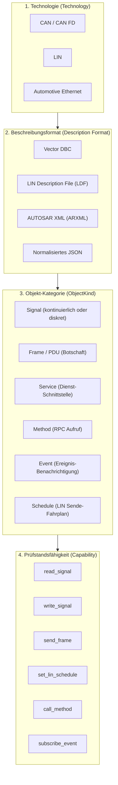
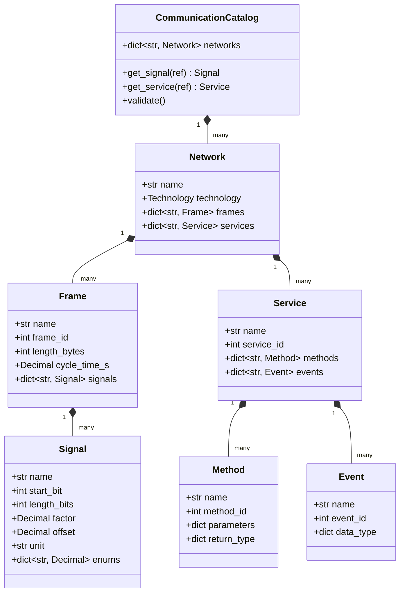

# 05 — Multi-Bus-Architektur (CAN, LIN, Ethernet)

Dieses Dokument beschreibt die technologie-neutrale Kommunikationsarchitektur von **SpecToTest**, die nahtlose Einbindung von CAN-, LIN- und Ethernet-(SOME/IP)-Netzwerken sowie die Werkzeuge zur Konvertierung und Validierung industrieller Beschreibungsdateien (DBC, LDF, ARXML).

---

## 1. Die Vier-Ebenen-Architektur (`tcg/comm/`)

Ein häufiges Problem in Testwerkzeugen ist das „Durchsickern“ von Bus-Besonderheiten in den Compiler-Kern. Wenn der Compiler wissen muss, was ein CAN-Startbit oder eine SOME/IP-Methoden-ID ist, wird er starr und fehleranfällig.

In **SpecToTest** trennt das Modul `tcg/comm/model.py` die Kommunikation strikt in vier Ebenen:



1. **`Technology`:** Das Übertragungsmedium (`can`, `lin`, `ethernet`).
2. **`Description Format`:** Das industrielle Quellformat (DBC, LDF, ARXML, JSON). Diese Formate werden **ausschließlich** von Importern in `tcg/comm/importers/` geparst — niemals vom Compiler!
3. **`ObjectKind`:** Was die Ressource fachlich darstellt (`signal`, `frame`, `service`, `method`, `event`, `schedule`). Ein Ethernet-Dienst wird niemals künstlich als CAN-Signal modelliert.
4. **`Capability`:** Was der Prüfstands-Adapter physisch leisten muss, um eine Operation auszuführen.

---

## 2. Ressourcen-Adressierung mit `ResourceRef`

In modernen Fahrzeugnetzwerken kann derselbe Signalname auf unterschiedlichen Bussen oder Steuergeräten vorkommen (z. B. `VehicleSpeed` auf dem Powertrain-CAN und dem Chassis-CAN).

SpecToTest verwendet daher qualifizierte Ressourcen-Referenzen mit dem Trenner `::`:
- **Unqualifiziert (lokal):** `VehicleSpeed` (funktioniert, wenn der Name im Projekt eindeutig ist).
- **Voll qualifiziert:** `PowertrainCAN::VehicleSpeed` oder `BodyLIN::DoorContactStatus`.

### Adressierungs-Richtlinien (`adapter_naming`)
Beim Binden einer Beschreibung an den Prüfstand kann festgelegt werden, wie die Zieladressierung erfolgt:
- `local` (Standard): Der reine Signalname wird an den Prüfstand übergeben.
- `qualified`: Der vollständige Pfad `Network::Signal` wird übergeben.
- `prefixed`: Ein konfigurierter Prefix wird vorangestellt.

---

## 3. Die Bus-Technologien im Detail

### A. CAN (Controller Area Network)
- **Quellformate:** Vector `.dbc` oder normalisiertes `.json`.
- **Eigenschaften:** Botschafts-ID (Standard 11-Bit oder Extended 29-Bit), DLC (1 bis 64 Bytes für CAN FD), Zykluszeit, Signallage (Start-Bit, Bitlänge, Byte-Order Intel/Motorola), Skalierungsfaktor, Offset, Min/Max und Enums.
- **Symbolische Zustandsauflösung:** Diskrete Zustände (z. B. `BMSState = DriveReady`, `DoorContactStatus = Geschlossen`) werden signalabhängig in exakte Rohwerte übersetzt. Die Konfiguration erfolgt strikt ohne Vermischung mit Demo-Defaults.
- **Operationen (`operations/can.py`):**
  - `set_can_signal(bench, signal, value)`
  - `expect_can_signal(bench, signal, value)`
  - `expect_can_signal_tolerance(bench, signal, value, tolerance)`
  - `expect_can_signal_range(bench, signal, min_value, max_value)`
  - `wait_can_signal(bench, signal, value, timeout, interval)`

### B. LIN (Local Interconnect Network)
- **Quellformate:** LIN Description File (`.ldf`) oder normalisiertes `.json`.
- **Eigenschaften:** Master/Slave-Knoten, Frame-Identifier (0 bis 63), Signal-Publishing, Schedule Tables (Zeitpläne für Master-Requests und Slave-Responses).
- **Operationen (`operations/lin.py`):**
  - `set_lin_signal(bench, signal, value)`: Schreibt einen Wert in den LIN-Puffer.
  - `expect_lin_signal(bench, signal, value)`: Prüft ein empfangenes LIN-Signal.
  - `set_lin_schedule(bench, schedule_table)`: Aktiviert eine Schedule Table im LIN-Master.

### C. Automotive Ethernet (SOME/IP & Service-Oriented Architecture)
- **Quellformate:** AUTOSAR `.arxml` (System Extracts, Software Components) oder normalisiertes `.json`.
- **Eigenschaften:** Service-ID, Instance-ID, Methoden mit Request-/Response-Parametern, Events mit Update-Zyklen oder On-Change-Benachrichtigungen.
- **Operationen (`operations/ethernet.py`):**
  - `call_method(bench, service, method, payload)`: Sendet einen SOME/IP RPC-Aufruf.
  - `expect_method_return(bench, service, method, expected_return)`: Prüft den Rückgabewert des Methodenaufrufs.
  - `subscribe_event(bench, service, event)`: Abonniert eine Eventgroup via SOME/IP-SD.
  - `expect_event(bench, service, event, expected_data)`: Verifiziert den Empfang von Event-Daten.

---

## 4. Konverter- & Validierungs-Tools (`tools/`)

SpecToTest liefert robuste Standalone-Tools mit umfassenden Konsistenzprüfungen:

### 1. DBC-Konverter (`tools/dbc_to_json.py`)
Konvertiert Vector `.dbc` in JSON und prüft die Datenbank semantisch:
```bash
python3 tools/dbc_to_json.py tools/powertrain_bms.dbc -o inputs/can_signals.json --check
```
**Automatische Validierungen:**
- **Bit-Kollisionen:** Erkennt, wenn sich Signale innerhalb einer Botschaft unerlaubt überlappen.
- **DLC-Überlauf:** Warnt, wenn Signale die deklarierte Nutzdatenlänge (DLC) der Botschaft überschreiten.
- **Duplicate IDs:** Erkennt doppelte Botschafts-IDs auf demselben Bus.

### 2. LDF-Konverter (`tools/ldf_to_json.py`)
Konvertiert LIN Description Files (`.ldf`) nach JSON:
```bash
python3 tools/ldf_to_json.py tools/body_comfort.ldf -o inputs/lin_signals.json
```

### 3. ARXML-Konverter (`tools/arxml_to_json.py`)
Parst AUTOSAR ARXML-Dateien und extrahiert Service-Schnittstellen, Methoden und Events nach JSON:
```bash
python3 tools/arxml_to_json.py tools/vehicle_services.arxml -o inputs/eth_services.json
```

---

## 5. Das Multi-Bus Datenmodell (Klassendiagramm)



---

## 6. Multi-Bus Beispiel-Spezifikation

Mit der Multi-Bus-Architektur können Testfälle mehrere Bus-Systeme synchron stimulieren und überwachen:

```text
# TESTFALL: TC_MULTIBUS_GATEWAY_ROUTING
NAME: Gateway-Routing von LIN Türkontakt auf CAN und SOME/IP Status

## Precondition
10. CAN-Signal BMSState auf DriveReady setzen
20. LIN-Schedule "NORMAL_OPERATION" aktivieren

## Action
30. LIN-Signal DoorContactStatus auf Offen setzen
40. Warte 50 ms

## Expected Result
30. CAN-Signal DoorContactStatus ist Offen
40. SOME/IP-Event "BodyService::DoorAlert" empfangen mit Payload {"status": "OPEN"}

## Postcondition
50. LIN-Signal DoorContactStatus auf Geschlossen setzen
60. CAN-Signal BMSState auf Standby setzen
```

