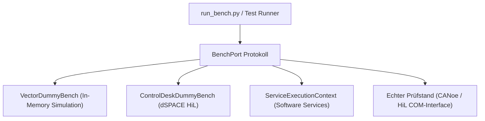

# 06 — Code-Generator & Testbench-Ausführung

Dieses Dokument beschreibt die Funktionsweise des **Python Code Emitters**, die Struktur des generierten Testcodes, die Prüfstandsabstraktion über das **`BenchPort`**-Protokoll sowie die Ausführung und Protokollierung mit **`run_bench.py`**.

---

## 1. Der Python Code Emitter (`python_emitter.py`)

Der Code Emitter (`tcg/adapters/outbound/python_emitter.py`) ist ein Driven Adapter. Er übersetzt den validierten AST (`TestCaseNode`) in schlanken, wartbaren und direkt lesbaren Python-Code.

### Kernmerkmale des generierten Codes:
1. **Kein Framework-Boilerplate:** Jeder Schritt ist ein direkter, unverschleierter Funktionsaufruf (z. B. `_op_ignition.set_ignition(bench, state=True)`).
2. **Exakte Traceability:** 
   - Der Modul-Docstring enthält den exakten Wortlaut der ursprünglichen Spezifikation.
   - Über jedem Einzelschritt steht die Zeilennummer und der Originalsatz als Kommentar.
3. **Garantierte Aufräumsicherheit (`try ... finally`):**
   - Precondition, Action und Erwartungen laufen in einem geschützten `try`-Block.
   - Die Postcondition liegt im `finally`-Block und wird **immer** ausgeführt — selbst bei Exceptions, Assertionsfehlern oder Verbindungsabbrüchen.
4. **Standardisierter Einstiegspunkt:**
   - Jede generierte Datei exportiert ein Dictionary `RUNNERS`, das Testfall-IDs auf ihre Ausführungsfunktionen abbildet:
     ```python
     RUNNERS = {
         "TC_01_UNDERVOLTAGE_RECOVERY": run_tc_01_undervoltage_recovery,
     }
     ```

---

## 2. Struktur eines generierten Testskripts (Beispiel)

```python
"""Original Test Specification:
========================================================================
# TESTFALL: TC_01_UNDERVOLTAGE_RECOVERY
NAME: Unterspannung und Wiederanlauf

## Precondition
10. Zündung an
20. Batteriespannung = 13.8V

## Action
30. Batteriespannung = 7000mV
40. Warte 500 ms

## Expected Result
30. Batteriespannung ist 7V ± 100mV

## Postcondition
50. Zündung aus
========================================================================
"""
from decimal import Decimal
import operations.ignition as _op_ignition
import operations.supply as _op_supply
import operations.timing as _op_timing
from tcg.runtime.result import StepRecord, TestResult


def run_tc_01_undervoltage_recovery(bench) -> TestResult:
    result = TestResult("TC_01_UNDERVOLTAGE_RECOVERY")
    try:
        # Precondition
        # Zeile 5: 10. Zündung an
        _op_ignition.set_ignition(bench, state=True)
        result.add_step(StepRecord(bench.now(), "set_ignition", {"state": True}))

        # Zeile 6: 20. Batteriespannung = 13.8V
        _op_supply.set_supply(bench, value=Decimal('13.8'))
        result.add_step(StepRecord(bench.now(), "set_supply", {"value": Decimal('13.8')}))

        # Action & Bound Expectations
        # Zeile 9: 30. Batteriespannung = 7000mV
        _op_supply.set_supply(bench, value=Decimal('7.000'))
        result.add_step(StepRecord(bench.now(), "set_supply", {"value": Decimal('7.000')}))

        # Zeile 14: 30. Batteriespannung ist 7V ± 100mV (Expected Result)
        _op_supply.expect_supply_tolerance(bench, value=Decimal('7'), tolerance=Decimal('0.100'))
        result.add_step(StepRecord(bench.now(), "expect_supply_tolerance", {"status": "PASS"}))

        # Zeile 10: 40. Warte 500 ms
        _op_timing.wait(bench, seconds=Decimal('0.500'))
        result.add_step(StepRecord(bench.now(), "wait", {"seconds": Decimal('0.500')}))

        result.set_verdict("PASS")

    except AssertionError as err:
        result.set_verdict("FAIL", message=str(err))
    except Exception as err:
        result.set_verdict("ERROR", message=f"{type(err).__name__}: {err}")
    finally:
        # Postcondition (Garantiertes Cleanup)
        try:
            # Zeile 17: 50. Zündung aus
            _op_ignition.set_ignition(bench, state=False)
            result.add_step(StepRecord(bench.now(), "set_ignition", {"state": False}))
        except Exception as cleanup_err:
            result.record_cleanup_error(cleanup_err)

    return result


RUNNERS = {
    "TC_01_UNDERVOLTAGE_RECOVERY": run_tc_01_undervoltage_recovery,
}
```

---

## 3. Die Prüfstandsabstraktion (`BenchPort`)

Das Protokoll `BenchPort` entkoppelt den Testcode von physischer Hardware:

```python
class BenchPort(Protocol):
    def now(self) -> Decimal:
        """Gibt den aktuellen Simulations- bzw. Prüfstands-Zeitstempel in Sekunden zurück."""
        ...

    def wait(self, seconds: Decimal) -> None:
        """Wartet für die angegebene Zeitdauer (virtuelle oder Echtzeit)."""
        ...
```

### Die mitgelieferten Prüfstands-Adapter:



1. **`VectorDummyBench`:**
   - Schnelle, vollständig autarke In-Memory-Simulation.
   - Hält interne Zustände für Batteriespannung, Klemme 15, UDS-Fehlerspeicher sowie CAN-, LIN- und Ethernet-Nachrichten.
   - Reagiert dynamisch auf Stimuli (z. B. automatisches Auslösen von Unterspannungs-DTCs bei $U < 9\,\text{V}$).
2. **`ControlDeskDummyBench`:**
   - Schnittstelle für dSPACE HiL-Prüfstände (Modellgrößen, Hardware-IOs).
3. **`ServiceExecutionContext`:**
   - Beweist die Universalität von SpecToTest für reine Software-Systeme (z. B. In-Memory Key-Value Stores, Crash-Recovery-Tests).

---

## 4. Testausführung mit `run_bench.py`

Das Kommandozeilenwerkzeug `run_bench.py` entdeckt alle generierten Testskripte in einem Suite-Verzeichnis und führt sie aus:

```bash
python3 run_bench.py --bench dummy --suite generated --report reports/report.html --junit reports/junit.xml
```

### CLI-Optionen im Überblick
| Parameter | Standard | Beschreibung |
|---|---|---|
| `--bench` | `dummy` | Wählt den Prüfstands-Adapter (`dummy`, `controldesk`, `service`). |
| `--suite` | `generated` | Verzeichnis mit generierten Testdateien. |
| `--config` | `inputs/demo_bench.json` | Konfigurationsdatei für Prüfstandsparameter. |
| `--profile` | `inputs/resources.json` | Ressourcenprofil zur Validierung. |
| `--report` | `reports/report.html` | Pfad für den interaktiven HTML-Dashboard-Report. |
| `--junit` | `reports/junit.xml` | Pfad für den CI/CD-kompatiblen JUnit-XML Report. |
| `--stop-on-fail` | `False` | Bricht die Suite sofort beim ersten Fehlversuch ab. |

---

## 5. Reporting & CI/CD-Integration

Jeder Testlauf erzeugt drei standardisierte Artefakte:

### 1. Konsolen-Ausgabe (CLI)
Kompakte, farbige Übersicht mit Ausführungszeiten je Einzelschritt und Status:
```text
==============================================================================
⚡ SpecToTest — Automatisierter Testbench-Lauf
==============================================================================
Prüfstand:   Vector CANoe Simulation (Dummy)
Test-Suite:  generated (13 Skripte gefunden)
------------------------------------------------------------------------------
 ✅ PASS  [bms        ] TC_08_BMS_HV_PRECHARGE_SEQUENCE        (12 Schritte,    0.4 ms)
 ✅ PASS  [bms        ] TC_09_BMS_CELL_OVERVOLTAGE_DERATING    ( 8 Schritte,    0.2 ms)
 ✅ PASS  [can        ] TC_06_CAN_SIGNAL_TRANSMISSION          ( 6 Schritte,    0.1 ms)
 ✅ PASS  [diagnostics] TC_01_UNDERVOLTAGE_RECOVERY            ( 9 Schritte,    0.3 ms)
------------------------------------------------------------------------------
Ergebnis: 13 bestanden, 0 fehlgeschlagen (Gesamtdauer: 0.05 s)
==============================================================================
```

### 2. Detailliertes Execution-Logging (`logs/`)
- Jede Testausführung wird in einer timestamped Logdatei (`logs/test_run_YYYYMMDD_HHMMSS.log`) archiviert.
- Der symbolische Link `logs/latest.log` verweist immer direkt auf den jüngsten Lauf.
- Protokolliert jeden Einzelschritt mit Zeitstempel, Funktionsaufruf, Parametern und Rückgabewerten.

### 3. Interaktives HTML-Dashboard (`report.html`)
- Standalone HTML-Datei (keine externen Webserver-Abhängigkeiten).
- Enthält Zusammenfassungs-Kacheln, Filter nach Status (PASS, FAIL, ERROR) und aufklappbare Schritt-für-Schritt-Traces für jeden Testfall.

### 4. JUnit-XML (`junit.xml`)
- Vollständig konform zum JUnit-Schema.
- Wird von GitHub Actions, GitLab CI, Jenkins und Azure DevOps direkt eingelesen, um Test-Trends und Regressions-Diagramme darzustellen.
