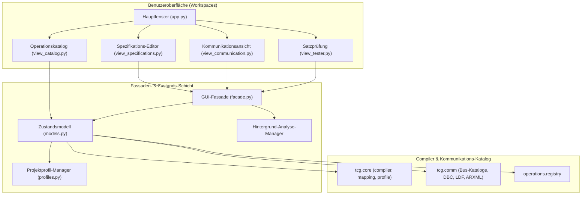
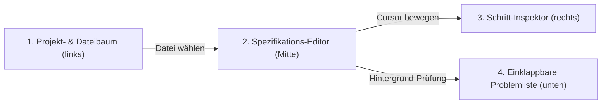
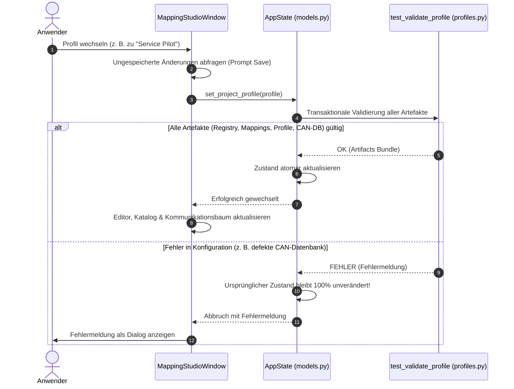

# 07 — SpecToTest Studio (GUI)

Dieses Dokument beschreibt die Architektur, die Arbeitsbereiche und die Bedienung von **SpecToTest Studio**, der grafischen Desktop-Entwicklungsumgebung auf Basis von **PySide6 / Qt**.

---

## 1. Starten der Benutzeroberfläche

Die GUI kann direkt über das Startskript `gui.py` aufgerufen werden:

```bash
# Standard-Start (Dunkles Farbschema, Automotive-Profil)
python3 gui.py

# Start im hellen Farbschema
python3 gui.py --light

# Start mit einem spezifischen Profil (z. B. Software Service Pilot)
python3 gui.py --profile service
```

---

## 2. Architektur & Entkopplung (`tcg/gui/`)

Die GUI ist strikt von den Compiler-Interna entkoppelt. Sie greift niemals unkontrolliert auf AST-Strukturen zu, sondern nutzt ein sauberes Schichtenmodell:



- **`AppState` (`models.py`):** Hält die aktiven Mappings, die geladene Registry, das Ressourcenprofil und die Kommunikationsdatenbank.
- **`Facade` (`facade.py`):** Kapselt komplexe Operationen (z. B. asynchrone Syntaxanalyse im Hintergrund, Verknüpfungsberechnungen zwischen Aktionen und Erwartungen).
- **`AnalysisManager`:** Führt die Kompilierung bei Tastatureingaben verzögert (Debounce 300 ms) im Hintergrund aus, ohne die UI zu blockieren.

---

## 3. Die vier Haupt-Workspaces

### A. Spezifikations-Editor (`view_specifications.py`)
Der zentrale Arbeitsbereich für das Schreiben und Untersuchen von Tests:



1. **Projektbaum (links):**
   - Strukturierte Ordneransicht aller `.txt`- und `.md`-Spezifikationen.
   - Filterfeld zur schnellen Volltext-Suche nach Dateinamen.
   - Vollständiger Dateipfad und Modus als Tooltip.
2. **Editor (Mitte):**
   - Syntax-Highlighting für Abschnitte (`Precondition`, `Action`, etc.), Schrittnummern und Kontrollstrukturen.
   - Änderungsstatus-Anzeige (`*` bei ungespeicherten Änderungen).
   - Schnellspeicher-Button (`Cmd+S` / `Ctrl+S`).
3. **Schritt-Inspektor (rechts, 3 Tabs):**
   - **Tab „Details“:** Zeigt für die Zeile unter dem Cursor sofort das zugeordnete Satzmuster (`[MAP_...]`), die aufgerufene Operation, deren Docstring und alle extrahierten Parameter mit Typ an.
   - **Sprung zur Verknüpfung (`btn_jump_linked`):** Befindet sich der Cursor auf einem Aktionsschritt, führt ein Klick direkt zur zugehörigen Prüfung im Abschnitt `Expected Result` (und umgekehrt).
   - **Tab „Schritt einfügen“:** Ermöglicht das schnelle Einfügen vorbereiteter Satzbausteine über strukturierte Eingabefelder (`widget_smart_param.py`).
   - **Tab „Python“:** Zeigt die Live-Vorschau der generierten Python-Funktion für den aktuellen Testfall.
4. **Einklappbare Problemliste (unten):**
   - Zeigt Syntaxfehler, ungebundene Sätze, ungültige Ressourcen oder Phasenverletzungen übersichtlich in einer sortierbaren Tabelle an.
   - Klick auf einen Fehler springt direkt in die betreffende Zeile im Editor.

---

### B. Operationskatalog (`view_catalog.py`)
Der vollständige Überblick über alle im System registrierten Fachfunktionen:
- **Phasenfilter:** Filtern nach `SETUP`, `STIMULUS`, `CHECK` oder `TEARDOWN`.
- **Statusanzeige:** Erkennt sofort Lücken (rot: Operation existiert im Code, besitzt aber noch kein Satzmuster; grün: Operation ist verknüpft).
- **Details:** Zeigt Parameterliste mit Pflicht-/Optional-Kennzeichnung, Einheiten und zulässigen Wertebereichen.
- **Mapping-Verwaltung:** Neues Satzmuster für eine Operation direkt per Dialog anlegen oder bestehende Mappings bearbeiten.

---

### C. Multi-Bus Kommunikationsansicht (`view_communication.py`)
Ermöglicht das visuelle Durchsuchen aller geladenen Fahrzeugnetzwerke:
- **Netzwerkbaum:** Gruppiert nach Technologie (CAN, LIN, Ethernet).
- **Detaillierte Tabellen:**
  - **CAN & LIN:** Botschaften, Frame-IDs, Zykluszeiten, Startbits, Bitlängen, Byte-Order, Skalierungsfaktoren, Offsets und diskrete Enums (z. B. `0 = Geschlossen`, `1 = Offen`).
  - **Ethernet (SOME/IP):** Service-IDs, Instance-IDs, Methoden mit Request-/Response-Signaturen und abonnierbare Events.
- **Volltext-Filter:** Schnelles Auffinden von Signalen über alle Netzwerke hinweg.

---

### D. Satzprüfung / Mapping Tester (`view_tester.py`)
Ein interaktives Testlabor für Satzformulierungen:
- Eingabe einer beliebigen Textzeile.
- Sofortige Rückmeldung:
  - Match-Status (Erfolgreich gemappt, Ambiguität oder kein Match).
  - Aufgerufene Operation und extrahierte Parameter.
  - Warnung vor unerwünschten Mehrdeutigkeiten.

---

## 4. Projektprofile & Transaktionaler Profilwechsel

SpecToTest Studio unterstützt mehrere Projektkonfigurationen (z. B. Automotive HiL vs. Software Service Pilot).



### Transaktionale Sicherheit
Ein Profilwechsel wird **nur dann** vollzogen, wenn die Zielkonfiguration vollständig fehlerfrei geladen werden kann. Ist beispielsweise eine CAN-Signaldatenbank beschädigt, wird der Wechsel abgebrochen und der aktuelle Arbeitsstand bleibt unberührt.
