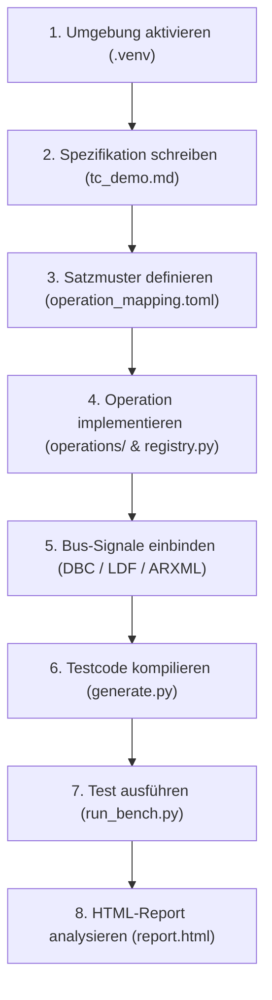

# 08 — Schritt-für-Schritt-Anleitung (Hands-on Tutorial)

Dieses Dokument führt dich Schritt für Schritt durch den gesamten Prozess: Vom Anlegen einer neuen Spezifikation über das Definieren von Sprachmustern und Python-Operationen bis hin zur Ausführung auf der Testbench und der Auswertung im HTML-Report.

---

## 1. Übersicht des Arbeitsablaufs



---

## 2. Schritt 1: Virtuelle Umgebung aktivieren

Öffne ein Terminal im Projektverzeichnis und aktiviere die vorbereitete Python-Umgebung:

```bash
cd /Users/cc/Desktop/SpecToTest
source .venv/bin/activate

# Überprüfen, ob alle Abhängigkeiten bereitstehen
python3 -c "import PySide6; print('PySide6 Version:', PySide6.__version__)"
```

---

## 3. Schritt 2: Eine neue Spezifikation anlegen

Erstelle eine neue Spezifikationsdatei `inputs/diagnostics/tc_demo_battery.md`:

```markdown
# TESTFALL: TC_DEMO_BATTERY_MONITORING
NAME: Überwachung der Batterie-Grenzwerte und Schützabschaltung
TESTZIEL: Nachweis, dass bei Überlast der Hauptschütz binnen 500 ms öffnet.

## Precondition
10. Zündung an
20. Fehlerspeicher BCM1 löschen
30. CAN-Signal BMSState auf DriveReady setzen

## Action
40. Batteriespannung = 14.5V
50. CAN-Signal PackCurrent = 250 A
60. Warte 500 ms

## Expected Result
40. CAN-Signal HVMainPosContactState ist Geschlossen
60. CAN-Signal HVMainPosContactState ist Offen
60. Fehlerspeichereintrag DTC_BMS_OVERTEMPERATURE eingetragen

## Postcondition
70. Batteriespannung = 13.8V
80. CAN-Signal BMSState auf Standby setzen
90. Zündung aus
```

---

## 4. Schritt 3: Satzmuster im TOML-Mapping prüfen & erweitern

Öffne `inputs/operation_mapping.toml`. Für die meisten Anweisungen existieren bereits Mappings. 

Angenommen, du möchtest eine neue Formulierung unterstützen:
`Stromgrenze für Laden auf {strom} festlegen`

Füge folgendes Mapping ans Ende der TOML-Datei an:
```toml
[[mapping]]
id = "MAP_BMS_SET_CHARGE_LIMIT"
template = "Stromgrenze für Laden auf {strom} festlegen"
operation = "set_can_signal"
parameters = { strom = "value" }
```
*(Hinweis: Für `set_can_signal` existiert bereits der Parameter `signal`. Du kannst im Mapping auch feste Signalzuordnungen treffen oder universelle Muster nutzen.)*

---

## 5. Schritt 4: Operation implementieren & im Vertrag registrieren

Möchtest du eine völlig neue Prüfstandsaktion einführen, gehe wie folgt vor:

### A. Python-Funktion schreiben (`operations/bms.py`)
```python
from decimal import Decimal

def emergency_disconnect(bench, reason: str) -> None:
    """Öffnet im Notfall unverzüglich alle Hochvolt-Schütze."""
    bench.write_can_signal('HVMainPosContactState', 0)
    bench.write_can_signal('HVMainNegContactState', 0)
    bench.log(f"Notabschaltung ausgelöst: {reason}")
```

### B. Vertrag in `operations/registry.py` eintragen
```python
from tcg.core.contracts import OperationContract, ParameterSpec, STIMULUS, TEARDOWN
from tcg.core.parameters import String
from operations.bms import emergency_disconnect

CONTRACT_EMERGENCY_DISCONNECT = OperationContract(
    name='emergency_disconnect',
    function=emergency_disconnect,
    docstring='Löst eine sofortige Notabschaltung der HV-Schütze aus.',
    parameters=(
        ParameterSpec('reason', String(), required=True),
    ),
    phases=STIMULUS | TEARDOWN,
)
```

Füge `CONTRACT_EMERGENCY_DISCONNECT` zum Aufruf von `build_registry([...])` in `operations/registry.py` hinzu.

---

## 6. Schritt 5: Bus-Signale aus DBC / LDF importieren

Wenn du ein neues CAN-Signal aus einer Vector-DBC-Datei übernehmen möchtest:

1. **DBC-Datei aktualisieren:** Platziere deine `.dbc` in `tools/powertrain_bms.dbc`.
2. **Konverter ausführen:**
   ```bash
   python3 tools/dbc_to_json.py tools/powertrain_bms.dbc -o inputs/can_signals.json --check
   ```
3. Das Signal (z. B. `MaxChargeCurrent`) und dessen diskrete Enums (z. B. `0 = Normal`, `1 = Derating`) stehen sofort im gesamten System und in der GUI zur Verfügung.

---

## 7. Schritt 6: Testcode kompilieren (`generate.py`)

Kompiliere deine neue Spezifikation in ein ausführbares Python-Testskript:

```bash
python3 generate.py \
    --spec inputs/diagnostics/tc_demo_battery.md \
    --mapping inputs/operation_mapping.toml \
    --resources inputs/resources.json \
    --output generated/diagnostics/test_tc_demo_battery.py
```

### Batch-Generierung aller Spezifikationen
Um alle Spezifikationen im Ordner `inputs/` auf einen Schlag zu übersetzen:
```bash
python3 generate.py --batch
```
Das Werkzeug erzeugt alle Testdateien in `generated/` sowie die Suite-Manifest-Datei `generated/.manifest.json`.

---

## 8. Schritt 7: Tests auf der Testbench ausführen (`run_bench.py`)

Führe die generierten Tests auf der virtuellen Testbench aus:

```bash
python3 run_bench.py \
    --bench dummy \
    --suite generated \
    --report reports/report.html \
    --junit reports/junit.xml
```

### Konsolen-Ergebnis:
```text
==============================================================================
⚡ SpecToTest — Automatisierter Testbench-Lauf
==============================================================================
Prüfstand:   Vector CANoe Simulation (Dummy)
Test-Suite:  generated
------------------------------------------------------------------------------
 ✅ PASS  [diagnostics] TC_DEMO_BATTERY_MONITORING             ( 9 Schritte,    0.2 ms)
------------------------------------------------------------------------------
Ergebnis: 1 bestanden, 0 fehlgeschlagen (Gesamtdauer: 0.02 s)
==============================================================================
```

---

## 9. Schritt 8: HTML-Report öffnen & analysieren

Öffne den erzeugten Report im Webbrowser:
```bash
open reports/report.html
```

Im Report siehst du:
- Eine Übersicht über alle Testfälle und deren Gesamtlaufzeit.
- Klick auf `TC_DEMO_BATTERY_MONITORING` klappt die **Schritt-für-Schritt-Chronik** auf.
- Für jeden Schritt siehst du den exakten Simulationszeitstempel, die aufgerufene Operation, übergebene Parameter und den gemessenen Rückgabewert.

---

## 10. Häufige Fehlerquellen & Schnelle Hilfe

| Fehlermeldung | Ursache | Lösung |
|---|---|---|
| `SpecError: no mapping template exactly matches '...'` | Für den Satz existiert noch kein Muster in der TOML-Datei. | Prüfe auf Tippfehler oder lege in `inputs/operation_mapping.toml` ein neues `[[mapping]]` an. |
| `SpecError: ambiguous: 2 template matches ...` | Zwei Satzmuster sind zu allgemein formuliert und matchen denselben Text. | Mache eines der Templates durch zusätzliche literale Wörter spezifischer. |
| `SpecError: operation '...' is not permitted in section '...'` | Phasenschutz-Verletzung (z. B. Assertion im `Action`-Abschnitt). | Verschiebe Prüfungen nach `Expected Result` oder passe die Phasenberechtigung im `OperationContract` an. |
| `SpecError: expected result references non-existent step 'X'` | Die Schrittnummer in `Expected Result` existiert nicht in `Action`. | Nummerierung in `Action` und `Expected Result` aufeinander abstimmen. |
| `SpecError: Zustand '...' ist für Signal '...' nicht gültig` | Der Enum-Zustand gehört zu einem anderen Signal oder existiert nicht in der DBC. | Erlaubte Enums in der Kommunikationsansicht der GUI oder in der DBC prüfen. |
