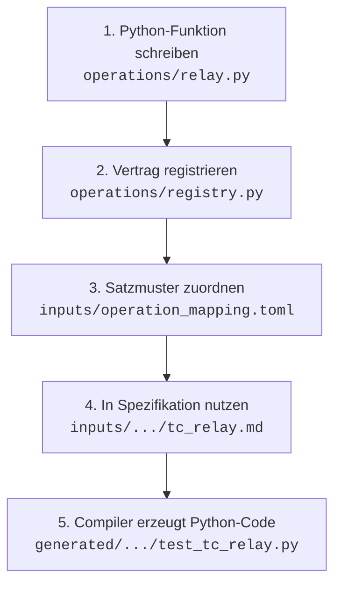

# Operationsbibliothek (`operations/`)

Dieser Ordner enthält alle hardware- und simulationsbezogenen Testoperationen von **SpecToTest**.
Die Operationen sind gewöhnliche Python-Funktionen, die über einen Prüfstands-Port (`bench`) Aktionen ausführen oder Systemzustände verifizieren.

Der Compiler-Kern (`tcg/`) ist strikt von dieser Bibliothek entkoppelt: Er kennt weder Prüfstandsdetails noch Busprotokolle, sondern interagiert ausschließlich über typisierte **Verträge** ([`OperationContract`](file:///Users/cc/Desktop/SpecToTest/tcg/core/contracts.py)).

---

## 1. Modulübersicht

| Modul | Zweck | Typische Operationen |
|---|---|---|
| [`can.py`](file:///Users/cc/Desktop/SpecToTest/operations/can.py) | CAN-Kommunikation, Vector & ControlDesk | `set_can_signal`, `expect_can_signal`, `expect_can_signal_tolerance`, `wait_can_signal` |
| [`can_catalog.py`](file:///Users/cc/Desktop/SpecToTest/operations/can_catalog.py) | Symbolische CAN-Zustände aus DBC/ARXML | Signal- und Wertebereichsauflösung |
| [`lin.py`](file:///Users/cc/Desktop/SpecToTest/operations/lin.py) | LIN-Bus Protokoll | `set_lin_signal`, `expect_lin_signal`, `set_lin_schedule`, `send_lin_frame` |
| [`ethernet.py`](file:///Users/cc/Desktop/SpecToTest/operations/ethernet.py) | Automotive Ethernet & SOME/IP | `call_eth_method`, `subscribe_eth_event`, `expect_eth_event` |
| [`comm_types.py`](file:///Users/cc/Desktop/SpecToTest/operations/comm_types.py) | Multibus-Typkonvertierung & Registry-Binding | Dynamische Signalbindung für CAN, LIN, Ethernet |
| [`diagnostic.py`](file:///Users/cc/Desktop/SpecToTest/operations/diagnostic.py) | UDS-Diagnose & Fehlerspeicher (ISO 14229) | `clear_fault_memory`, `read_fault_memory`, `expect_fault_memory_entry` |
| [`ignition.py`](file:///Users/cc/Desktop/SpecToTest/operations/ignition.py) | Klemme 15 / Zündungssteuerung | `set_ignition` |
| [`supply.py`](file:///Users/cc/Desktop/SpecToTest/operations/supply.py) | Geregelte Spannungsversorgung | `set_supply`, `set_battery_voltage` |
| [`timing.py`](file:///Users/cc/Desktop/SpecToTest/operations/timing.py) | Zeitsteuerung & Warteoperationen | `wait` |
| [`hmi.py`](file:///Users/cc/Desktop/SpecToTest/operations/hmi.py) | Bildschirmanzeige & Kombiinstrument | `select_screen`, `expect_screen_text`, `write_parameter`, `expect_parameter` |
| [`registry.py`](file:///Users/cc/Desktop/SpecToTest/operations/registry.py) | Zentrale Verträge, Typen & Capabilities | Exportiert `REGISTRY` und `build_operations_registry` |

---

## 2. In 4 Schritten eine neue Operation hinzufügen

Der gesamte Ablauf von der Python-Funktion bis zum Aufruf im generierten Testskript gliedert sich in vier Schritte:



---

### Schritt 1: Python-Funktion schreiben (`operations/relay.py`)

Erstelle eine neue Datei `operations/relay.py` (oder ergänze ein bestehendes Modul).

Man unterscheidet zwei Arten von Operationen:

#### A. Aktions-Operation (Stimulus, Setup oder Teardown)
Verändert einen Zustand auf der Testbench (sendet Nachrichten, setzt Spannungen, schaltet Relais):

```python
# operations/relay.py

def set_relay(bench, *, name: str, state: str) -> None:
    """Schaltet ein Relais am Prüfstand.
    
    Args:
        bench: Der Prüfstands-Port (DummyBench, ControlDesk, CANoe etc.).
        name: Name oder Kanal des Relais (z.B. 'MainHV', 'Precharge').
        state: Zielzustand ('Geschlossen' oder 'Offen').
    """
    bench.set_relay(name, state)
```

#### B. Prüf-Operation (Assertion / Expected Result)
Liest einen Zustand aus und verifiziert ihn. Schlägt die Prüfung fehl, **muss** `CheckFailed` aus `tcg.runtime.test_log` geworfen werden:

```python
# operations/relay.py
from tcg.runtime.test_log import CheckFailed

def expect_relay(bench, *, name: str, expected_state: str) -> None:
    """Verifiziert den aktuellen Zustand eines Relais.
    
    Wirft CheckFailed, wenn der Zustand abweicht.
    """
    actual_state = bench.get_relay(name)
    if actual_state != expected_state:
        raise CheckFailed(
            f"Relais '{name}' hat Zustand '{actual_state}', erwartet war '{expected_state}'"
        )
```

> [!IMPORTANT]
> **Konventionen für Operations-Funktionen:**
> 1. Erstes Argument ist immer `bench` (Positionsargument).
> 2. Alle fachlichen Parameter folgen nach `*` als reine **Keyword-Argumente**.
> 3. Prüfoperationen werfen niemals rohe `assert`-Exceptions oder `ValueError`, sondern ausschließlich `CheckFailed`.

---

### Schritt 2: Vertrag in `operations/registry.py` registrieren

Öffne [`operations/registry.py`](file:///Users/cc/Desktop/SpecToTest/operations/registry.py).

Ein Vertrag [`OperationContract`](file:///Users/cc/Desktop/SpecToTest/tcg/core/contracts.py) definiert:
- Den eindeutigen Operationsnamen (das Referenzziel für das TOML-Mapping)
- Die zugehörige Python-Funktion
- Die Parametertypen ([`ParameterSpec`](file:///Users/cc/Desktop/SpecToTest/tcg/core/contracts.py))
- Die zulässigen Phasen (`SETUP` für Vorbedingung/Aktion/Nachbedingung, `CHECK` für Erwartungen)

```python
from tcg.core.contracts import OperationContract, ParameterSpec
from tcg.core.parameters import String
from operations import relay

# Phasen-Konstanten aus registry.py:
# SETUP = frozenset({'PRECONDITION', 'ACTION', 'CLEANUP'})
# CHECK = frozenset({'EXPECTED'})

CONTRACT_SET_RELAY = OperationContract(
    'set_relay',
    relay.set_relay,
    (
        ParameterSpec('name', String()),
        ParameterSpec('state', String()),
    ),
    SETUP,  # Erlaubt in Precondition, Action, Postcondition
)

CONTRACT_EXPECT_RELAY = OperationContract(
    'expect_relay',
    relay.expect_relay,
    (
        ParameterSpec('name', String()),
        ParameterSpec('expected_state', String()),
    ),
    CHECK,  # Streng limitiert auf den Abschnitt 'Expected Result'
)
```

Trage die Verträge in die Liste `REGISTRY = build_registry((...))` in [`operations/registry.py`](file:///Users/cc/Desktop/SpecToTest/operations/registry.py) ein.

---

### Schritt 3: Satzschablone in `inputs/operation_mapping.toml` definieren

Öffne [`inputs/operation_mapping.toml`](file:///Users/cc/Desktop/SpecToTest/inputs/operation_mapping.toml).

Verknüpfe natürliche Sätze mit den Verträgen. Platzhalter in geschweiften Klammern `{...}` werden auf die Parameternamen der Python-Funktion gemappt:

```toml
# Aktion (Stimulus)
[[mapping]]
id = "MAP_SET_RELAY"
template = "Relais {r_name} auf {r_state} setzen"
operation = "set_relay"
parameters = { r_name = "name", r_state = "state" }

# Prüfung (Expected Result)
[[mapping]]
id = "MAP_EXPECT_RELAY"
template = "Relais {r_name} ist {r_state}"
operation = "expect_relay"
parameters = { r_name = "name", r_state = "expected_state" }
```

---

### Schritt 4: In Testspezifikationen verwenden

Verwende die formulierten Sätze direkt in Markdown- (`.md`) oder Text-Spezifikationen (`.txt`):

```markdown
# TESTFALL: TC_RELAY_CONTROL
**NAME:** Hauptschütz Steuerung
**ANFORDERUNG:** REQ_HV_RELAY_001

## Action
10. Relais "MainHV" auf "Geschlossen" setzen
20. Warte 100 ms

## Expected Result
10. Relais "MainHV" ist "Geschlossen"

## Postcondition
30. Relais "MainHV" auf "Offen" setzen
```

---

### Schritt 5: Code kompilieren & das Ergebnis

Führe den Compiler aus:
```bash
python generate.py \
    --spec inputs/bms/tc_relay_control.md \
    --mapping inputs/operation_mapping.toml \
    --resources inputs/resources.json \
    --output generated/bms/test_tc_relay_control.py
```

Der Outbound-Emitter generiert folgenden vollständigen Python-Code:

```python
# Generated by tcg 0.3.0. Do not edit; change the specification and regenerate.
from decimal import Decimal
from tcg.runtime import TestResult
import operations.relay as _op_relay
import operations.timing as _op_timing

def run_tc_relay_control(bench):
    cleanup_errors = []
    try:
        # --- Action & Expected Result ---
        # 10. Relais "MainHV" auf "Geschlossen" setzen
        _op_relay.set_relay(bench, name='MainHV', state='Geschlossen')
        # 10. Relais "MainHV" ist "Geschlossen"
        _op_relay.expect_relay(bench, name='MainHV', expected_state='Geschlossen')
        # 20. Warte 100 ms
        _op_timing.wait(bench, seconds=Decimal('0.1'))
    finally:
        # --- Postcondition (Cleanup) ---
        try:
            _op_relay.set_relay(bench, name='MainHV', state='Offen')
        except Exception as _cln_err:
            cleanup_errors.append(_cln_err)
        if cleanup_errors:
            raise cleanup_errors[0]
    return TestResult('TC_RELAY_CONTROL', "PASS")
```

---

## 3. Typisierung & Physikalische Einheiten

SpecToTest konvertiert und validiert Eingaben zur Kompilierzeit:

- **[`Quantity`](file:///Users/cc/Desktop/SpecToTest/tcg/core/parameters.py):** Automatische Skalierung physikalischer Größen (z.B. `7000mV` $\rightarrow$ `Decimal('7')` Volt, `500 ms` $\rightarrow$ `Decimal('0.5')` Sekunden).
- **[`Boolean`](file:///Users/cc/Desktop/SpecToTest/tcg/core/parameters.py):** Deutsche und englische Zustände (`an`/`aus`, `ein`/`aus`, `aktiv`/`inaktiv`, `true`/`false`).
- **[`Resource`](file:///Users/cc/Desktop/SpecToTest/tcg/core/parameters.py):** Validiert Bezeichner gegen `inputs/resources.json` (z.B. Steuergeräte wie `BCM1`, `BMS`).
- **[`SignalValue`](file:///Users/cc/Desktop/SpecToTest/operations/comm_types.py):** CAN/LIN-Signalwerte mit automatischer Prüfung gegen DBC-/LDF-/ARXML-Datenbanken und Auflösung symbolischer Zustände (z.B. `"Offen"` $\rightarrow$ `1`).

---

## 4. Weiterführende Dokumentation

- [**`docs/04_operationskatalog_und_vertraege.md`**](file:///Users/cc/Desktop/SpecToTest/docs/04_operationskatalog_und_vertraege.md) – Detaillierte Referenz zum Vertragssystem und Phasenschutz.
- [**`docs/03_mapping_und_typsystem.md`**](file:///Users/cc/Desktop/SpecToTest/docs/03_mapping_und_typsystem.md) – Detaillierte Syntax des TOML-Mappings und Typsystems.
- [**`docs/08_schritt_fuer_schritt_anleitung.md`**](file:///Users/cc/Desktop/SpecToTest/docs/08_schritt_fuer_schritt_anleitung.md) – Vollständiges Hands-on Tutorial für das gesamte Projekt.
